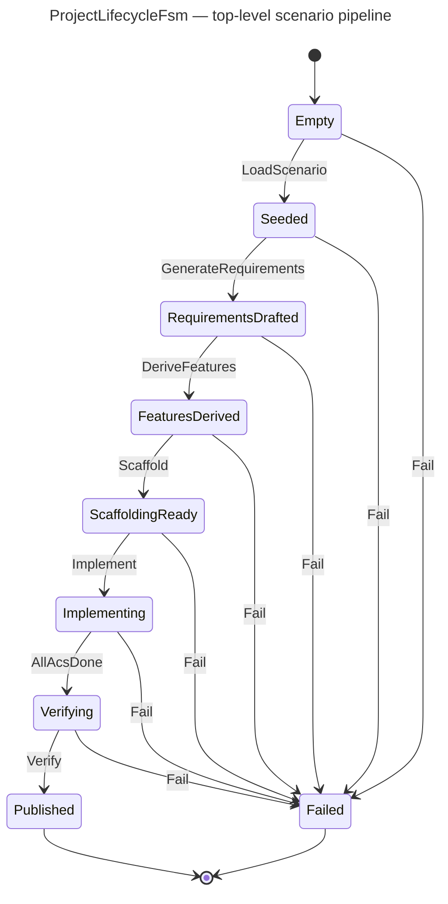
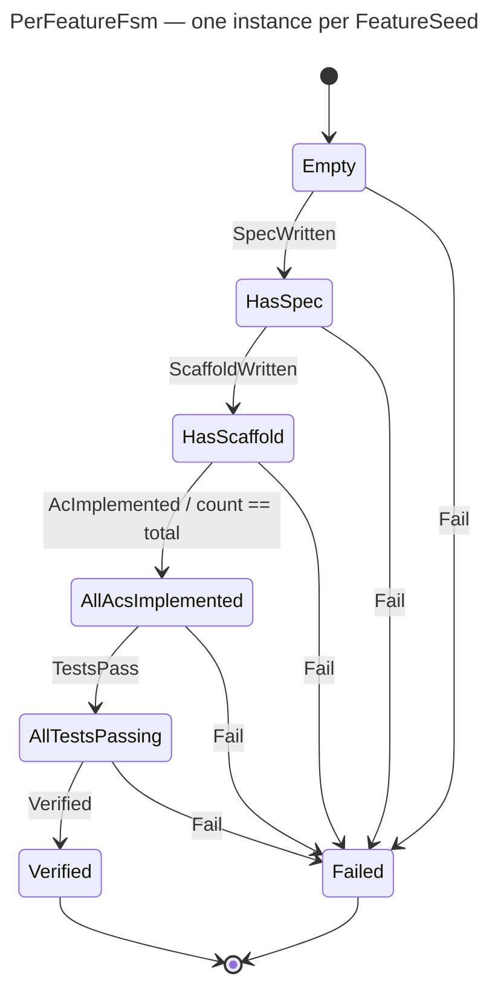
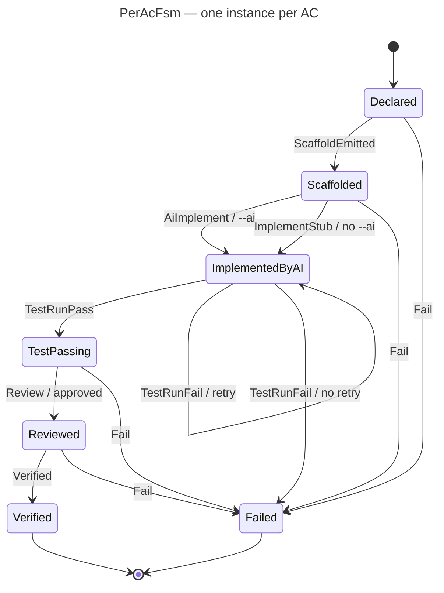

# ScenariiPlayer — Design (Contract Freeze)

Author: Stéphane Erard · Date: 2026-04-14 · Status: **Draft — design & stubs only, no implementation**.

## Summary

`ScenariiPlayer` is a sub-module of `@frenchexdev2/requirements` (under `src/cli/scenario/`) that replays a declarative **Scenario** JSON file end-to-end:

1. Loads `scenario.schema.json`-validated input.
2. Generates `Requirement` + `Feature` + `AC` class files via the existing wizard cores (`runRequirementWizard`, `runFeatureWizard`) in `--yes` mode.
3. Scaffolds tests at every declared `TestLevel` via the scaffolder registry.
4. Optionally delegates AC implementation to an `AiAdapter` (Claude API with prompt caching, or a deterministic stub).
5. Runs `compliance --strict` on the generated project as a closing gate.

Orchestration: three coordinated **typed-FSMs** — see below.

## Data contract

- **Types**: [`src/cli/scenario/types.ts`](../src/cli/scenario/types.ts) — `Scenario`, `RequirementSeed`, `FeatureSeed`, `FeatureSeedAc`, `ScenarioTargets`, `ScenarioNarration`.
- **JSON Schema**: [`schemas/scenario.schema.json`](../schemas/scenario.schema.json) — hand-written; will be regenerated via `ts-json-schema-generator` once frozen.

`Seed` types are **partial-by-intent**: authors fill only what matters; wizard defaults / style templates fill the rest. Forward references (`satisfiedByFeatureIds` on requirement seeds, `satisfies` on feature seeds) are cross-checked by `scenario validate` before any side effect.

## FSM A — `ProjectLifecycleFsm`

One instance per scenario run. Owns the top-level pipeline.

### States

- `Empty` — no scenario loaded yet (initial).
- `Seeded` — scenario loaded and validated; seeds available.
- `RequirementsDrafted` — every `RequirementSeed` has been replayed through the wizard and written to `requirements/requirements/`.
- `FeaturesDerived` — every `FeatureSeed` has been replayed and written to `requirements/features/`.
- `ScaffoldingReady` — tests have been scaffolded for every declared `AC × TestLevel`.
- `Implementing` — N `PerAcFsm` instances have been forked; waiting on `AllAcsDone`.
- `Verifying` — every PerAcFsm is terminal; `compliance --strict` is running.
- `Published` — terminal success state.
- `Failed` — terminal failure state (any state → `Failed` on error).

### Events

| Event | From → To | Guard | Entry action |
|---|---|---|---|
| `LoadScenario(path)` | `Empty → Seeded` | schema validates; refs resolve | read + parse + schema-validate JSON; emit narration.intro |
| `GenerateRequirements` | `Seeded → RequirementsDrafted` | `seeds.requirements.length > 0` | loop each RequirementSeed through `runRequirementWizard(..., { yes: true })` |
| `DeriveFeatures` | `RequirementsDrafted → FeaturesDerived` | `seeds.features.length > 0` | loop each FeatureSeed through `runFeatureWizard(..., { yes: true })` |
| `Scaffold` | `FeaturesDerived → ScaffoldingReady` | — | invoke `generateScaffoldForSpec` across the 7-level registry |
| `Implement` | `ScaffoldingReady → Implementing` | — | fork N `PerAcFsm` instances (one per AC) |
| `AllAcsDone` | `Implementing → Verifying` | every PerAcFsm terminal | — |
| `Verify` | `Verifying → Published` | compliance --strict passes | run compliance; assert `targets.expectedArtifacts`; emit narration.outro |
| `Fail(reason)` | any → `Failed` | — | append reason to replay log |

### Diagram



Caption: ProjectLifecycleFsm — eight success states plus a terminal `Failed`; each success transition corresponds to one stream in the scenario playback pipeline.
Alt: State diagram showing the linear progression Empty → Seeded → RequirementsDrafted → FeaturesDerived → ScaffoldingReady → Implementing → Verifying → Published, with every non-terminal state also able to transition to a terminal Failed state.

## FSM B — `PerFeatureFsm`

One instance per `FeatureSeed`. Slave to `ProjectLifecycleFsm`.

### States

- `Empty` — spawned, not yet seeded (initial).
- `HasSpec` — `FeatureSpec` written to disk.
- `HasScaffold` — tests scaffolded for every `AC × TestLevel`.
- `AllAcsImplemented` — every child `PerAcFsm` is in `TestPassing` or later.
- `AllTestsPassing` — full feature test suite green.
- `Verified` — terminal success.
- `Failed` — terminal failure.

### Events

| Event | From → To | Guard |
|---|---|---|
| `SpecWritten` | `Empty → HasSpec` | `runFeatureWizard` returned a valid spec |
| `ScaffoldWritten` | `HasSpec → HasScaffold` | every declared AC × TestLevel produced a file |
| `AcImplemented(acName)` | `HasScaffold → AllAcsImplemented` | `implementedCount === feature.acs.length` |
| `TestsPass` | `AllAcsImplemented → AllTestsPassing` | vitest exit code 0 |
| `Verified` | `AllTestsPassing → Verified` | compliance line count == 0 uncovered |
| `Fail(reason)` | any → `Failed` | — |

Entry actions are pure bookkeeping — side effects are owned by `ProjectLifecycleFsm` and `PerAcFsm`.

### Diagram



Caption: PerFeatureFsm — aggregates child PerAcFsm completions into a single per-feature verdict.
Alt: State diagram with linear path Empty → HasSpec → HasScaffold → AllAcsImplemented → AllTestsPassing → Verified and every non-terminal state able to fall into a terminal Failed state; the transition from HasScaffold to AllAcsImplemented is guarded by a count equality.

## FSM C — `PerAcFsm`

One instance per AC. Fires its parent `PerFeatureFsm`'s `AcImplemented(acName)` event upon entering `TestPassing`.

### States

- `Declared` — AC exists in the FeatureSeed (initial).
- `Scaffolded` — a test file + `@FeatureTest`/`@Verifies` stub exists.
- `ImplementedByAI` — an implementation body has been produced (AI or stub).
- `TestPassing` — the scaffolded test passes against the implementation.
- `Reviewed` — a human or automated reviewer has approved.
- `Verified` — terminal success.
- `Failed` — terminal failure.

### Events

| Event | From → To | Guard | Entry action |
|---|---|---|---|
| `ScaffoldEmitted` | `Declared → Scaffolded` | file written | — |
| `AiImplement(prompt)` | `Scaffolded → ImplementedByAI` | `--ai` flag set | call `AiAdapter.implementAc(prompt)` (Claude API, prompt caching on) |
| `ImplementStub` | `Scaffolded → ImplementedByAI` | `--ai` flag not set | write deterministic `throw new Error('not yet implemented')` body |
| `TestRunPass` | `ImplementedByAI → TestPassing` | vitest exit 0 for this AC | fire parent `AcImplemented(acName)` |
| `TestRunFail(retry?)` | `ImplementedByAI → ImplementedByAI` or `→ Failed` | `retry && attempts < max` | re-invoke adapter with failure context |
| `Review({reviewer, approved})` | `TestPassing → Reviewed` | `approved === true` | — |
| `Verified` | `Reviewed → Verified` | — | — |
| `Fail(reason)` | any → `Failed` | — | — |

Guards are pure predicates on event payload; all state outside the machine (attempt count) flows through the event stream so replay is deterministic.

### Diagram



Caption: PerAcFsm — one instance per AC; the `Scaffolded → ImplementedByAI` branch chooses AiAdapter vs deterministic stub based on the `--ai` flag.
Alt: State diagram with path Declared → Scaffolded → ImplementedByAI → TestPassing → Reviewed → Verified, plus a retry self-loop on ImplementedByAI driven by TestRunFail, and every non-terminal state able to fall into a terminal Failed state.

## Coupling contract

- The three FSMs share **no mutable state**. Cross-FSM communication is a single typed event bus owned by the orchestrator.
- The orchestrator appends every event to a replay log. Replaying the log on a fresh set of FSMs must produce **byte-identical** final states and disk artifacts under a fixed `--seed`.
- The `AiAdapter` port is the only seam allowed to perform network I/O. Per `REQ-AI-AS-IMPLEMENTER-ADAPTER`, `rg "anthropic|fetch\("` outside the adapter file must return zero matches.

## Traceability

```ts
Scenario file
  └─ ProjectLifecycleFsm  ── @Satisfies ──> REQ-SCENARIO-DRIVEN-WORKFLOW
      ├─ PerFeatureFsm[]  ── @Satisfies ──> REQ-MULTI-FSM-ORCHESTRATION
      │   └─ PerAcFsm[]   ── @Satisfies ──> REQ-AI-AS-IMPLEMENTER-ADAPTER
      └─ (AiAdapter port) ── @Satisfies ──> REQ-AI-AS-IMPLEMENTER-ADAPTER
```

Requirement stubs live under [`requirements/requirements/`](../requirements/requirements/):
- `req-scenario-driven-workflow.ts`
- `req-multi-fsm-orchestration.ts`
- `req-ai-as-implementer-adapter.ts`

Feature stubs live under [`requirements/features/scenario/`](../requirements/features/scenario/):
- `scenario-play-command.ts` (15 ACs)
- `scenario-record-command.ts` (9 ACs)
- `scenario-list-command.ts` (6 ACs)
- `scenario-validate-command.ts` (8 ACs)
- `scenario-inspect-command.ts` (7 ACs)
- `scenario-export-command.ts` (6 ACs)
- `scenario-orchestrator.ts` (19 ACs)
- `scenario-ai-adapter.ts` (11 ACs)

All eight Features carry `readonly enabled = false;` and every Requirement has `status: 'Draft' as const;` — implementation is deferred to Vague 3 agents.
