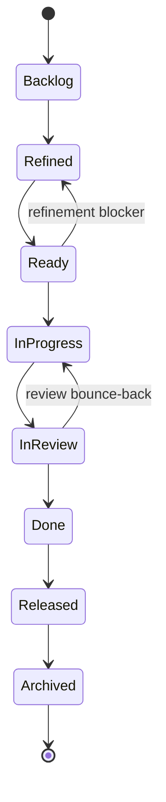

# AgileStyle — A Typed Backlog For Teams Who Are Done Fighting Jira

> **Your Product Backlog is source code. Commit it, diff it, validate it, ship it.**
> A typed Requirements DSL for Scrum, XP and SAFe teams — Connextra user stories, Given-When-Then acceptance criteria, SAFe epics and enablers, XP spikes, and reproducible bugs, all first-class and INVEST-enforced.

`@frenchexdev2/requirements` ships an `AgileStyle` preset (`@frenchexdev2/requirements/styles/agile` v1.0.0) that replaces Jira's unbounded custom-field sprawl with a **typed, git-native, compile-checked** backlog. Built on the Agile Manifesto, the Scrum Guide, Cohn's user stories, Wake's INVEST, North's BDD, Beck's XP and Leffingwell's SAFe — encoded as schema, not as culture.

Schema version: **`2026-04-14`**.

---

## 1. Who it's for

| Persona | The pain today |
|---|---|
| **Scrum PM / Product Owner** | A backlog of 800 Jira tickets, half with 280-character summaries and no acceptance criteria. The "As a / I want / So that" template lives in a wiki page from 2019 that nobody opens. |
| **Scrum Master / Agile coach** | Every retrospective produces "action items" that live in a Confluence page and evaporate by the next sprint. Nothing is filed as real work. |
| **SAFe RTE / Epic owner** | PI Planning outputs are PowerPoint decks. Epic → Feature → Story decomposition is maintained by hand in Portfolio Jira, drifts immediately, and there is no link from an Epic to the code that implements it. |
| **XP / TDD engineer** | Given-When-Then scenarios exist in three places at once: the Jira ticket body, a `.feature` Gherkin file for SpecFlow, and a docstring in the test. They diverge within a sprint. |
| **BDD practitioner** | `.feature` files are great for tests but silent on epics, enablers, spikes, and tech debt. No discipline ties a scenario to a business outcome. |
| **Engineering manager** | Spike learnings are forgotten. Tech debt lives on a Miro board. Bugs live in a separate queue with different custom fields. None of it is diff-able or auditable. |

If any of those hit: you are the target audience.

---

## 2. The problem — what happens to requirements in a Jira-dominated Agile shop

Walk into almost any Scrum team on the planet and look at a "user story" in Jira. You will see this:

- **Summary field**: 280 characters, something like *"Checkout — faster please"*. No role, no benefit, no measurable outcome. Wake's INVEST "V" for Valuable has been silently deleted.
- **Description field**: free-text markdown. Sometimes a Connextra template. Sometimes a bulleted list. Sometimes a screenshot of a Slack thread. Different for every PM, different every quarter.
- **Acceptance Criteria**: a custom text field. On good teams, Given-When-Then. On average teams, three prose sentences. On bad teams, blank — "the PO will explain in refinement."
- **Gherkin `.feature` file**: lives in `/tests/features/checkout.feature`, maintained by QA, linked to the ticket by convention only. Within one sprint, the scenarios in Jira and the scenarios in the `.feature` file have diverged. Nobody notices until the demo.
- **Epic**: a parent ticket with 40 children. The "epic link" is the only structural invariant. There is no measurable business outcome attached — no KPI, no target, no baseline. "Improve checkout" is the epic name, and it has been open for two years.
- **Spike**: a ticket labelled `spike`. No timebox. No deliverable. It gets re-estimated for six sprints and produces a Confluence page nobody reads.
- **Bug**: a different issue type, a different custom-field schema, a different SLA. The "repro steps" field is optional and often empty. Developers close tickets with *"works on my machine, probably a cache issue"*.
- **Tech debt**: not in Jira at all. On a Miro board. Or a Notion page. Or in the head of the staff engineer.
- **Retrospective action items**: filed as comments in a Confluence retro template. By the next sprint, nobody remembers them. By the next quarter, the same items appear again under slightly different wording.

Every Scrum ceremony sits on top of this mess and pretends it's discipline. Refinement meetings exist to translate free-text back into structure, by voice, every two weeks. Sprint planning negotiates stories whose acceptance criteria change mid-sprint. Reviews demo code against acceptance criteria nobody can find. Retros name the problem — *"we need to be more disciplined about user stories"* — and then file the finding in the same broken system that caused it.

The root cause is not laziness. The root cause is that **the artifacts are prose in a UI, not types in a repository**. There is no compiler. There is no diff. There is no CI gate. So there is no discipline. There cannot be.

`AgileStyle` fixes that at the root: your backlog becomes typed JSON checked into git, and every ceremony runs against a schema the CI pipeline enforces.

---

## 3. The Agile intellectual lineage this Style encodes

`AgileStyle` is not opinion. Every construct maps 1:1 to a canonical Agile source:

- **Agile Manifesto** (Beck, Cockburn, Fowler, Martin, Sutherland, et al., [agilemanifesto.org](https://agilemanifesto.org/), 2001) — working software, responding to change, customer collaboration. The `natural` fallback pattern exists because the Manifesto values individuals and interactions over tools; we warn, we don't block.
- **Scrum Guide** (Sutherland & Schwaber, 2020 revision) — the eight-state `statusWorkflow` (`Backlog → Refined → Ready → InProgress → InReview → Done → Released → Archived`) with rework loops models the Scrum Board plus the realities every team hits: `InReview → InProgress` bounce-backs and `Ready → Refined` re-openings.
- **Mike Cohn, *User Stories Applied* (2004)** — the `user-story` pattern is pure Connextra: `As a {role}, I want {capability}, so that {benefit}.` The three slots (`role`, `capability`, `benefit`) are exactly Cohn's template.
- **Bill Wake, INVEST** (XP123, 2003) — Independent, Negotiable, Valuable, Estimable, Small, Testable. The validator enforces "Valuable" as a hard rule (RULE 5 below): a user-story with an empty `benefit` slot is a feature spec, not a story.
- **Dan North, *Introducing BDD* (2006) / Gherkin** — the `given-when-then` pattern's three slots (`precondition`, `trigger`, `outcome`) are canonical Gherkin. Scenarios become executable acceptance tests via `verificationMethod: 'BDD'`.
- **Kent Beck, *Extreme Programming Explained* (2000/2004)** — `PairReview`, `TDD`, `BDD`, `ExploratoryTesting` are XP verification methods. The `spike` pattern is straight XP: timeboxed investigation producing a decision memo.
- **Dean Leffingwell, *SAFe*** — the `epic` pattern with its mandatory `kpi` slot is the Portfolio Kanban input. `enabler` is SAFe's architectural runway concept. `Refines` traces Epic → Feature → Story per SAFe decomposition.

Every one of these traditions is usually transmitted as prose and culture. `AgileStyle` encodes them as **TypeScript types, JSON schemas, and pure validators** — so discipline survives the departure of the senior engineer who used to enforce it.

---

## 4. What you get — the vocabulary

### 4.1 Requirement kinds (8)

| Kind | Purpose |
|---|---|
| `UserStory` | The atomic unit of user value (Cohn). |
| `Epic` | Multi-sprint outcome with measurable KPI (SAFe). |
| `Enabler` | Technical runway unblocking stories (SAFe). |
| `Spike` | Timeboxed XP investigation (Beck). |
| `TechnicalDebt` | Debt register entry, tracked as first-class work. |
| `Bug` | Reproducible defect with repro steps. |
| `NonFunctional` | Performance / availability / UX SLOs. |
| `Research` | Discovery work — user research, market study. |

### 4.2 Status workflow (Scrum/Kanban FSM)



Initial: `Backlog`. Terminal: `Archived`. Nine transitions total, including the two rework loops teams actually live in.

### 4.3 Risk taxonomy — 5-level severity with likelihood × impact matrix

Levels: `Showstopper`, `High`, `Medium`, `Low`, `Trivial`.

| likelihood \ impact | Critical | Major | Minor | Cosmetic |
|---|---|---|---|---|
| **Certain** | Showstopper | High | — | — |
| **Likely** | High | Medium | — | — |
| **Possible** | Medium | Medium | Low | — |
| **Unlikely** | — | Low | Trivial | Trivial |

Plain-English levels any PO understands — no CVSS decimals, no actuarial tables.

### 4.4 Verification methods (8)

`AcceptanceTest` · `DefinitionOfDone` · `DemoToPO` · `UserValidation` · `PairReview` · `TDD` · `BDD` · `ExploratoryTesting`.

Each maps to a concrete ceremony or practice. `DemoToPO` is sprint review. `PairReview` is XP pairing. `TDD` is red-green-refactor. `BDD` is `.feature` scenarios. Nothing abstract.

### 4.5 Rationale kinds (8)

`user-value` · `technical-enabler` · `debt-paydown` · `bug-fix` · `spike-learning` · `business-goal` · `team-health` · `customer-feedback`.

Every requirement must say **why** — and "why" is one of these eight, not free text.

### 4.6 Source kinds — typed provenance

Every requirement carries a `source`, and each kind has its own slot schema (validated):

| `kind` | slots (required) |
|---|---|
| `product-owner` | `name`, `date` |
| `user-interview` | `interviewee`, `date`, `session-notes-url` (optional) |
| `market-research` | `study`, `firm`, `year` |
| `sprint-retrospective` | `sprintId`, `date`, `action-item` |
| `customer-support` | `ticketId`, `channel` (email/chat/phone/zendesk), `date` |
| `backlog-grooming` | `date`, `facilitator` |
| `technical-debt-register` | `debtId`, `owner` |
| `product-kpi` | `metric`, `target`, `currentValue` |

That `sprint-retrospective` kind is the single discipline that stops retro actions from vanishing: you file them as typed requirements with the sprint ID, the date, and the action-item text. Next retro, they are visible in the board because they are in the backlog.

### 4.7 Statement patterns — all 7

| pattern | label | template | slots |
|---|---|---|---|
| `user-story` | User story (Connextra) | `As a {role}, I want {capability}, so that {benefit}.` | `role`, `capability`, `benefit` |
| `given-when-then` | Acceptance scenario (Gherkin / BDD) | `Given {precondition}, when {trigger}, then {outcome}.` | `precondition`, `trigger`, `outcome` |
| `epic` | Epic (SAFe) | `Epic: {epic}. Business outcome: {outcome}. Measured by {kpi}.` | `epic`, `outcome`, `kpi` |
| `enabler` | Enabler (SAFe technical enabler) | `Technical enabler: {capability}. Required by {userStories}. Risk mitigation: {riskMitigated}.` | `capability`, `userStories`, `riskMitigated` |
| `spike` | Spike (XP timeboxed investigation) | `Spike: investigate {question}. Timebox: {timebox}. Deliverable: {deliverable}.` | `question`, `timebox`, `deliverable` |
| `bug` | Bug report | `Bug: {summary}. Expected: {expected}. Actual: {actual}. Repro: {repro}.` | `summary`, `expected`, `actual`, `repro` |
| `natural` | Natural language (fallback — generates warning) | `{text}` | `text` |

### 4.8 Templates — six scaffolds for `requirement new --template <id>`

| template id | kind | pattern | verif. method |
|---|---|---|---|
| `user-story-standard` | `UserStory` | `user-story` | `AcceptanceTest` |
| `given-when-then-ac` | `UserStory` | `given-when-then` | `BDD` |
| `epic-scaffold` | `Epic` | `epic` | `DemoToPO` |
| `enabler-technical` | `Enabler` | `enabler` | `PairReview` |
| `spike-timeboxed` | `Spike` | `spike` | `ExploratoryTesting` |
| `bug-report` | `Bug` | `bug` | `AcceptanceTest` |

---

## 5. Contrast with `DefaultStyle` (29148 + Volere + EARS)

`DefaultStyle` is great for regulated products: EARS patterns (`ubiquitous`, `event-driven`, `state-driven`, `optional`, `unwanted`), five-state lifecycle (`Draft → Approved → Implemented → Verified → Deprecated`), sources that are `stakeholder` / `regulation` / `standard` / `contract`. It expects requirements to be **stable** and **reviewed**.

`AgileStyle` expects requirements to be **discovered iteratively**, bounce between `InReview` and `InProgress`, and carry KPIs (`product-kpi`) rather than regulation citations. Same port interface (`RequirementStyle`); incompatible ontologies. Pick the one that matches your delivery model.

---

## 6. A complete worked example — building a checkout flow feature

### 6.1 The Epic

```json
{
  "$schemaVersion": "2026-04-14",
  "kind": "requirement",
  "id": "EPIC-CHECKOUT-01",
  "title": "Frictionless checkout for returning customers",
  "requirementKind": "Epic",
  "priority": "High",
  "status": "Refined",
  "statement": {
    "pattern": "epic",
    "epic": "Reduce friction in the returning-customer checkout flow",
    "outcome": "Returning customers complete checkout in a single screen without re-entering payment or shipping data",
    "kpi": "checkout conversion rate 62% → 75% within two quarters"
  },
  "rationale": {
    "kind": "business-goal",
    "text": "Q2 OKR: lift checkout conversion by 13pp. Shopify benchmark 71%."
  },
  "source": {
    "type": "product-kpi",
    "metric": "checkout_conversion_rate",
    "target": "0.75",
    "currentValue": "0.62"
  },
  "risk": { "level": "High", "likelihood": "Likely", "impact": "Critical" },
  "verificationMethod": "DemoToPO",
  "fitCriteria": [
    { "id": "FC-CONV", "kind": "metric", "description": "conversion rate ≥ 0.75 for 30 days" }
  ]
}
```

### 6.2 Three user stories decomposing the epic (@Refines EPIC-CHECKOUT-01)

```json
{
  "$schemaVersion": "2026-04-14",
  "kind": "requirement",
  "id": "US-CHECKOUT-11",
  "title": "One-click re-order with saved payment method",
  "requirementKind": "UserStory",
  "priority": "High",
  "status": "Ready",
  "refines": ["EPIC-CHECKOUT-01"],
  "statement": {
    "pattern": "user-story",
    "role": "returning customer with a saved card",
    "capability": "complete checkout in a single tap using my default payment method",
    "benefit": "I don't abandon my cart because of form fatigue"
  },
  "rationale": { "kind": "user-value", "text": "Customer-support tickets #44910, #45201 cite re-entry friction." },
  "source": {
    "type": "customer-support",
    "ticketId": "ZD-44910",
    "channel": "zendesk",
    "date": "2026-03-08"
  },
  "verificationMethod": "AcceptanceTest",
  "fitCriteria": [
    { "id": "FC-11-AC1", "kind": "unit-test", "description": "Given a logged-in customer with a default card, when they click 'Buy now', then the order is placed without a second screen" }
  ]
}
```

```json
{
  "id": "US-CHECKOUT-12",
  "requirementKind": "UserStory",
  "status": "Ready",
  "refines": ["EPIC-CHECKOUT-01"],
  "statement": {
    "pattern": "user-story",
    "role": "returning customer",
    "capability": "ship to any of my saved addresses without re-typing",
    "benefit": "I save 90 seconds at every checkout"
  }
}
```

```json
{
  "id": "US-CHECKOUT-13",
  "requirementKind": "UserStory",
  "status": "Backlog",
  "refines": ["EPIC-CHECKOUT-01"],
  "statement": {
    "pattern": "user-story",
    "role": "mobile customer",
    "capability": "use Apple Pay / Google Pay as a default payment method",
    "benefit": "I check out without typing anything on a phone keyboard"
  }
}
```

### 6.3 A Given-When-Then acceptance criterion on US-CHECKOUT-11

```json
{
  "id": "US-CHECKOUT-11-AC1",
  "requirementKind": "UserStory",
  "status": "Ready",
  "refines": ["US-CHECKOUT-11"],
  "statement": {
    "pattern": "given-when-then",
    "precondition": "a customer is logged in with a default saved card and a default shipping address",
    "trigger": "they click the 'Buy now' button on a product page",
    "outcome": "the order is placed and a confirmation screen is shown within 2 seconds, with no intermediate form"
  },
  "verificationMethod": "BDD",
  "fitCriteria": [
    { "id": "FC-11-AC1-UT", "kind": "unit-test", "description": "BuyNow.placesOrderWithoutIntermediateForm" }
  ]
}
```

### 6.4 A spike for payment-gateway discovery

```json
{
  "id": "SPIKE-PAY-01",
  "requirementKind": "Spike",
  "priority": "High",
  "status": "InProgress",
  "refines": ["US-CHECKOUT-13"],
  "statement": {
    "pattern": "spike",
    "question": "Can we support Apple Pay + Google Pay on our existing Stripe integration, or do we need Adyen?",
    "timebox": "3 days",
    "deliverable": "ADR with recommendation + working prototype against Stripe sandbox"
  },
  "rationale": { "kind": "spike-learning" },
  "verificationMethod": "ExploratoryTesting",
  "source": { "type": "backlog-grooming", "date": "2026-04-10", "facilitator": "R. Patel" }
}
```

### 6.5 A bug found during testing

```json
{
  "id": "BUG-CHECKOUT-07",
  "requirementKind": "Bug",
  "priority": "High",
  "status": "InReview",
  "refines": ["US-CHECKOUT-11"],
  "statement": {
    "pattern": "bug",
    "summary": "One-click re-order double-charges customers when network is flaky",
    "expected": "a single charge per order, regardless of network conditions",
    "actual": "two identical charges recorded when the confirmation request retries",
    "repro": "1) log in with a saved card  2) throttle network to 3G  3) click 'Buy now'  4) wait 5s  5) observe two entries in the Stripe dashboard"
  },
  "rationale": { "kind": "bug-fix" },
  "verificationMethod": "AcceptanceTest",
  "risk": { "level": "Showstopper", "likelihood": "Certain", "impact": "Critical" }
}
```

### 6.6 `requirement show` output (reporter `renderRequirement`)

```
US-CHECKOUT-11  One-click re-order with saved payment method
  Kind: UserStory    Status: Ready    Priority: High    Risk: —
  Verification: AcceptanceTest
  Story: As a returning customer with a saved card, I want complete checkout in a single tap using my default payment method, so that I don't abandon my cart because of form fatigue.
```

### 6.7 Markdown export — "story card" (reporter `renderMarkdown`)

```markdown
# US-CHECKOUT-11 — One-click re-order with saved payment method

> As a returning customer with a saved card, I want complete checkout in a single tap using my default payment method, so that I don't abandon my cart because of form fatigue.

## Acceptance criteria

- [ ] Given a logged-in customer with a default card, when they click 'Buy now', then the order is placed without a second screen

---
**Source**: customer-support · **Priority**: High · **Status**: Ready · **Risk**: —
```

Paste that into a sprint-review slide, a Notion page, or a GitHub PR description. Identical output from identical spec. Zero drift.

---

## 7. What the validators enforce — the 5 AgileStyle rules

Every rule below is implemented in `AGILE_VALIDATORS.validateSpec` and runs on every `compliance` invocation.

| # | Rule | Discipline saved |
|---|---|---|
| **1** | `UserStory` kind requires `user-story` OR `given-when-then` statement pattern | No more "user story" tickets that are one-line feature requests. |
| **2** | `Epic` requires the `epic` pattern **and** a non-empty `kpi` slot | No more permanent "Improve checkout" epics with no success criterion. If you cannot measure it, it is not an epic. |
| **3** | `Spike` requires the `spike` pattern **and** a non-empty `timebox` | No more open-ended spikes. An open-ended spike is research, not a spike. |
| **4** | `Bug` requires the `bug` pattern **and** a non-empty `repro` | No more "works on my machine" tickets. If you cannot reproduce it, you do not yet have a bug report. |
| **5** | Any statement with `pattern === 'user-story'` must have a non-empty `benefit` | INVEST's "Valuable". A story without benefit is a feature spec. Wake wins. |

These are not suggestions. They fail CI. Your backlog cannot rot past these five lines.

Plus the generic checks: `requirementKind` must be one of the eight listed, `status` must be an AgileStyle state, every required slot in the chosen pattern must be a non-empty string, `unknown pattern '…'` is rejected.

---

## 8. Integrations

- **VS Code schema binding** — publish the JSON Schema derived from `AGILE_VOCABULARY` and bind it via `settings.json` `json.schemas`. Autocomplete on `requirementKind`, `status`, `statementPattern`, and every `source.type` slot. Red squiggles under "InProgess".
- **Gherkin bridge** (`requirement export --format gherkin`, Tier 2) — every `given-when-then` statement becomes one `.feature` scenario for Cucumber / SpecFlow / pytest-bdd. Your BDD tests stop drifting because they are generated from the backlog, not kept in sync by humans.
- **vitest AcceptanceTest runner** — `verificationMethod: 'AcceptanceTest' | 'BDD' | 'TDD'` maps to the `@FeatureTest` / `@Verifies` decorators already shipped by `@frenchexdev2/requirements`. One story, one `.spec.json`, N vitest tests, all wired.
- **`compliance --strict` as Definition-of-Done gate** — add `npx requirements compliance --strict` as a required CI check. No merge without: every `UserStory` has an AC, every AC has a passing test, every `Epic` has a `kpi`, every `Bug` has `repro`. DoD becomes a pipeline step instead of a wiki page.
- **Jira import/export adapter** (Tier 2, one-way first: Jira → spec) — seed the repo from your existing Jira and stop editing there. Two-way sync is deliberately deferred: the point is to get off Jira, not to marry it.

---

## 9. Comparison — AgileStyle vs the field

| Tool | Git-native | Typed | INVEST-enforced | Epic → code trace | Gherkin-compat | Open-source | Price |
|---|---|---|---|---|---|---|---|
| **Jira + custom fields** | no | no | no | no (labels, by convention) | no | no | ~$8/user/mo |
| **Notion / Confluence** | no | no | no | no | no | no | ~$10/user/mo |
| **Azure Boards** | partial | no | no | partial | no | no | per-user |
| **GitHub Issues** | yes (partial) | no | no | partial | no | yes | free-ish |
| **ProductBoard / Aha!** | no | partial | no | no | no | no | $$$ |
| **Raw Gherkin `.feature`** | yes | partial | no | no | native | yes | free |
| **AgileStyle** | **yes** | **yes (TS + JSON schema)** | **yes (RULE 5)** | **yes (`refines`)** | **yes (exporter)** | **yes (MIT)** | **free** |

The row that matters is "INVEST-enforced": nobody else does this. Jira gives you a field; nothing checks it is non-empty or that `benefit` reads like a value statement. `AgileStyle` fails your PR if you forget it.

---

## 10. How it fits Scrum ceremonies

| Ceremony | What AgileStyle does |
|---|---|
| **Backlog refinement** | PO + team move stories `Backlog → Refined`. The validator runs on every edit — a story cannot reach `Refined` if `pattern` is missing slots, if a `UserStory` lacks `benefit`, or if an `Epic` lacks `kpi`. |
| **Sprint planning** | Team pulls stories `Refined → Ready`. The Definition of Ready is codified: `status: 'Ready'` plus all required slots plus at least one `fitCriteria` with `kind: 'unit-test'` or `'demonstration'`. Machine-checked. |
| **Daily stand-up** | `requirement trace gaps` and `trace chain <id> <ac>` answer "what's in-flight, what's bounced back, what's blocked". `InReview → InProgress` loops are visible in history (git blame). |
| **Sprint review** | Done stories transition `Done → Released` by the PO. `verificationMethod: 'DemoToPO'` is the explicit handshake. The Markdown story-card renders identically to the one used in planning. |
| **Retrospective** | Actions are filed as `UserStory` or `TechnicalDebt` with `source.type: 'sprint-retrospective'` carrying `sprintId`, `date`, `action-item`. Next retro they are real tickets in the board. The retro-action death spiral ends. |

---

## 11. The SAFe angle — scaling to a Release Train

SAFe is where Agile-at-scale usually collapses: the Portfolio Kanban is a spreadsheet, Epics drift from Features, PI objectives live in PowerPoint, and the ART has no structural link to the code. `AgileStyle` gives a SAFe ART five concrete primitives:

1. **Portfolio Kanban input = `Epic` requirements.** Each epic carries a mandatory `kpi` (RULE 2). The Portfolio funnel is literally `requirement list --kind Epic --status Backlog,Refined`. Investment decisions use `source.type: 'product-kpi'` with `metric`, `target`, `currentValue` — baseline and target are typed fields, not prose.
2. **Architectural runway = `Enabler` requirements.** The `enabler` pattern names the `capability`, the downstream `userStories` it unblocks (IDs, not prose), and the `riskMitigated`. An enabler with no `userStories` is an enabler with no customer — caught by schema.
3. **PI Planning objectives = `Epic` with `rationale.kind: 'business-goal'`.** PI objectives stop being slides and start being requirements with a status, a KPI, and a trace chain down to features and stories.
4. **Feature → Story decomposition = `@Refines`.** Every story declares `refines: ['FEAT-…']`; every feature declares `refines: ['EPIC-…']`. `requirement trace chain EPIC-CHECKOUT-01` walks the tree. The decomposition is a graph, not a PowerPoint hierarchy, and dependency management becomes `trace impact` when an enabler slips.
5. **ART Sync & Inspect-and-Adapt = real data.** I&A workshops run off `trace gaps`, `trace matrix`, and the compliance report — factual inputs about what shipped, what stalled in `InReview`, which epics hit their KPI and which did not. No more argumentum ad memoriam.

The RTE gets a dashboard generated from git, not maintained in Confluence. The Epic Owner gets a compile-time guarantee their epic carries a KPI. The System Architect gets enablers with named downstream consumers. The PO gets stories that cannot escape refinement without a `benefit` slot filled.

SAFe's ceremonies do not change. Only the substrate does: typed JSON in a repo, validated in CI, rendered to Markdown for the humans who still want slides.

---

## 12. Getting started — 3 steps

```bash
# 1. Install
pnpm add @frenchexdev2/requirements

# 2. Pick the style in requirements.config.json
#    { "style": "@frenchexdev2/requirements/styles/agile" }

# 3. Scaffold your first story
npx requirement new --style agile --template user-story-standard
npx requirements compliance --strict   # add to CI as a required check
```

That is the adoption curve. No migration. No consultants. Add one file, add one CI step, stop editing Jira.

---

## 13. Roadmap

- **Jira importer** (Tier 2) — one-way `jira → spec` to seed a repo from an existing project.
- **Gherkin exporter** — `requirement export --format gherkin` emitting `.feature` files for Cucumber / SpecFlow / pytest-bdd.
- **Confluence exporter** — stakeholder-facing release notes generated from `Released` requirements in a sprint window.
- **SAFe ART-level aggregation reports** — roll-ups of Epic KPI attainment across trains, suitable for Inspect & Adapt packets.
- **FitCriterion adapters** — Datadog / Grafana / Stripe-metric adapters populating `kind: 'metric'` fit criteria directly from production telemetry.

---

## 14. License + community

- **License**: MIT.
- **PRs welcome**: especially new templates, new exporters, and concrete SAFe case studies.
- **Glossary**: every term in this document traces to a citation in `src/styles/agile.ts`.
- **Plan**: `docs/plan.md` tracks Tier 1 (shipped) and Tier 2 (Jira / Gherkin / Confluence bridges).

Stop fighting Jira. Commit your backlog.
