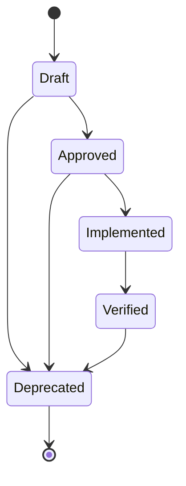

> Requirements you can compile, diff, and grep — with the rigor of ISO/IEC/IEEE 29148, the discipline of Volere, and the clarity of EARS.

# DefaultStyle — a typed Requirements DSL that your CI already understands

`@frenchexdev2/requirements` ships with a preset called **DefaultStyle**. It is the 90% case: a coherent bundle of vocabulary, validators, templates and a reporter that turns "write a requirement" from a blank-page anxiety into a filled-in form, and turns the resulting artefact into something your compiler, your test runner, and your pull-request review can all reason about.

It is not another tracker. It is not a Wiki macro. It is a *style* — in the SysML sense — a coherent ontology bolted onto a typed DSL, that produces JSON on disk, TypeScript classes in your editor, and Markdown for humans, all from one source of truth.

---

## Who it's for

- **Indie maintainers** tired of prose-only `REQUIREMENTS.md` files that silently drift away from the code they used to describe.
- **Startup engineering teams** who need 29148-grade rigor for an audit (SOC 2, ISO 27001, MDR, DORA) but have zero budget for DOORS and zero patience for Jama.
- **Teaching contexts** — requirements-engineering courses that want students to *write* real specs, not just read about them, in a toolchain that will survive their graduation.
- **Open-source projects** that want contributors to propose requirements through pull requests, with diffable specs reviewers can actually critique line by line.

Concrete pains DefaultStyle dissolves:

- "What's our definition of *done* for this AC?" — the style forces a `verificationMethod` and at least one typed `fitCriterion`.
- "Where does this requirement come from?" — `RequirementProvenance` has eight source kinds with typed slots; you cannot forget the citation.
- "Is this requirement approved or still a draft?" — a five-state workflow with explicit transitions; no Kanban fudge.
- "Can our test suite prove we meet it?" — `@Satisfies` on Features + `@Verifies` on tests, audited by `requirements compliance --strict` in CI.

---

## The problem

Most requirements live in three doomed places.

**Word documents.** Someone writes `REQ-042: the system shall handle errors gracefully`, and six months later nobody knows what "gracefully" means, whether it was implemented, whether it was tested, or whether the author still works here. Word has no schema; Word has no diff; Word cannot be grepped by your CI. The document becomes archaeological.

**Confluence / Notion pages.** Better, because at least they have history — but the history is page-level, not field-level. You cannot ask "show me every requirement whose priority changed from Medium to Critical in Q1". You cannot programmatically assert that every requirement has a rationale. You cannot fail the build when a requirement has no fit criterion. The tool's data model is "rich text blocks", and rich text cannot be verified.

**Jira tickets.** Jira has custom fields, yes. But every team invents its own: one project's "Acceptance Criteria" is a rich-text blob, another's is a checklist of sub-tasks, a third's is just the description. There is no shared ontology. Refactoring the schema means migrating thousands of tickets by hand. And crucially, Jira tickets die: a closed issue is an archaeological find, not a living specification.

Worse than any of these: **requirements drift from code**. The spec says *"the system shall retry on transient failures"*; the code does not retry; no test catches this because no test is bound to that clause. The link between intent and artifact is a convention — a comment here, a ticket number there — and conventions decay.

The traditional enterprise response is DOORS, Jama Connect, Polarion. These tools model requirements as first-class objects, support traceability, export to ReqIF. But they cost thousands per seat per year, live in a separate GUI, ignore your `git blame`, and treat "the code" as an opaque artefact linked by a URL. Engineers hate them. Spec authors end up re-exporting to Word anyway.

DefaultStyle takes a different stance: the spec is a **typed artefact in the repository**, next to the code it governs, diffable by Git, validated by TypeScript, linted by vitest, audited by the CLI, and rendered to Markdown for humans when they need humans to read it. The spec is *code-shaped*, not document-shaped.

---

## The philosophy

DefaultStyle is not invented — it is assembled. Its pieces have lineages.

- **ISO/IEC/IEEE 29148:2018** — *Systems and software engineering — Life cycle processes — Requirements engineering*. This is the canonical meta-standard. It prescribes the shape of a requirement (identifier, statement, rationale, source, priority, verification), the distinction between stakeholder / system / software requirements, and the characteristics a well-formed requirement must exhibit (necessary, appropriate, unambiguous, complete, singular, feasible, verifiable, correct, conforming). DefaultStyle's `Requirement<S>` class encodes 29148's required attributes as typed fields. [ieee.org/29148](https://www.iso.org/standard/72089.html)

- **Volere** (Suzanne & James Robertson, *Mastering the Requirements Process*, 3rd ed., Addison-Wesley 2012). Volere gave us the *requirements shell*: a structured template where every requirement carries a description, a rationale, a **fit criterion** (how to tell whether the requirement has been met), a source, and a priority. `RequirementFitCriterion` is Volere's contribution; so is the insistence that rationale is not optional. [volere.org](https://www.volere.org/)

- **SysML** (OMG, *Systems Modeling Language*). SysML contributed the three verbs of the traceability graph: **satisfy** (a design element satisfies a requirement), **verify** (a test case verifies a requirement), **refine** (a requirement refines another, more abstract one). The DSL encodes these as decorators: `@Satisfies` lives on Features, `@Verifies` on tests, `@Refines` on Requirements. [omg.org/spec/SysML](https://www.omg.org/spec/SysML/)

- **EARS** — *Easy Approach to Requirements Syntax* (Alistair Mavin et al., Rolls-Royce, IEEE International Requirements Engineering Conference 2009). EARS identified five canonical statement patterns that cover the vast majority of functional requirements: ubiquitous, event-driven, state-driven, optional-feature, unwanted-behaviour. Constraining requirements to one of five patterns eliminates 80% of the ambiguity that makes prose requirements untestable. [alistairmavin.com/ears](https://alistairmavin.com/ears/)

- **Specification by Example** (Gojko Adzic, *Specification by Example*, Manning 2011). The idea that executable examples — not prose — are the ultimate artefact of a requirement. DefaultStyle's `fitCriteria` with `unit-test` / `metric` / `quality-gate` kinds operationalises this: the spec does not just *describe* behaviour, it *points at* the executable evidence that the behaviour holds.

These five are the canonical roots because, together, they answer the five questions a requirement must answer: *what* (EARS), *why* (Volere rationale), *how we know* (Volere fit criterion + SysML verify), *who asked* (29148 source), *what it relates to* (SysML satisfy/refine).

DefaultStyle does not invent. It *assembles* — and it types the assembly so TypeScript refuses to let you break it.

---

## What you get — vocabulary

### Requirement kinds

| Kind            | Typical use                                                  |
| --------------- | ------------------------------------------------------------ |
| `Functional`    | What the system does (EARS patterns fit best here).          |
| `NonFunctional` | Quality attributes — latency, throughput, availability.      |
| `Constraint`    | Immovable facts — runtime, legal jurisdiction, budget.       |
| `Compliance`    | Externally-mandated requirements (GDPR, HIPAA, PCI-DSS, …).  |
| `UserStory`     | Stakeholder-framed requirements — *as a X, I want Y so Z*.   |

### Status workflow

A five-state FSM, deliberately narrow, deliberately terminal:



No "In Progress", no "Blocked", no "Waiting on Legal". Those are *ticket* states, not *requirement* states. A requirement is either drafted, approved, implemented, verified, or superseded. Everything else is project management.

### Risk taxonomy

| Level      | Meaning                                                                   |
| ---------- | ------------------------------------------------------------------------- |
| `Critical` | Loss of life, loss of business, regulatory breach.                        |
| `High`     | Major revenue impact or severe reputational damage.                       |
| `Medium`   | Degraded user experience, recoverable outage.                             |
| `Low`      | Cosmetic or convenience-level concern.                                    |

Each Requirement carries a `risk: { level, ifNotMet, mitigations? }` object — the risk is named, the consequence is written, the mitigations are listed.

### Verification methods

| Method          | When                                                       |
| --------------- | ---------------------------------------------------------- |
| `Test`          | Executable verification (unit, e2e, property).             |
| `Inspection`    | Human review against a checklist.                          |
| `Analysis`      | Mathematical or modelling-based verification.              |
| `Demonstration` | Walk-through in a controlled scenario.                     |

### Rationale kinds

`evidence-based`, `principle`, `value-driven`, `regulatory-compliance`, `risk-mitigation`, `precedent`.

A rationale always states a *kind* so readers know what weight to give it: is this based on data, on a professional principle, on a value judgment, on a regulation, on risk arithmetic, or on precedent?

### Source kinds — with typed slots

| `kind`             | Required slots                        | Optional slots        |
| ------------------ | ------------------------------------- | --------------------- |
| `stakeholder`      | `role`, `date`                        | —                     |
| `regulation`       | `jurisdiction`, `act`                 | `article`, `paragraph`|
| `standard`         | `org`, `id`                           | `section`             |
| `contract`         | `doc`                                 | `clause`              |
| `risk`             | `registerEntry`, `severity`           | —                     |
| `business-goal`    | `okrId`, `period`                     | —                     |
| `incident`         | `incidentId`, `date`                  | `postmortemUrl`       |
| `domain-knowledge` | `reference`                           | —                     |

Each requirement must cite its source. The slot shape is validated by the style — an `incident` source without an `incidentId` fails the wire-level check.

### Statement patterns — EARS five + natural fallback

| Pattern         | Template                                           |
| --------------- | -------------------------------------------------- |
| `ubiquitous`    | `The system shall {response}.`                     |
| `event-driven`  | `When {trigger}, the system shall {response}.`     |
| `state-driven`  | `While {state}, the system shall {response}.`      |
| `optional`      | `Where {feature}, the system shall {response}.`    |
| `unwanted`      | `If {trigger}, then the system shall {response}.`  |
| `natural`       | `{text}` (free prose — generates a warning)        |

The `natural` pattern exists as an escape hatch for requirements that genuinely do not fit EARS (typically stakeholder-framed user stories). It compiles, but the linter flags it — a signal to the author that the requirement might be refined.

---

## A complete example

Let's walk the full pipeline: wizard → JSON → TypeScript → console → Markdown.

### 1. The wizard

```shell
$ npx requirements new
? Template: EARS Event-driven — "When X, the system shall …"
? Requirement id: REQ-PAYMENT-RETRY-001
? Title: Retry transient payment-provider failures
? Priority: High
? Statement pattern: event-driven
? Trigger: the payment provider returns HTTP 502, 503 or 504
? Response: retry up to 3 times with exponential backoff (250ms, 500ms, 1s)
? Kind: Functional
? Rationale kind: evidence-based
? Rationale claim: Stripe Q1-2026 SRE report shows 1.8% of 5xx errors clear on retry within 2s
? Add evidence? metric: stripe_5xx_clearance_rate = 1.8% on 2026-01-31
? Source kind: incident
?   incidentId: INC-2025-11-14-checkout-outage
?   date: 2025-11-14
?   postmortemUrl: https://status.example.com/incidents/2025-11-14
? Verification method: Test
? Fit criterion kind: unit-test
?   describes: PaymentRetryFeature.retriesTransient5xx
?   binds: ["test/unit/payment-retry.test.ts"]
? Risk level: High
? If not met: repeated customer-visible checkout failures, 15k€/day revenue loss
? Status: Draft

✔ Wrote requirements/REQ-PAYMENT-RETRY-001.spec.json
✔ Wrote requirements/REQ-PAYMENT-RETRY-001.ts
```

### 2. The resulting `.spec.json`

```json
{
  "$schema": "./node_modules/@frenchexdev2/requirements/schema/requirement.schema.json",
  "$schemaVersion": "2026-04-14",
  "kind": "requirement",
  "id": "REQ-PAYMENT-RETRY-001",
  "title": "Retry transient payment-provider failures",
  "priority": "high",
  "status": "Draft",
  "requirementKind": "Functional",
  "statement": {
    "pattern": "event-driven",
    "trigger": "the payment provider returns HTTP 502, 503 or 504",
    "response": "retry up to 3 times with exponential backoff (250ms, 500ms, 1s)"
  },
  "rationale": {
    "kind": "evidence-based",
    "claim": "Stripe Q1-2026 SRE report shows 1.8% of 5xx errors clear on retry within 2s",
    "evidence": [
      {
        "kind": "metric",
        "name": "stripe_5xx_clearance_rate",
        "value": "1.8%",
        "date": "2026-01-31"
      }
    ]
  },
  "fitCriteria": [
    {
      "kind": "unit-test",
      "describes": "PaymentRetryFeature.retriesTransient5xx",
      "binds": ["test/unit/payment-retry.test.ts"]
    }
  ],
  "verificationMethod": "Test",
  "source": {
    "type": "incident",
    "incidentId": "INC-2025-11-14-checkout-outage",
    "date": "2025-11-14",
    "postmortemUrl": "https://status.example.com/incidents/2025-11-14"
  },
  "risk": {
    "level": "High",
    "ifNotMet": "repeated customer-visible checkout failures, 15k€/day revenue loss",
    "mitigations": [
      "circuit-breaker on sustained 5xx",
      "dead-letter queue for idempotency-keyed retries"
    ]
  }
}
```

### 3. The generated TypeScript class

```typescript
import {
  Requirement,
  Priority,
} from '@frenchexdev2/requirements';
import type { DefaultStyleType } from '@frenchexdev2/requirements/styles/default';

export abstract class REQ_PAYMENT_RETRY_001 extends Requirement<DefaultStyleType> {
  readonly id       = 'REQ-PAYMENT-RETRY-001';
  readonly title    = 'Retry transient payment-provider failures';
  readonly priority = Priority.High;
  readonly status   = 'Draft' as const;
  readonly kind     = 'Functional' as const;

  readonly statement = {
    pattern:  'event-driven',
    trigger:  'the payment provider returns HTTP 502, 503 or 504',
    response: 'retry up to 3 times with exponential backoff (250ms, 500ms, 1s)',
  } as const;

  readonly rationale = {
    kind:  'evidence-based',
    claim: 'Stripe Q1-2026 SRE report shows 1.8% of 5xx errors clear on retry within 2s',
    evidence: [
      { kind: 'metric', name: 'stripe_5xx_clearance_rate', value: '1.8%', date: '2026-01-31' },
    ],
  } as const;

  readonly fitCriteria = [
    { kind: 'unit-test', describes: 'PaymentRetryFeature.retriesTransient5xx',
      binds: ['test/unit/payment-retry.test.ts'] },
  ] as const;

  readonly verificationMethod = 'Test' as const;

  readonly source = {
    type: 'incident',
    incidentId: 'INC-2025-11-14-checkout-outage',
    date: '2025-11-14',
    postmortemUrl: 'https://status.example.com/incidents/2025-11-14',
  } as const;

  readonly risk = {
    level: 'High',
    ifNotMet: 'repeated customer-visible checkout failures, 15k€/day revenue loss',
    mitigations: [
      'circuit-breaker on sustained 5xx',
      'dead-letter queue for idempotency-keyed retries',
    ],
  } as const;
}
```

Because `Requirement<S>` is generic and `DefaultStyleType = typeof DefaultStyle` is const-typed, every string discriminant (`status`, `kind`, `statement.pattern`, `rationale.kind`, `source.type`, `risk.level`, `verificationMethod`) is **narrowed at compile time**. Misspelling `'Implemtned'` is a `tsc` error, not a runtime surprise.

### 4. `requirement show` console output

```shell
$ npx requirements show REQ-PAYMENT-RETRY-001

REQ-PAYMENT-RETRY-001  Retry transient payment-provider failures
  priority: high  status: Draft  kind: Functional
  statement: When the payment provider returns HTTP 502, 503 or 504, the system shall retry up to 3 times with exponential backoff (250ms, 500ms, 1s).
```

### 5. `requirement export --format md`

```markdown
# REQ-PAYMENT-RETRY-001 — Retry transient payment-provider failures

**Kind**: Functional · **Priority**: high · **Status**: Draft

> When the payment provider returns HTTP 502, 503 or 504, the system shall retry up to 3 times with exponential backoff (250ms, 500ms, 1s).
```

One source of truth. Five shapes. Zero drift.

---

## What the validators enforce

DefaultStyle ships two validation layers.

**Layer 1 — wire-level (Ajv against JSON Schema).** The `.spec.json` is validated against a JSON Schema derived from `Requirement<DefaultStyleType>`. This catches:

- Unknown fields, wrong types, missing required fields — the classic JSON Schema job.
- Wrong `$schemaVersion` — the style rejects specs authored against an incompatible version (`2026-04-14` is the current schema generation).
- Malformed `source` slots — e.g. an `incident` source without `incidentId` or with a non-ISO `date`.

**Layer 2 — semantic (DefaultValidators in `default.ts`).** Four rules:

1. **`validateStatement`** — the `statement.pattern` must be one of the six patterns (`ubiquitous`, `event-driven`, `state-driven`, `optional`, `unwanted`, `natural`), and every required slot for that pattern must be a non-empty string. An `event-driven` statement without a `trigger` fails here, even though JSON Schema alone might accept it.
2. **`validateSpec.requirementKind`** — must be one of `Functional | NonFunctional | Constraint | Compliance | UserStory`. Typos surface as path-scoped errors.
3. **`validateSpec.status`** — must be one of the five workflow states. Sneaking in `'Rejected'` fails.
4. **`validateSpec`** recursively calls `validateStatement`, so shape + pattern are always checked together.

Both layers run on every `requirement new`, every `requirement validate`, every CI build. Ajv's job is structural; DefaultValidators' job is ontological. Neither is redundant: one catches *malformed*, the other catches *out-of-vocabulary*.

---

## Integrations

- **VS Code schema binding.** The generated `.spec.json` carries a `$schema` pointer to `schema/requirement.schema.json` in the package. Autocomplete for every field, hover docs, inline errors — without a single extension.
- **Vitest dog-fooding.** Tests bind to ACs via `@FeatureTest` / `@Verifies`. The package's own test suite uses this exclusively (no `describe`/`it` at the top level). Coverage gates are enforced per file in `vitest.config.ts`.
- **Compliance `--strict` CI gate.** `npx requirements compliance --strict` fails the build if any AC has zero `@Verifies` bindings, if any Feature has zero `@Satisfies` relation to a Requirement, or if any Requirement has zero `fitCriteria`. This is the one check that prevents silent drift.
- **Scaffold pipeline.** `requirements scaffold test <id>` and `requirements scaffold e2e <id>` generate test stubs for uncovered ACs — so the *cost* of adding a new AC is one CLI command, not a blank-page problem.

---

## DefaultStyle vs alternatives

| Criterion                     | DefaultStyle        | Markdown / Confluence | Jira custom fields | DOORS / Jama    | ReqIF XML       | GitHub issues   |
| ----------------------------- | ------------------- | --------------------- | ------------------ | --------------- | --------------- | --------------- |
| Licence cost per seat         | 0 (MIT)             | 0 (if self-host)      | ~8€/mo             | 1000–3000€/yr   | 0 (format)      | 0               |
| Learning curve                | One CLI, one schema | None (prose)          | Medium (per team)  | Steep           | Steep           | None            |
| Machine-readable              | yes (JSON + TS)     | no                    | partial (API)      | yes (proprietary)| yes (XML)       | partial (API)   |
| Integrates with source code   | yes (in-repo)       | no                    | by URL only        | by URL only     | no              | by URL only     |
| Diffable by Git               | yes (line-level)    | no (page-level blob)  | no                 | no              | yes (verbose)   | no              |
| Standards-aligned             | 29148 + Volere + EARS + SysML | none        | none               | 29148 + ReqIF   | OMG ReqIF       | none            |
| Version-control friendly      | yes                 | no                    | no                 | no              | yes             | no              |
| Offline-first                 | yes                 | partial               | no                 | no              | yes             | no              |
| PR review of a spec change    | native (git diff)   | painful               | no                 | no              | painful (XML)   | issue comments  |
| Executable fit criteria       | yes                 | no                    | no                 | partial         | no              | no              |
| Typed at compile time         | yes (TypeScript)    | no                    | no                 | no              | no              | no              |

DefaultStyle is *not* trying to replace Jira as a task tracker. It is trying to replace the place where you *write the spec*. Tasks stay in Jira; specs live next to the code.

---

## Getting started in 3 steps

**1. Install.**

```bash
pnpm add -D @frenchexdev2/requirements
```

**2. Create your first requirement.**

```bash
npx requirements new
```

The wizard picks a template, walks you through every required field, validates the result, and writes `requirements/REQ-xxx.spec.json` plus a matching `.ts` class.

**3. Wire the compliance gate into CI.**

```yaml
# .github/workflows/ci.yml
- run: npx requirements compliance --strict
```

From now on, any AC without a `@Verifies` binding — or any Requirement without a `fitCriterion` — fails the build. Drift becomes a red X, not a slow decay.

---

## Roadmap

The Tier-2 items on the current plan ([sparkling-booping-moonbeam.md](../../../../../.claude/plans/sparkling-booping-moonbeam.md)):

- **Watch mode.** `requirements watch` — re-validate specs on save, re-run the compliance gate in the background, push results to a small HTTP endpoint your editor can poll.
- **Bidirectional sync.** Given a `.spec.json`, regenerate the `.ts` class; given a hand-edited `.ts` class, regenerate the `.spec.json`. Today the flow is one-way (wizard → both). Tomorrow, either file is authoritative.
- **Mermaid traceability graph.** `requirements trace graph --format mermaid` — a full Requirement ⇢ Feature ⇢ AC ⇢ Test DAG, rendered as a mermaid diagram, ready for your architecture doc. Drift becomes visible, not just numeric.
- **Custom styles in user-space.** A project declares `requirements.config.json` pointing at a TypeScript module that exports its own `RequirementStyle`. Legal domains can ship an `obligation`/`permission`/`prohibition` statement pattern set; safety-critical projects can ship an IEC 61508 risk taxonomy.
- **Adapter ecosystem.** `FitCriterionAdapter` plugins for Datadog metrics, Grafana SLOs, SonarQube quality gates, so `fitCriteria` can be *evaluated* against live systems, not merely *declared*.

---

## License & community

- **License.** MIT. Use it commercially, fork it, embed it.
- **Contributions.** Pull requests welcome. Every PR that touches `src/` must ship a Feature + ACs + `@Verifies` bindings, audited by `npx requirements compliance --strict` in CI.
- **Glossary.** Term definitions live in `GLOSSARY.md` at the package root — 29148 terms mapped to DefaultStyle fields, SysML verbs mapped to decorators, EARS patterns mapped to template ids.
- **Plan reference.** The living roadmap is [sparkling-booping-moonbeam.md](../../../../../.claude/plans/sparkling-booping-moonbeam.md). Tier-1 is shipped; Tier-2 is the immediate horizon.

---

*DefaultStyle is the 90% preset. It is deliberately opinionated so you do not have to be. When the 10% of the world that is legal, safety-critical, or domain-specific needs something different, the `RequirementStyle` interface is designed to be forked — one sub-concern at a time, never a full rewrite. That is the SOLID contract baked into the package.*

*Requirements you can compile, diff, and grep.*
