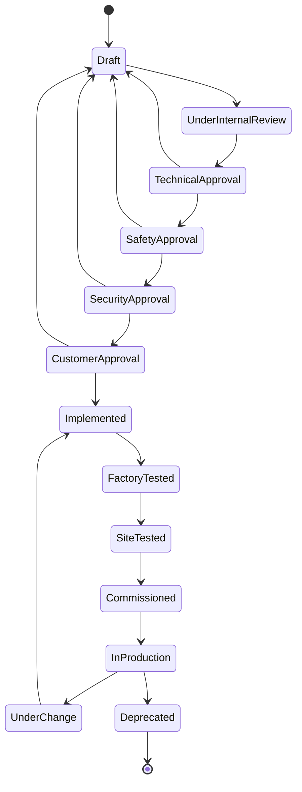

# IndustrialStyle — Typed Requirements for SIS, DCS, SCADA and OT Cybersecurity

> **From HAZOP to FAT without leaving `git`.** A typed Requirements DSL that encodes IEC 61508, IEC 61511, IEC 62443, ISA-88, ISA-95, ISA-18.2 and 21 CFR Part 11 as code — not as Excel.

`@frenchexdev2/requirements` is an open-source, type-safe Requirements DSL. Its **IndustrialStyle** preset is purpose-built for factory automation, process control, power utility automation, and OT cybersecurity projects delivered by systems integrators (Schneider Electric, Siemens, Rockwell, ABB, Honeywell, Yokogawa, Emerson) and consumed by regulated end customers (pharma, oil & gas, water, power, auto, food).

It replaces the URS-Word / HAZOP-Excel / FAT-PDF mosaic with one typed, git-native, machine-checkable artefact — and gates your CI pipeline on it.

---

## Who it's for

- **Principal engineers at systems integrators** assembling FAT packages and chasing down URS deltas across 40 Word documents the week before a customer witness test.
- **Functional safety engineers** translating HAZOP findings and LOPA scenarios into SIFs, SILs and proof-test schedules — and justifying the route to the TÜV assessor.
- **OT cybersecurity officers** mapping IEC 62443 zones and conduits to countermeasures, then proving SL-T achievement to an internal auditor with nothing but PDFs.
- **PLC, batch and SCADA software engineers** working against IEC 61131-3 codebases, writing ST/FBD for interlocks they first read in an Excel cell.
- **Validation leads in pharma / food** preparing GAMP 5 + 21 CFR Part 11 audit trails, managing electronic signatures and MoC dossiers by hand.
- **OEM machine builders** assembling CE / UL / ATEX / IECEx technical files whose requirements section is a narrative paragraph no generator can read.

If your last project burned two engineer-weeks to reconcile a URS revision against a FAT protocol, this document is for you.

---

## The problem

Industrial software engineering has a requirements-traceability problem that the IT industry solved a decade ago and never shared.

A typical SIS + DCS + SCADA project for a mid-size fired heater accumulates, before a single line of IEC 61131-3 is written:

- A **User Requirement Specification** (URS) — Word, 180 pages, revision B.
- A **Functional Requirement Specification** (FRS) and **Functional Design Specification** (FDS) — each 250 pages, written by the integrator, reviewed by the customer.
- A **HAZOP report** — Excel, 1 400 rows, nodes N-01 to N-47, each row a deviation (no flow / reverse flow / more pressure) with recommendations.
- A **LOPA worksheet** — another Excel, one row per scenario, columns for initiating event, enabling conditions, IPLs, target SIL.
- A **Safety Requirements Specification** (SRS) — IEC 61511-1 §10, 60 pages.
- A **Cause-and-Effect matrix** — a poster-size spreadsheet.
- An **Alarm Rationalisation Database** — ISA-18.2 compliant, sometimes in a dedicated tool (exSILentia, TiPS), often in Access.
- A **IEC 62443 threat model** — PDF, with a zone / conduit diagram in Visio and SL-T targets buried in a table.
- A **FAT protocol** and a **SAT protocol** — two more Word documents.
- An **MoC** (Management of Change) register, a **commissioning punch-list**, an **Acceptance Certificate**.

None of these talk to each other.

The HAZOP node that says *"XV-101 must close on low flow within 2 s, SIL 2"* appears — if you are lucky — in five places: HAZOP row, LOPA scenario, SRS §4.7, Cause-and-Effect entry, FAT test step 87. Each copy drifts independently. A customer raises a change in revision C of the URS and three documents silently diverge. The alarm rationalisation database lists 340 alarms; the HMI project has 380; nobody can tell whether the 40 extra are rationalised, duplicates, or forgotten legacy.

Come FAT, the witness engineer asks: *"show me the test that proves the XV-101 trip achieves its SIL 2 target and meets its 2 s response time."* Somebody opens three spreadsheets. Somebody else opens the FAT procedure PDF. The test exists, but the traceability link between HAZOP row, SRS requirement, SIF tag, proof-test procedure and FAT step is a chain of human memory and column references. One broken link and the witness refuses to sign.

Come IEC 62443 audit, the assessor asks: *"zone Level-2 Supervision has SL-T (2,2,2,1,2,1,2). Show me every requirement that derives from it and every countermeasure that implements it."* Nobody has that view. The zone diagram is in Visio. The countermeasures are in a firewall-rules spreadsheet. The requirements are in the SRS. No query is possible.

Come 21 CFR Part 11 inspection, the FDA inspector asks: *"show me the audit trail for requirement REQ-SIF-042 — every change, every signer, every reason."* Somebody opens the document change log tab.

The cost is not abstract: it is **FAT rework, SAT delays, liquidated damages, audit findings, and burnout**. Every integrator knows the pattern. Nobody has fixed it, because the traceability tools on the market are either **enterprise-priced and cloud-hosted** (jarring for OT teams), **text-only with no typing** (ReqIF on Excel), or **vendor-locked** (DOORS, Jama, Polarion). None of them encode the standards themselves — they are generic buckets.

**IndustrialStyle encodes the standards.** The types enforce IEC 61508 SIL levels. The validators refuse a Safety requirement without a SIL. The templates pre-fill SIF fields per IEC 61511. The lifecycle FSM has a SafetyApproval gate and a SecurityApproval gate because your project has them. The source kinds include `hazop`, `lopa`, `fmea`, `cybersecurity-threat` because your sources are exactly those.

And because it is a typed DSL in a `.spec.json` file next to your IEC 61131-3 project, it lives in `git`, is diffable, mergeable, reviewable — and auditable by `grep`.

---

## The standards lineage

Every rule in IndustrialStyle traces to a named clause of a named standard. Nothing is invented.

| Standard | Scope | What IndustrialStyle encodes |
|---|---|---|
| [IEC 61508](https://webstore.iec.ch/publication/5515) | Functional safety of E/E/PE systems | `risk.level` = SIL1–SIL4 / NonSIL; `verificationMethod` SILProofTest & SILValidation; validator rule: Safety requirements must carry SIL1–4 |
| [IEC 61511](https://webstore.iec.ch/publication/24241) | Functional safety, process sector | `safety-function` statement pattern (action / demand / responseTime / silLevel / proofInterval); `sif-iec61511` template |
| [IEC 62443](https://www.iec.ch/blog/understanding-iec-62443) | Industrial automation & control security | `security-zone` statement pattern; `cybersecurity-threat` source kind (zone / threatId / slTarget); `cyber-zone-62443` template; `SecurityApproval` lifecycle state |
| IEC 61131-3 | PLC languages (ST, LD, FBD, SFC, IL) | Statement patterns expressed so they survive codegen to ST / FBD (future adapter) |
| IEC 61850 | Power utility automation | `Interoperability` requirementKind; `interoperability-opcua` template |
| [ISA-88](https://www.isa.org/standards-and-publications/isa-standards/isa-standards-committees/isa88) | Batch control | `batch-recipe-isa88` template; `batch-recipe-rule` rationale kind; `Traceability` kind for batch genealogy |
| [ISA-95](https://www.isa.org/standards-and-publications/isa-standards/isa-standards-committees/isa95) | Enterprise ↔ control integration | Purdue-level zone naming in `security-zone` slot hints |
| [ISA-18.2](https://www.isa.org/standards-and-publications/isa-standards/isa-standards-committees/isa18) | Alarm management | `alarm` statement pattern (tag / priority / condition / consequence / action / responseTime); `alarm-isa182` template; `alarm-rationalisation` rationale kind |
| ISO 13849 / IEC 62061 | Machinery safety (PL / SIL-machinery) | Same SIL taxonomy extended via custom Style pack for PL a–e |
| IEC 60204-1 / NAMUR NE | Electrical equipment / process recommendations | `vendor-recommendation` source kind; `best-practice` rationale kind |
| [21 CFR Part 11](https://www.fda.gov/regulations-laws-enforcement/part-11-electronic-records-electronic-signatures) | FDA electronic records | `gxp-21cfr11` template; Audit verification method; tamper-evident HistoryEntry log |
| [GAMP 5](https://ispe.org/publications/guidance-documents/gamp-5-guide-2nd-edition) | GxP validation | Regulatory kind validator: must cite a standard/regulation source |

If your deliverable has to survive a HAZOP review, a TÜV route validation, a 62443 security assessment or an FDA inspection, every one of these rows matters. IndustrialStyle bakes them into the type system.

---

## The heavy-gate lifecycle

Every status transition is auditable. The lifecycle mirrors what an integrator actually executes: an internal technical review, a functional-safety sign-off, a cybersecurity sign-off, a customer sign-off, implementation, FAT, SAT, commissioning, hand-over to production, and — crucially — MoC rework loops.



Why every state is auditable:

- **Draft / UnderInternalReview** — the integrator's internal desk check before external eyes.
- **TechnicalApproval** — lead engineer signs technical adequacy.
- **SafetyApproval** — the functional-safety manager signs per IEC 61508/61511 CSM. Without this gate, no SIF moves forward.
- **SecurityApproval** — the CSMS owner signs per IEC 62443. Until 2018 this gate did not exist; in 2026 it is non-negotiable.
- **CustomerApproval** — the URS/FRS/FDS is jointly agreed. A SIF cannot be implemented without it.
- **Implemented / FactoryTested / SiteTested / Commissioned / InProduction** — the physical-world gates, each producing artefacts.
- **UnderChange** — the MoC gate: every field change re-enters implementation with a full audit trail.
- **Deprecated** — end-of-life, retained for records.

Rework loops (`TechnicalApproval → Draft`, etc.) are explicit because they happen — and the HistoryEntry log records *why*.

---

## Statement patterns beyond EARS

IndustrialStyle keeps the five EARS patterns (Mavin et al., [alistairmavin.com/ears](https://alistairmavin.com/ears/)) engineers already know, and adds four industrial-native patterns.

### EARS (quick reference)

- **ubiquitous** — `The system shall {response}.`
- **event-driven** — `When {trigger}, the system shall {response}.`
- **state-driven** — `While {state}, the system shall {response}.`
- **optional** — `Where {feature}, the system shall {response}.`
- **unwanted** — `If {trigger}, then the system shall {response}.`

### `safety-function` — IEC 61511 SIF

Every Safety Instrumented Function fits one template. Worked example: trip of a fired heater on low fuel-gas flow.

```typescript
import { Feature, Priority, type ACResult } from '@frenchexdev2/requirements';

export abstract class HeaterTripFeature extends Feature {
  readonly id = 'SIF-042';
  readonly title = 'Fired heater trip on low fuel-gas flow';
  readonly priority = Priority.Critical;

  abstract trippedWithinTwoSecondsOfLowFlow(): ACResult;
  abstract proofTestedAnnually(): ACResult;
  abstract maintainsSIL2UnderDemand(): ACResult;
}
```

The underlying typed spec:

```json
{
  "kind": "requirement",
  "id": "SIF-042",
  "title": "Fired heater trip on low fuel-gas flow",
  "requirementKind": "Safety",
  "priority": "Critical",
  "status": "SafetyApproval",
  "risk": { "level": "SIL2", "ifNotMet": "Loss of containment, possible burner explosion" },
  "verificationMethod": "SILProofTest",
  "statement": {
    "pattern": "safety-function",
    "action": "close XV-101 fuel-gas isolation valve",
    "demand": "FT-101 reads < 0.2 kg/s for > 3 s (2oo3)",
    "responseTime": "2 s",
    "silLevel": "SIL2",
    "proofInterval": "12 months"
  }
}
```

Rendered Markdown (for the FAT binder):

```markdown
# SIF-042 — Fired heater trip on low fuel-gas flow

| Field | Value |
|---|---|
| Kind | Safety |
| SIL / Risk | SIL2 |
| Priority | Critical |
| Status | SafetyApproval |
| Verification method | SILProofTest |
| Source | hazop (study=HAZOP-2025-REF-C, node=N-12, deviation=no flow, date=2025-11-04) |

## Statement

> The safety function shall close XV-101 fuel-gas isolation valve upon FT-101 reads < 0.2 kg/s for > 3 s (2oo3) within 2 s, achieving SIL2 with proof-test interval 12 months.

**If not met**: Loss of containment, possible burner explosion
```

### `interlock` — non-SIL protective function

```json
{
  "statement": {
    "pattern": "interlock",
    "id": "IL-42",
    "condition": "TT-201 > 180 °C AND PT-201 > 8 bar",
    "action": "inhibit start command on P-201 feed pump",
    "bypassRule": "key-switched, logged, 8 h auto-timeout"
  }
}
```

Renders as: *Interlock IL-42: when TT-201 > 180 °C AND PT-201 > 8 bar, the system shall inhibit start command on P-201 feed pump; bypass key-switched, logged, 8 h auto-timeout.*

### `alarm` — ISA-18.2

```json
{
  "statement": {
    "pattern": "alarm",
    "tag": "PAH-101",
    "priority": "High",
    "condition": "PT-101 > 9.5 bar",
    "consequence": "Relief valve lift within 30 s if unaddressed",
    "action": "Reduce feed via HC-102 to below 80%",
    "responseTime": "60 s"
  }
}
```

Renders as: *Alarm PAH-101 at High shall annunciate when PT-101 > 9.5 bar, with consequence Relief valve lift within 30 s if unaddressed and required operator action Reduce feed via HC-102 to below 80% within 60 s.*

### `security-zone` — IEC 62443-3-3

```json
{
  "requirementKind": "Security",
  "statement": {
    "pattern": "security-zone",
    "zone": "Level 2 Supervision",
    "slTarget": "(2,2,2,1,2,1,2)",
    "requirement": "SR 1.1 — Human user identification and authentication",
    "conduit": "L2↔L3 DMZ conduit",
    "countermeasure": "Active Directory + MFA, enforced at next-gen firewall"
  }
}
```

### `natural` — brownfield fallback

Available for legacy imports; raises a validator warning. Use it to onboard a 10-year-old SRS, then refactor.

---

## Sources typed for auditors

Ten sourceKinds, each with typed slots. No more "source: see Excel sheet tab 3."

| kind | slots | Example fill |
|---|---|---|
| `iec-standard` | id, section, edition | `id=61511-1, section=§10.3.2, edition=2016` |
| `iso-standard` | id, section | `id=13849-1, section=§4.5.2` |
| `isa-standard` | id | `id=18.2-2016` |
| `regulation` | jurisdiction, act, article | `jurisdiction=EU, act=Machinery Directive 2006/42/EC, article=Annex I §1.2.1` |
| `customer-urs` | docId, section, revision | `docId=URS-SCH-PROJ-204, section=§4.7, revision=B` |
| `hazop` | study, node, deviation, date | `study=HAZOP-2025-REF-C, node=N-12, deviation="no flow", date=2025-11-04` |
| `lopa` | study, scenario, iplCount | `study=LOPA-SIF-042, scenario="loss of containment — fired heater", iplCount=3` |
| `fmea` | study, failureMode, rpnBefore | `study=FMEA-Pump-P201, failureMode="seal leak", rpnBefore=240` |
| `cybersecurity-threat` | zone, threatId, slTarget | `zone="Level 2 Supervision", threatId=T-L2-003, slTarget="(2,2,2,1,2,1,2)"` |
| `incident` | incidentId, date, reportUrl | `incidentId=INC-2024-087, date=2024-06-12, reportUrl=https://…` |
| `vendor-recommendation` | vendor, documentId | `vendor=NAMUR, documentId=NE 107` |

Every requirement points back to its origin. An auditor can walk the chain in one `grep`.

---

## What the validators enforce

IndustrialStyle ships three load-bearing invariants on top of the default shape checks. They fail your CI pipeline — not a lint report.

1. **Safety requires SIL 1–4.** If `requirementKind = "Safety"` and `risk.level` is not one of `SIL1 / SIL2 / SIL3 / SIL4`, validation fails with *"Safety requirements must carry SIL1-4 per IEC 61508"*. You cannot ship a Safety requirement tagged `NonSIL`. This catches the single most common drafting mistake: a SIF whose LOPA was never run.
2. **`safety-function` requires a SIL verification method.** If `statement.pattern = "safety-function"`, then `verificationMethod` must be `SILProofTest`, `SILValidation`, or `Certification`. A SIF cannot be verified by a `UnitTest` alone. This enforces the IEC 61511-1 §12 verification route.
3. **Regulatory requirements must cite a standard or regulation.** If `requirementKind = "Regulatory"`, `source.type` must be one of `iec-standard / iso-standard / isa-standard / regulation`. A CE, ATEX or 21 CFR Part 11 requirement with a `stakeholder` source is rejected. The auditor will thank you.

These three rules are the difference between a requirements register that passes a desk check and one that passes a TÜV assessment.

---

## Templates — nine ready-to-instantiate skeletons

Run `requirement new --template <id>` and the wizard pre-fills kind, statement pattern, priority, fit criterion, rationale kind and verification method.

| id | When to use it |
|---|---|
| `sif-iec61511` | A SIL-rated SIS function: valve trip, motor stop, burner shutdown, ESD. |
| `process-interlock` | A protective function sized below the SIL threshold — good-practice safeguard. |
| `alarm-isa182` | An operator-actionable alarm with a rationalisation record. |
| `cyber-zone-62443` | A SL-T target for a 62443 zone, enforced via a conduit countermeasure. |
| `batch-recipe-isa88` | A recipe phase with equipment binding, parameters, completion criteria. |
| `availability-sla` | Uptime SLA with measurement window and degraded-mode behaviour. |
| `regulatory-ce-atex` | Certification-driven requirement with accredited-body verification. |
| `gxp-21cfr11` | Tamper-evident audit trail, electronic signature, access control. |
| `interoperability-opcua` | OPC UA / IEC 61850 protocol conformance + information-model binding. |

---

## End-to-end scenario — commissioning a SIS for a fired heater

A mid-size refinery, a Schneider integrator, a fired heater H-101. HAZOP ran three weeks ago. Node N-12 flagged *"no flow"* as the deviation. LOPA assessed the scenario as requiring SIL 2 with 3 IPLs.

### Step 1 — HAZOP finding enters the DSL

```bash
$ npx requirement new --style industrial --template sif-iec61511
```

Wizard transcript:

```
? Requirement id: SIF-042
? Title: Fired heater trip on low fuel-gas flow
? Priority [Critical]: <enter>
? Kind [Safety]: <enter>
? Statement pattern [safety-function]: <enter>
? action: close XV-101 fuel-gas isolation valve
? demand: FT-101 reads < 0.2 kg/s for > 3 s (2oo3)
? responseTime: 2 s
? silLevel [SIL1 SIL2 SIL3 SIL4]: SIL2
? proofInterval: 12 months
? Source kind [hazop]: <enter>
? hazop.study: HAZOP-2025-REF-C
? hazop.node: N-12
? hazop.deviation: no flow
? hazop.date: 2025-11-04
? risk.ifNotMet: Loss of containment, possible burner explosion
? verificationMethod [SILProofTest]: <enter>
  Wrote: requirements/specs/SIF-042.spec.json
```

### Step 2 — the generated `.spec.json`

```json
{
  "$schemaVersion": "2026-04-14",
  "$schema": "@frenchexdev2/requirements/styles/industrial/schema/1.0.0",
  "kind": "requirement",
  "id": "SIF-042",
  "title": "Fired heater trip on low fuel-gas flow",
  "requirementKind": "Safety",
  "priority": "Critical",
  "status": "Draft",
  "risk": {
    "level": "SIL2",
    "ifNotMet": "Loss of containment, possible burner explosion"
  },
  "verificationMethod": "SILProofTest",
  "statement": {
    "pattern": "safety-function",
    "action": "close XV-101 fuel-gas isolation valve",
    "demand": "FT-101 reads < 0.2 kg/s for > 3 s (2oo3)",
    "responseTime": "2 s",
    "silLevel": "SIL2",
    "proofInterval": "12 months"
  },
  "source": {
    "type": "hazop",
    "study": "HAZOP-2025-REF-C",
    "node": "N-12",
    "deviation": "no flow",
    "date": "2025-11-04"
  },
  "rationale": {
    "kind": "hazard-analysis",
    "summary": "LOPA-SIF-042 scenario 'loss of containment' requires SIL2 with 3 IPLs."
  },
  "history": []
}
```

### Step 3 — the Feature class

```typescript
import { Feature, Priority, TestLevel, type ACResult } from '@frenchexdev2/requirements';

export abstract class HeaterTripFeature extends Feature {
  readonly id = 'SIF-042';
  readonly title = 'Fired heater trip on low fuel-gas flow';
  readonly priority = Priority.Critical;

  abstract trippedWithinTwoSecondsOfLowFlow(): ACResult;
  abstract passesProofTestEveryTwelveMonths(): ACResult;
  abstract maintainsSIL2UnderDemand(): ACResult;
  abstract rejectsSpuriousLowFlowSignal(): ACResult;
}
```

A Feature **@Satisfies** one or more Requirements. The Feature decomposes the SIF into acceptance criteria a test engineer can write against.

### Step 4 — scaffolded tests

```bash
$ npx requirements scaffold test SIF-042
$ npx requirements scaffold e2e  SIF-042
```

Generates three test files (unit, HIL, SILProofTest procedure), each wired via `@FeatureTest` / `@Verifies`:

```typescript
@FeatureTest(HeaterTripFeature)
class HeaterTripHILTest extends HeaterTripFeature {
  @Verifies('trippedWithinTwoSecondsOfLowFlow')
  @Expects(TestLevel.E2E)
  trippedWithinTwoSecondsOfLowFlow(): ACResult {
    // HIL rig: inject FT-101 < 0.2 kg/s for > 3 s; measure XV-101 close time
    return { ok: true };
  }

  @Verifies('passesProofTestEveryTwelveMonths')
  @Expects(TestLevel.Perf)
  passesProofTestEveryTwelveMonths(): ACResult { /* procedure link */ return { ok: true }; }
}
```

### Step 5 — Markdown export for the FAT binder

```bash
$ npx requirements export --format md --out fat/SIF-042.md
```

Produces the Markdown shown earlier, suitable for inclusion in the FAT package.

### Step 6 — `compliance --strict` in CI

```bash
$ npx requirements compliance --strict
```

```
Feature SIF-042 — HeaterTripFeature
  trippedWithinTwoSecondsOfLowFlow      PASS  (HIL)
  passesProofTestEveryTwelveMonths      PASS  (procedure ref)
  maintainsSIL2UnderDemand              PASS  (SILValidation)
  rejectsSpuriousLowFlowSignal          MISSING  ← uncovered AC

Quality gate: FAIL (1 AC uncovered)
Exit code: 1
```

Your CI pipeline fails before the FAT witness arrives. You fix the gap, not the liquidated damages.

### Step 7 — 21 CFR Part 11 audit trail

Every status transition and every field change appends to `history`:

```json
"history": [
  { "at": "2025-11-05T09:14:02Z", "from": "Draft", "to": "UnderInternalReview",
    "by": "j.martin@integrator.com", "reason": "Desk check" },
  { "at": "2025-11-08T16:02:11Z", "from": "SafetyApproval", "to": "Draft",
    "by": "e.berger@integrator.com", "reason": "SIL LOPA re-run — target changed from SIL1 to SIL2" },
  { "at": "2025-11-10T11:40:00Z", "from": "Draft", "to": "SafetyApproval",
    "by": "e.berger@integrator.com", "reason": "Revised per LOPA-SIF-042 rev 2" }
]
```

Append-only, git-signed, inspector-ready.

---

## Commercial proposition — why this sells to Schneider

**The integrator economics.** A principal engineer costs ~€800/day. A FAT rework loop — the kind triggered by an uncovered SIF AC discovered in front of a customer witness — costs 2–5 engineer-weeks of schedule, plus customer goodwill. IndustrialStyle catches uncovered ACs in the CI pipeline, not on the FAT floor. One avoided rework loop per project pays for an enterprise-wide deployment.

**Replaces Excel traceability matrices with a version-controllable typed DSL.** The current state of the art in most integrator shops is a hand-maintained cross-reference spreadsheet. It is always out of date. IndustrialStyle makes traceability a build artefact: `requirements compliance` produces the matrix from source. If the matrix is wrong, the build fails.

**Integrates with EcoStruxure, Control Expert, Unity Pro.** The roadmap includes an IEC 61131-3 codegen adapter: a `safety-function` requirement generates a Structured Text skeleton with the demand logic, the trip action, the proof-test hook, and the instrumentation tags already wired. Engineers still write the real logic — but the envelope is generated, and the tags match the requirement by construction. This is the single biggest lever for cross-project consistency across a Schneider portfolio.

**IEC 62443 zone-conduit mapping as typed code, not PDF.** Every `security-zone` requirement carries its SL-T vector, its conduit, its countermeasure. A `zone-conduit` exporter (roadmap) generates the Visio-equivalent diagram and the conformance report the CSMS auditor asks for.

**21 CFR Part 11 compliance.** Append-only HistoryEntry log. Cryptographic signability (via git commit signing today, dedicated electronic-signature adapter on the roadmap). Tamper-evident by construction. For Schneider's pharma customers, this converts a manual process into a pipeline artefact.

**Export to client formats.** Word, PDF, ReqIF adapters on the roadmap. The customer still gets the deliverables they ask for — the integrator no longer maintains them by hand.

**Licensing model suggestion.** MIT open-source core (the `@frenchexdev2/requirements` package + IndustrialStyle) to drive adoption. **IndustrialStyle Pro** as a paid add-on: FAT/SAT template packs, customer-URS importer, IEC 61131-3 codegen adapter, ReqIF exporter, cryptographic signature adapter. Per-seat for engineers; per-project runtime for CI; optional Schneider-branded adapter pack bundled with EcoStruxure Automation Expert.

**Differentiation vs DOORS / Jama / Polarion.** They are SaaS or Windows-locked, per-seat €2–5k/year, opaque to `git`, and generic across industries. IndustrialStyle is git-native, typed, open-source-core, Style-extensible. An engineer clones a repo and works offline in Vim if they want. The tooling speaks the same language as their IEC 61131-3 project, not a separate enterprise silo.

---

## Comparison: IndustrialStyle vs alternatives

| | git-native | typed machine-readable | IEC 61508 native | IEC 62443 native | Price | Vendor lock-in | Audit-trail OOTB |
|---|---|---|---|---|---|---|---|
| IBM Rational DOORS | no | partial | no (generic) | no | €€€€ | high | partial |
| Jama Connect | no (SaaS) | partial | no | no | €€€ | high | yes (SaaS) |
| Siemens Polarion | no | partial | no | no | €€€ | high (Siemens) | yes |
| ReqIF + Excel | yes (text) | no | no | no | € | none | no |
| **IndustrialStyle** | **yes** | **yes** | **yes** | **yes** | **free core + paid Pro** | **none (MIT)** | **yes (git + HistoryEntry)** |

---

## Adoption path

Three tiers, no big-bang migration required.

1. **Individual engineer** — `pnpm add @frenchexdev2/requirements`, run `requirement new --style industrial --template sif-iec61511` against one HAZOP finding. Commit the `.spec.json` to the project repo. Fifteen minutes.
2. **Project team** — commit every requirement as a `.spec.json`, wire `npx requirements compliance --strict` into your CI pipeline (GitLab CI, Jenkins, Azure DevOps — it's a CLI, it runs anywhere). Fail the pipeline on uncovered ACs. One sprint.
3. **Enterprise** — adopt IndustrialStyle as the integrator-wide standard. Extend with company-specific adapters: FAT protocol template pack, customer-URS importer (parse Word, emit `.spec.json`), site-specific validator rules. One quarter, one dedicated platform engineer.

---

## Roadmap — what a Schneider partnership unlocks

- **EcoStruxure / Unity Pro / Control Expert codegen** — emit IEC 61131-3 Structured Text skeletons from `safety-function` and `interlock` requirements. Trip logic, proof-test hooks, tag-matching by construction.
- **62443 zone / conduit diagram exporter** — render Visio-equivalent SVG + conformance report from `security-zone` requirements.
- **ATEX / UL / IECEx certification package assembly** — collate all `Regulatory` requirements into an accredited-body-ready technical file.
- **SIL calculation integration** — bind `safety-function` requirements to FMEDA data, auto-compute PFDavg, flag proof-test interval violations.
- **Process hazard review workflow** — HAZOP → LOPA → SRS import/export round-trip, keeping the `.spec.json` as source of truth.
- **ReqIF + Word + PDF exporters** — customer-deliverable formats without hand rework.
- **Electronic signature adapter** — X.509 / eIDAS-compliant signing on status transitions for 21 CFR Part 11.

---

## Getting started (3 steps)

```bash
# 1. Install
pnpm add @frenchexdev2/requirements

# 2. Create your first SIF from a HAZOP finding
npx requirement new --style industrial --template sif-iec61511

# 3. Gate your CI on coverage
npx requirements compliance --strict
```

That's it. The `.spec.json` lives in your repo, next to your IEC 61131-3 project. The Features live in `requirements/features/`. The tests bind via `@FeatureTest` / `@Verifies`. The compliance report is a pipeline artefact.

---

## License + support

- **Core (`@frenchexdev2/requirements` + IndustrialStyle)** — MIT. Free forever, audit the source, fork if you must.
- **IndustrialStyle Pro** *(roadmap)* — commercial adapter pack: FAT/SAT templates, IEC 61131-3 codegen, 62443 diagram exporter, ReqIF / Word / PDF exporters, electronic-signature adapter. Per-seat + per-project runtime.
- **Enterprise support** *(roadmap)* — SLA, on-site training for integrator teams (2-day bootcamp: HAZOP → `.spec.json` → FAT in a repo), custom Style packs for integrator-specific deliverable formats, audit support for TÜV / FDA / 62443 assessments.

For Schneider Electric, Siemens, Rockwell, ABB, Honeywell, Yokogawa, Emerson and their end customers: this is the requirements layer your integration teams already wrote, badly, a hundred times in Excel. We are offering it to you as typed, version-controlled, MIT-licensed code — with a commercial Pro tier you can co-brand.

**Contact**: Stéphane Erard — FrenchExDev — `@frenchexdev2/requirements` maintainer.

---

*IndustrialStyle v1.0.0 — `@frenchexdev2/requirements/styles/industrial`.
Schema: 2026-04-14. Standards coverage: IEC 61508, IEC 61511, IEC 62443, IEC 61131-3, IEC 61850, ISA-88, ISA-95, ISA-18.2, ISO 13849, IEC 62061, IEC 60204-1, NAMUR NE, 21 CFR Part 11, GAMP 5.*
