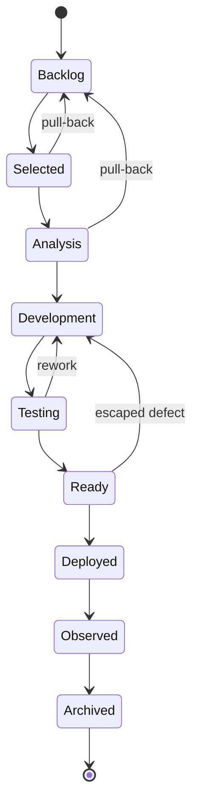
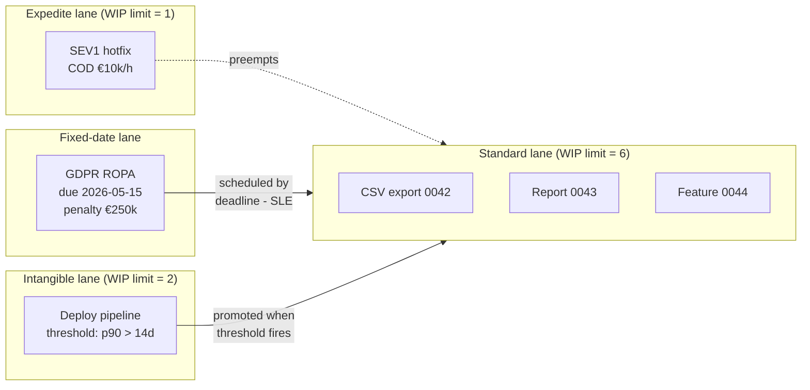

# KanbanStyle — Classes of Service as Types, Not Labels

> **Your board is lying to you.** Expedite pulls trample Standard flow without leaving a trace. FixedDate commitments sit buried in ticket descriptions as free-text due-dates. Intangible platform work never surfaces until the debt graph collapses. Your CFD looks healthy because you never told it what kind of work each ticket was. **KanbanStyle turns Anderson's Classes of Service into a typed, validated, git-native vocabulary — so your policies live in code, your flow metrics link to intent, and your discipline is mechanically enforced.**

The `KanbanStyle` preset for `@frenchexdev2/requirements` is a flow-driven requirements ontology derived from David J. Anderson's *Kanban* (2010). It ships the six Classes of Service, a nine-state workflow with escaped-defect rework loops, a cost-of-delay risk taxonomy, seven flow-aware verification methods, eight source kinds tied to real operational artifacts (CFDs, lead-time distributions, ops incidents, customer SLAs), and six templates covering the complete Class-of-Service palette. Validators enforce the four Kanban disciplines most boards leave tacit: Expedite must carry a quantified COD, FixedDate must carry a deadline, Intangible must carry a promotion threshold, and Standard must cite flow evidence.

---

## Who it's for

| Persona | Pain today |
|---|---|
| **Delivery lead running a Kanban service team** | Every ticket is nominally equal on the board. Then someone screams "fire" and Expedite work leapfrogs the queue without policy, without trace, without COD — and the CFD still looks green. |
| **DevOps / SRE handling mixed incident + feature streams** | Incident pulls and feature pulls share the same lanes. Post-mortem asks "why did that SEV2 sit in Analysis for three days?" and the board has no typed answer. |
| **Service-oriented platform team (consulting, support, in-house)** | FixedDate regulatory commitments live as due-date strings in Jira. The penalty clause is in an email. Nothing cross-links commitment, SLA, and actual lead-time evidence. |
| **Team that bounced off Scrum** | You escaped sprint ceremony and now you want flow — but your tooling still thinks in Story Points and Velocity. Classes of Service aren't in the schema. |
| **Classes-of-Service practitioner** | You know Anderson cold. You want Expedite / FixedDate / Intangible as first-class typed artifacts with templates, validators, and schema-bound editor support — not as Jira labels your juniors forget to set. |
| **Manager tired of cumulative-flow dashboards that lie** | The CFD is disconnected from the intent of each work item. You cannot grep for "all Intangible work whose threshold triggered this quarter" because the schema doesn't know. |

If any of these hurt, this pitch is for you.

---

## The problem: a "Kanban" shop without typed Classes of Service

You run a Kanban team. You have a board. You have WIP limits. You even run monthly operational reviews. Yet every three months the same pattern repeats.

**Monday, 10:00.** An intake request comes in: a paying customer needs a new export format. It's pulled into Selected, moved to Analysis, then Development. It's "Standard" work — except nobody wrote that down, because on your board, all tickets are the same colour.

**Tuesday, 14:30.** A SEV1 incident lands. Payments are failing. Your senior dev drops the export work, pulls the incident, and ships a hotfix by 18:00. Brilliant response time. But: no record that this was an Expedite-class pull. No quantification of the cost of delay (was it $10k/hr? $100k/hr? Nobody wrote it down). No trace that the export ticket was **preempted**. The next CFD retrospective shows "a perfectly healthy week" because the lanes balance out.

**Wednesday, 09:00.** Legal emails: GDPR Article 30 record of processing must be delivered by May 15th or the company eats a €250k fine. Someone opens a Jira ticket titled "GDPR ROPA" with a due-date field populated. No class, no penalty captured, no SLE. Three weeks later the deadline slips by four days because the ticket wasn't **typed as FixedDate**.

**Thursday, 16:00.** Your platform engineer files a ticket: "rewrite the deployment pipeline — takes 22 minutes, should take 4." It goes into the backlog at Low priority. Ten months later, P90 lead-time has crossed 18 days because deployment congestion silently consumed the team's flow. The Intangible work never surfaced because **there was no promotion threshold**. Anderson's rule — intangibles must carry an explicit promotion rule — was never encoded.

**Friday, 11:00.** A defect escapes to production. The customer reports it. You pull it back, log it as "bug," send it through Development again. Your `statusHistory` shows it jumped from `Observed` straight to `Development`. Your reporting treats this as a *new* item. The fact that it's a **lifecycle reset** — a pulled-back defect traversing columns for the second time — is invisible to every metric you publish.

Meanwhile your leadership dashboard shows: "Throughput: 34 tickets/week. Lead time p85: 6.2 days. CFD: healthy."

**Every one of those numbers is true and none of them are useful**, because the board doesn't know what kind of work each ticket represents. Anderson's Classes of Service — the entire intellectual core of the Kanban Method — have been reduced to an optional Jira label nobody sets consistently. Your policies are in a Confluence page that was last edited in 2023. Your flow evidence sits in a CFD screenshot tooling emails you weekly, unlinked to any specific commitment. Your SLEs are aspirational, not typed claims.

This isn't a tooling problem you can fix with another plugin. It's an **ontology problem**. The types are missing.

---

## The Kanban intellectual lineage

KanbanStyle is not a new theory. It is a typed encoding of forty years of flow thinking.

- **David J. Anderson** — *[Kanban: Successful Evolutionary Change for Your Technology Business](https://www.amazon.com/dp/0984521402)* (Blue Hole Press, 2010). The canonical text. Introduces the six practices and the four Classes of Service (Standard / Expedite / FixedDate / Intangible). The Kanban Method's operational core.
- **Eliyahu M. Goldratt** — *[The Goal](https://www.amazon.com/dp/0884271951)* (North River Press, 1984). Theory of Constraints. Any system's throughput is set by its bottleneck; optimise anywhere else and you waste work. KanbanStyle's `flow-metric` and `blocked-ticket-report` source kinds make the bottleneck nameable.
- **W. Edwards Deming** — *[Out of the Crisis](https://www.amazon.com/dp/0262541157)* (MIT Press, 1986). The 14 Points; the PDSA cycle. Evolutionary improvement, evidence-based management, drive out fear. KanbanStyle's "Standard kind must cite flow evidence" validator is pure Deming.
- **John D.C. Little** — *A Proof for the Queuing Formula: L = λW* (Operations Research, 1961). Little's Law: WIP = Throughput × LeadTime. Three numbers, one identity, the empirical backbone of every meaningful flow claim. KanbanStyle's `flow-metric` slots — `metric`, `value`, `window` — track exactly these.
- **Don Reinertsen** — *[The Principles of Product Development Flow](https://www.amazon.com/dp/1935401009)* (Celeritas, 2009). Cost of Delay as the unit economic decision variable. "If you only quantify one thing, quantify the cost of delay." KanbanStyle's Expedite validator enforces a non-empty `cod` slot. No more implicit COD.
- **Anderson's Classes of Service** — the typed backbone: Expedite (drop-everything), FixedDate (hard deadline with penalty), Standard (FIFO / COD curve), Intangible (flat short-term, rising long-term, with promotion rule).
- **The 6 Kanban practices** — Visualise, Limit WIP, Manage flow, Make policies explicit, Implement feedback loops, Improve collaboratively. KanbanStyle directly serves practice #4 ("Make policies explicit"): **policies become validators**.

Why is Kanban a philosophical fit for a typed DSL? Because Anderson's artifacts are already typed in the prose — Class of Service, Service Level Expectation, Cost of Delay, Cumulative Flow Diagram, Lead-Time Distribution are **nouns with structure**, not free text. Most Kanban tooling throws that structure away at the schema boundary (Jira labels, Trello tags). KanbanStyle keeps it.

---

## What you get — the vocabulary

### `requirementKinds` — the six Classes of Service

| Kind | Anderson semantics |
|---|---|
| `Standard` | FIFO / cost-of-delay curve. Default flow. |
| `Expedite` | Drop everything. One in flight max (operational policy). |
| `FixedDate` | Hard deadline; penalty if missed. |
| `Intangible` | No immediate COD, matters long-term. **Must carry a promotion threshold.** |
| `LifeCycleReset` | Work that resets a cadence / refresh cycle. |
| `Defect` | Production defect pulled back into flow. |

### `statusWorkflow` — nine states with rework loops



Initial: `Backlog`. Terminal: `Archived`. Two rework loops (`Testing → Development`, `Ready → Development`) encode the escaped-defect reality most boards hide. Two pull-backs (`Selected → Backlog`, `Analysis → Backlog`) encode the honest "we shouldn't have pulled that yet."

### `riskTaxonomy` — five DelayHarm levels (the COD curve shape)

In Kanban, **risk is not a SIL level — it is the shape of the cost-of-delay curve.** A piece of work is "risky" when its COD curve is steep, not when it is "important."

| Level | Curve shape |
|---|---|
| `DelayHarmUrgent` | Steep, immediate — expedite territory |
| `DelayHarmFixedDate` | Step-function at the deadline |
| `DelayHarmLinear` | Classic linear cost of delay |
| `DelayHarmIntangible` | Flat short-term, rising long-term |
| `DelayHarmMinimal` | Near-zero COD |

Likelihood × impact matrix:

| likelihood ↓ / impact → | Severe | Moderate | Mild | None |
|---|---|---|---|---|
| **Imminent** | `DelayHarmUrgent` | `DelayHarmLinear` | — | — |
| **Soon** | `DelayHarmFixedDate` | `DelayHarmLinear` | — | — |
| **Eventual** | — | `DelayHarmIntangible` | `DelayHarmIntangible` | — |
| **Unlikely** | — | — | `DelayHarmMinimal` | `DelayHarmMinimal` |

### `verificationMethods` — flow-based evidence

| Method | Meaning |
|---|---|
| `LeadTimeWithinSLE` | p85 lead time ≤ the declared SLE |
| `DeployedToProduction` | Reached the `Deployed` column |
| `ObservedInProduction` | Post-deploy telemetry confirms behaviour |
| `BlockerCleared` | Expedite: the blocker is gone |
| `SlaMet` | Customer SLA target hit |
| `FlowMetricGreen` | WIP / age / throughput within policy |
| `CumulativeFlowHealthy` | CFD bands are parallel, no growing queues |

### `rationaleKinds`

`cost-of-delay` · `sla-commitment` · `blocking-other-work` · `customer-commitment` · `technical-dependency` · `flow-impediment` · `cumulative-flow-signal` · `lead-time-trend`

### `sourceKinds` — eight operational artifact types with typed slots

| Kind | Slots |
|---|---|
| `flow-metric` | `metric` (leadTime/throughput/wip/age), `value` (number), `window` (string) |
| `cumulative-flow-diagram` | `date` (iso-date), `capturedUrl` (url, optional), `anomaly` (string, optional) |
| `lead-time-distribution` | `percentile` (p50/p85/p95), `value` (days, number), `capturedAt` (iso-date) |
| `customer-sla` | `customer` (string), `sla` (e.g. "95% ≤ 5 business days"), `agreedAt` (iso-date) |
| `blocked-ticket-report` | `blockedTicketId` (string), `blockingReason` (string), `date` (iso-date) |
| `service-request` | `requester` (string), `channel` (intake board/email/incident), `date` (iso-date) |
| `operational-review` | `date` (iso-date), `facilitator` (string) |
| `ops-incident` | `incidentId` (string), `severity` (SEV1/SEV2/SEV3), `date` (iso-date) |

### `statementPatterns` — seven typed templates

| Pattern | Template | Required slots |
|---|---|---|
| `service-request` | `Deliverable: {outcome}. Customer: {customer}. Done when: {doneWhen}. Class of service: {cos}.` | `outcome`, `customer`, `doneWhen`, `cos` |
| `fixed-date-commitment` | `By {deadline}, the system shall {deliverable}. Penalty if missed: {penalty}.` | `deadline`, `deliverable`, `penalty` |
| `expedite-pull` | `Expedite pull: {work}. Blocking: {blocking}. Cost of delay: {cod}.` | `work`, `blocking`, `cod` |
| `intangible-investment` | `Intangible work: {work}. Long-term benefit: {benefit}. Threshold for surfacing as Standard: {threshold}.` | `work`, `benefit`, `threshold` |
| `defect-pull` | `Defect in {area}: {symptom}. Detected by {detection}. Reset lifecycle: {reset}.` | `area`, `symptom`, `detection`, `reset` |
| `sla-commitment` | `Service: {service}. Lead-time SLE: {p85} at 85th percentile. Class of service: {cos}.` | `service`, `p85`, `cos` |
| `natural` | `{text}` (fallback — generates warning) | `text` |

### Templates shipped — six skeletons

| Template id | Kind | Pattern | Priority | Rationale | Verification |
|---|---|---|---|---|---|
| `service-request-standard` | Standard | service-request | Medium | cost-of-delay | LeadTimeWithinSLE |
| `expedite-pull` | Expedite | expedite-pull | Critical | blocking-other-work | BlockerCleared |
| `fixed-date-delivery` | FixedDate | fixed-date-commitment | High | customer-commitment | SlaMet |
| `intangible-improvement` | Intangible | intangible-investment | Low | lead-time-trend | FlowMetricGreen |
| `defect-reset` | Defect | defect-pull | High | flow-impediment | DeployedToProduction |
| `sla-definition` | Standard | sla-commitment | High | sla-commitment | LeadTimeWithinSLE |

---

## A complete worked example: a mixed-class-of-service day

One team, one Tuesday-to-Friday slice, every Class of Service actually exercised. Every artifact below is a real `.spec.json` valid against `$schemaVersion = 2026-04-14`.

### Monday 09:00 — Standard service-request, pulled by the dev team

```bash
requirement new --style kanban --template service-request-standard
```

`.spec.json`:

```json
{
  "$schemaVersion": "2026-04-14",
  "kind": "requirement",
  "id": "REQ-EXPORT-CSV-0042",
  "title": "CSV export of invoice line-items for accounting team",
  "requirementKind": "Standard",
  "status": "Selected",
  "priority": "Medium",
  "verificationMethod": "LeadTimeWithinSLE",
  "statement": {
    "pattern": "service-request",
    "outcome": "Accounting can download a per-invoice CSV of line-items, UTF-8, semicolon-separated",
    "customer": "Accounting team (internal)",
    "doneWhen": "deployed to prod and validated by accounting lead on 2026-Q2 close",
    "cos": "Standard"
  },
  "source": {
    "type": "customer-sla",
    "customer": "Accounting (internal)",
    "sla": "95% ≤ 5 business days",
    "agreedAt": "2026-01-15"
  },
  "rationale": { "kind": "cost-of-delay", "text": "Monthly close delays each cost 0.5 FTE/day." }
}
```

`requirement show`:

```
[Standard] REQ-EXPORT-CSV-0042  CSV export of invoice line-items for accounting team
  column: Selected    priority: Medium
  verification: LeadTimeWithinSLE
  statement: Deliverable: Accounting can download a per-invoice CSV of line-items, UTF-8, semicolon-separated. Customer: Accounting team (internal). Done when: deployed to prod and validated by accounting lead on 2026-Q2 close. Class of service: Standard.
```

Rendered ticket card:

```markdown
# [Standard] REQ-EXPORT-CSV-0042 — CSV export of invoice line-items for accounting team

`Selected` · priority: Medium · verification: LeadTimeWithinSLE

## Statement

> Deliverable: Accounting can download a per-invoice CSV of line-items, UTF-8, semicolon-separated. Customer: Accounting team (internal). Done when: deployed to prod and validated by accounting lead on 2026-Q2 close. Class of service: Standard.
```

### Tuesday 10:30 — Expedite pull from a SEV1 ops-incident

```bash
requirement new --style kanban --template expedite-pull
```

```json
{
  "$schemaVersion": "2026-04-14",
  "kind": "requirement",
  "id": "REQ-PAY-HOTFIX-0001",
  "title": "Restore 3-D Secure challenge flow for EU cardholders",
  "requirementKind": "Expedite",
  "status": "Development",
  "priority": "Critical",
  "verificationMethod": "BlockerCleared",
  "statement": {
    "pattern": "expedite-pull",
    "work": "Restore 3-D Secure challenge for EU Visa/Mastercard cardholders after TLS-cipher rotation",
    "blocking": "all payments through the EU acquirer — 100% revenue impact on EU checkout",
    "cod": "~€10 000 / hour revenue loss (measured from incident INC-2026-0417 dashboard, p50 hourly EU checkout)"
  },
  "source": {
    "type": "ops-incident",
    "incidentId": "INC-2026-0417",
    "severity": "SEV1",
    "date": "2026-04-14"
  },
  "risk": { "level": "DelayHarmUrgent" },
  "rationale": { "kind": "blocking-other-work", "text": "Every Standard item in flight is now effectively frozen for EU revenue." }
}
```

Rendered ticket card:

```markdown
# [Expedite] REQ-PAY-HOTFIX-0001 — Restore 3-D Secure challenge flow for EU cardholders

`Development` · priority: Critical · verification: BlockerCleared

**Cost of delay**: ~€10 000 / hour revenue loss (measured from incident INC-2026-0417 dashboard, p50 hourly EU checkout)
**Blocking**: all payments through the EU acquirer — 100% revenue impact on EU checkout

## Statement

> Expedite pull: Restore 3-D Secure challenge for EU Visa/Mastercard cardholders after TLS-cipher rotation. Blocking: all payments through the EU acquirer — 100% revenue impact on EU checkout. Cost of delay: ~€10 000 / hour revenue loss (measured from incident INC-2026-0417 dashboard, p50 hourly EU checkout).

**Delay profile**: DelayHarmUrgent
```

The **COD is a typed, non-empty string**. The validator rejected the first draft (which just said "high impact") and forced the quantification. That quantification now lives in git, forever, linkable from the post-mortem.

### Tuesday 14:00 — FixedDate regulatory commitment

```bash
requirement new --style kanban --template fixed-date-delivery
```

```json
{
  "$schemaVersion": "2026-04-14",
  "kind": "requirement",
  "id": "REQ-GDPR-ROPA-0001",
  "title": "GDPR Article 30 Record of Processing Activities — annual refresh",
  "requirementKind": "FixedDate",
  "status": "Analysis",
  "priority": "High",
  "verificationMethod": "SlaMet",
  "statement": {
    "pattern": "fixed-date-commitment",
    "deadline": "2026-05-15",
    "deliverable": "publish the updated ROPA covering the 2025-04 → 2026-04 period to the DPO shared drive and notify the CNIL contact",
    "penalty": "EUR 250 000 administrative fine (CNIL simplified procedure, second offence scale)"
  },
  "source": {
    "type": "customer-sla",
    "customer": "DPO / CNIL",
    "sla": "ROPA updated within 12 months rolling",
    "agreedAt": "2025-04-15"
  },
  "risk": { "level": "DelayHarmFixedDate" }
}
```

Rendered:

```markdown
# [FixedDate] REQ-GDPR-ROPA-0001 — GDPR Article 30 Record of Processing Activities — annual refresh

`Analysis` · priority: High · verification: SlaMet

**Due**: 2026-05-15
**Penalty if missed**: EUR 250 000 administrative fine (CNIL simplified procedure, second offence scale)

## Statement

> By 2026-05-15, the system shall publish the updated ROPA covering the 2025-04 → 2026-04 period to the DPO shared drive and notify the CNIL contact. Penalty if missed: EUR 250 000 administrative fine (CNIL simplified procedure, second offence scale).

**Delay profile**: DelayHarmFixedDate
```

### Wednesday — Intangible platform investment, with promotion threshold

```bash
requirement new --style kanban --template intangible-improvement
```

```json
{
  "$schemaVersion": "2026-04-14",
  "kind": "requirement",
  "id": "REQ-CI-DEPLOY-PIPELINE-0003",
  "title": "Parallelise deploy pipeline stages (build / test / publish)",
  "requirementKind": "Intangible",
  "status": "Backlog",
  "priority": "Low",
  "verificationMethod": "FlowMetricGreen",
  "statement": {
    "pattern": "intangible-investment",
    "work": "Rewrite deploy pipeline to run build / test / publish stages in parallel",
    "benefit": "Cut deploy wall-clock from ~22 min to ~4 min; reduce context-switch cost on every Standard pull.",
    "threshold": "Promote to Standard when p90 lead-time > 14 days sustained for 2 consecutive weeks (measured from lead-time-distribution source at p90)"
  },
  "source": {
    "type": "lead-time-distribution",
    "percentile": "p90",
    "value": 12.8,
    "capturedAt": "2026-04-10"
  },
  "risk": { "level": "DelayHarmIntangible" }
}
```

The threshold is **not a Confluence wish**. It is a typed string in the spec. When the `lead-time-distribution` source next reports p90 > 14d two weeks running, a daily `compliance` run can surface this as "promotable."

### Thursday — Defect pull from Observed, lifecycle reset

```bash
requirement new --style kanban --template defect-reset
```

```json
{
  "$schemaVersion": "2026-04-14",
  "kind": "requirement",
  "id": "REQ-INV-LINE-ROUND-0007",
  "title": "Invoice line rounding drifts by 1 cent for VAT-inclusive imports",
  "requirementKind": "Defect",
  "status": "Development",
  "priority": "High",
  "verificationMethod": "DeployedToProduction",
  "statement": {
    "pattern": "defect-pull",
    "area": "Invoicing / VAT-inclusive line rounding",
    "symptom": "Line total differs by 1 cent vs. customer-ordered total when shop is configured VAT-inclusive and quantity > 1",
    "detection": "customer ticket #CS-88219 (external), reproduced in staging by QA",
    "reset": "re-enters Development and Testing; regression test suite updated before Ready"
  },
  "source": {
    "type": "service-request",
    "requester": "Support (customer CS-88219)",
    "channel": "incident",
    "date": "2026-04-13"
  },
  "rationale": { "kind": "flow-impediment", "text": "Escaped defect — rework loop Testing→Development engaged." }
}
```

The `reset` slot makes the lifecycle-reset nature of this work **typed**: metrics can distinguish first-pass Development time from rework time without guessing.

---

## What the validators enforce

Four disciplines that most Kanban boards leave tacit. KanbanStyle makes them **mechanical**.

```typescript
// DISCIPLINE 1: Expedite must carry quantified Cost of Delay.
if (s.requirementKind === 'Expedite') {
  if (statement?.pattern !== 'expedite-pull') errors.push(/* pattern required */);
  else if (typeof statement.cod !== 'string' || (statement.cod as string).length === 0)
    errors.push({ path: 'statement.cod',
      message: 'Expedite kind requires a non-empty cost-of-delay (cod) slot' });
}

// DISCIPLINE 2: FixedDate must carry a non-empty deadline.
if (s.requirementKind === 'FixedDate') {
  if (statement?.pattern !== 'fixed-date-commitment') errors.push(/* pattern required */);
  else if (typeof statement.deadline !== 'string' || (statement.deadline as string).length === 0)
    errors.push({ path: 'statement.deadline',
      message: 'FixedDate kind requires a non-empty deadline slot' });
}

// DISCIPLINE 3 (Anderson): Intangibles must carry an explicit promotion threshold.
if (s.requirementKind === 'Intangible') {
  if (statement?.pattern !== 'intangible-investment') errors.push(/* pattern required */);
  else if (typeof statement.threshold !== 'string' || (statement.threshold as string).length === 0)
    errors.push({ path: 'statement.threshold',
      message: 'Intangible kind requires an explicit promotion threshold (Anderson rule)' });
}

// DISCIPLINE 4: Standard must cite flow-driven evidence.
if (s.requirementKind === 'Standard') {
  const flowSources = ['flow-metric', 'cumulative-flow-diagram',
                       'lead-time-distribution', 'customer-sla'];
  if (!t || !flowSources.includes(t)) errors.push({ path: 'source.type',
      message: `Standard kind should cite a flow-driven source (${flowSources.join(', ')})` });
}
```

Each rule is **one thing most teams pay lip service to, now mechanically blocked at commit time.**

- **Expedite → COD explicit.** Reinertsen 2009: "If you only quantify one thing, quantify COD." Now it's not optional.
- **FixedDate → deadline explicit.** The deadline is a structured slot, not a sentence inside a paragraph. The renderer surfaces it in bold above the fold.
- **Intangible → promotion threshold explicit.** Anderson's rule: intangible work without a promotion rule is technical debt in disguise. The validator enforces his rule directly.
- **Standard → flow evidence.** Deming's PDSA: drive decisions from measured flow, not anecdote. Standard items must cite one of `flow-metric`, `cumulative-flow-diagram`, `lead-time-distribution`, or `customer-sla`.

---

## Classes of Service in action



**Expedite** bypasses the Standard WIP limit (classic Anderson: one slot always reserved, taken only when truly warranted — "blast radius" of Expedite abuse is the entire Standard flow, which is why COD quantification is mandatory). **FixedDate** is scheduled by the team working backwards from `deadline - SLE(p85)`. **Standard** flows FIFO under the cost-of-delay curve. **Intangible** is pulled only when capacity allows, promoted to Standard when its typed `threshold` fires.

---

## Flow metrics integration

The eight source kinds let typed evidence flow through the system.

- **`flow-metric`** carries `metric` (`leadTime | throughput | wip | age`), a numeric `value`, and a `window`. You can grep all requirements whose Standard pull was justified by a `throughput` decline last quarter:

  ```bash
  jq 'select(.source.type == "flow-metric" and .source.metric == "throughput")' \
    requirements/*.spec.json
  ```

- **`cumulative-flow-diagram`** captures a dated snapshot URL plus an optional `anomaly` tag ("Development band widening"). CFDs are now linkable artefacts, not email attachments.

- **`lead-time-distribution`** carries `percentile` (`p50` / `p85` / `p95`) and `value` in days. This is the basis for every SLE claim — `sla-commitment` statements with `p85` correspond to a `lead-time-distribution` source at p85.

- **`blocked-ticket-report`** links `blockingReason` to Standard items that stalled. The blocker graph becomes queryable.

- **`ops-incident`** and **`service-request`** seed Expedite and Standard pulls with provenance (incident ID, requester, channel).

Every flow decision now leaves a **typed audit trail**.

---

## Integrations

- **VS Code schema binding.** `requirements/*.spec.json` binds to the KanbanStyle JSON Schema; completion, validation, and hover docs for every slot, every kind, every pattern.
- **`requirement compliance --strict`.** CI gate. Fails on: Expedite without COD; FixedDate without deadline; FixedDate without `penalty`; Intangible without `threshold`; Standard without flow-driven source. Wire it into `test:all` and the board cannot drift from policy.
- **Lead-time / throughput adapter** *(future)*. Consumes a CFD dashboard feed and fills `lead-time-distribution` and `flow-metric` sources automatically from live data.
- **Jira / Linear ingestion** *(future, Tier 2)*. Infer Class of Service from existing labels (`expedite`, `sev1`, `deadline`, `tech-debt`) and generate `.spec.json` drafts for review.
- **Grafana dashboard JSON** *(future)*. Auto-generate a CFD + lead-time distribution + throughput dashboard from the requirements stream — every panel backlinked to the requirement it measures.

---

## Comparison: KanbanStyle vs alternatives

| Tool | Typed CoS | Explicit policies | Flow-evidence links | Git-native | Open-source | SLE-native |
|---|---|---|---|---|---|---|
| Jira (Kanban board) | No (label) | Ad-hoc per project | No | No | No | No |
| LeanKit | Yes (proprietary) | Built-in | Partial | No | No | Yes |
| Azure Boards | No | No | Poor analytics | No | No | No |
| Trello | No | No | No | No | No | No |
| Linear | No (label) | No | No | Partial | No | No |
| Spreadsheet + CFD | Free | Free | Manual | Yes (csv) | Yes | Manual |
| **KanbanStyle** | **Yes (6 kinds)** | **Validators** | **8 source kinds** | **Yes** | **MIT** | **Yes (p85)** |

KanbanStyle is the only option that combines **typed Classes of Service + validators enforcing Anderson's rules + git-native storage + flow-source traceability** in a single open-source DSL.

---

## Adoption path

- **Individual.** Install `@frenchexdev2/requirements`. Pick your next 10 tickets. Run `requirement new --style kanban --template <id>` for each. Notice that you now *know* how many Expedite pulls you did last week.
- **Team.** Commit `requirements/` to the repo. Wire `requirement compliance --strict` into CI. Make the four disciplines mechanical. Your operational-review sessions now open with "show me all Intangibles whose threshold tripped."
- **Organisation.** Use `@Refines` to chain team-level Standards into program-level FixedDate commitments. Aggregate `flow-metric` sources across teams for an org-level CFD with typed provenance.

---

## Getting started (3 steps)

```bash
# 1. Install the package
npm install @frenchexdev2/requirements

# 2. Scaffold your first ticket — Standard service request
npx requirement new --style kanban --template service-request-standard

# 3. Render and inspect
npx requirement show REQ-EXPORT-CSV-0042
```

That's it. You now have a typed, validated, git-native Kanban requirement.

---

## Roadmap

- **CFD auto-generation** from the requirements stream (every state transition becomes a CFD data point).
- **Lead-time adapter** pulling from GitHub / Linear / Jira APIs — populate `lead-time-distribution` and `flow-metric` sources automatically.
- **SLE calculator** — percentile-based, from historical lead-time distributions.
- **COD calculator** — elapsed-time integration for Expedite classes; turn "€10k/hour" into running total against incident duration.
- **Workshop mode for STATIK** (Systems Thinking Approach To Introducing Kanban) — guided session that produces the initial `requirements/` folder from a discovery workshop.

---

## License + community

- **License**: MIT.
- **PRs welcome**: especially template contributions, validator rules, and fit-criterion adapters for monitoring backends (Datadog, Grafana, Prometheus, CloudWatch).
- **Glossary**: `packages/requirements/docs/glossary.md` — every Kanban term mapped to its typed counterpart in KanbanStyle.
- **Plan**: `packages/requirements/docs/plan.md` — Tier 1 (done), Tier 2 (Jira/Linear ingestion), Tier 3 (Grafana export, STATIK mode).
- **SysML verbs** used across the DSL: `@Satisfies`, `@Verifies`, `@Refines`. Use them correctly — they are the cross-cutting trace backbone between requirements, tests, and code.

---

**Make your policies explicit. Type your Classes of Service. Let the validators hold the line.** — That is the Kanban Method, mechanised.
