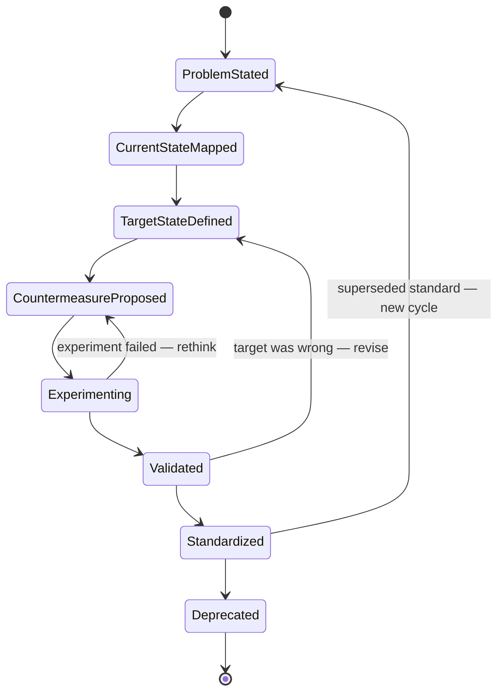

# LeanStyle — Requirements as Hypotheses, Traced from Gemba to Standard

> A typed Requirements DSL in the Toyota tradition. A3, PDCA, Gemba, VSM, Kaizen — not in PowerPoint, in your repo, versioned, validated, traced.

`@frenchexdev2/requirements` ships a preset called **LeanStyle** (`@frenchexdev2/requirements/styles/lean`) that rewires the whole Requirements vocabulary around Lean thinking: problems are hypotheses, requirements are experiments, standards are the crystallised residue of validated kaizen, and every waste claim must cite a direct observation. This document is a walk-through of what the Style actually contains and how practitioners use it.

---

## Who it's for

If one of these describes your week, LeanStyle was written for you.

| Persona | Today's pain | What LeanStyle changes |
|---|---|---|
| **CI lead / Lean Six Sigma Black Belt** | A3 sheets approved last quarter, never followed up — they die in a drawer. | A3s are typed JSON specs living in Git, moving through a PDCA status FSM. "Standardized" is a verified state, not a staple. |
| **Kaizen facilitator** | Post-event kaizen commitments scatter across Excel, email, Miro boards. None link to the code change that shipped. | Every kaizen is a `Kaizen-Experiment` requirement with a `kaizen-hypothesis` statement — change, expectedOutcome, reasoning, validationWindow, metric. Traceable. |
| **Value-stream manager** | VSM drawn once, wastes catalogued, nothing eliminated. | Every `Waste-Elimination` requirement *must* cite a `gemba-walk` or `vsm` source. Validator refuses armchair analysis. |
| **Toyota Kata coach (Rother)** | Learners run improvement katas in notebooks; no shared trace, no coaching record. | `kata-coaching` source kind records coach, learner, date. `kata-learning` rationale kind ties every experiment back to what was learned. |
| **Lean Startup PM (Ries)** | Hypotheses in slides, MVP metrics in Sheets, learnings in Notion — not composable. | Same `kaizen-hypothesis` pattern drives Build-Measure-Learn. Feature hypothesis becomes a typed requirement with a leading metric and a time-box. |
| **Agile team lead moving toward flow** | Story-point theatre; no measured takt, no standard work. | `Standardization` + `standard-work` pattern capture the "current best-known way" with takt time and checkpoint. |

---

## The problem

Lean is an evidence philosophy. Ohno's shop floor, Shingo's SMED, Womack and Jones's five principles, Ries's Build-Measure-Learn — all of them insist on the same move: go see, measure, hypothesise, experiment, learn, standardise, repeat. The philosophy is rigorous. The artifacts, in 2026, are not.

Walk into a mature Lean organisation and you will find:

- A3 sheets drawn in PowerPoint, exported to PDF, printed, pinned to a board, photographed, filed.
- Value-stream maps in Visio or Miro, with waste categories cataloged in sticky-note colour, then forgotten when the facilitator rotates off the project.
- Kaizen logs in Excel, one per plant, one per cell, each with a different column schema.
- Standard-work documents in Word, uploaded to SharePoint, last edited in 2021, nobody's sure which revision is current.
- Hoshin Kanri X-matrices in a PDF the CEO shows once a year.

None of these are versioned alongside the code that implements the countermeasure. None of them have a type system. None of them know the difference between a problem (unvalidated) and a standard (validated and in force). None of them enforce genchi genbutsu — you can type a waste claim in your armchair with zero evidence, save it, and it looks identical to a claim backed by a three-hour Gemba walk.

The Lean Startup side of the house has the same disease. Eric Ries's *Lean Startup* (2011) demands that product teams state hypotheses, build an MVP, measure actionable metrics, and decide pivot-or-persevere. In practice, PMs write hypotheses in decks, cobble MVPs together, read Mixpanel dashboards, and call meetings where the "learning" is whatever the loudest person in the room wants it to be. There is no structured record that "we said X would happen, we measured Y, therefore we persevere/pivot."

The Poppendiecks' *Lean Software Development* (2003) mapped the seven wastes onto software — partially done work, extra features, relearning, handoffs, task switching, delays, defects. The mapping is sharp. The tooling has never caught up. Backlogs fill with user stories that neither cite a waste nor state a hypothesis nor carry a metric. They are just descriptions.

LeanStyle is the small, focused answer to this: a typed DSL where a requirement is a node in a PDCA cycle, where waste claims are refused without a Gemba source, where every kaizen carries a time-box and a metric, and where a standard is something you reach by going through — not around — the experiment.

---

## The Lean philosophy behind the Style

The Style's source file cites its lineage in its header. Worth repeating here.

- **Taiichi Ohno — *Toyota Production System: Beyond Large-Scale Production* (1988).** The foundational text. Jidoka, just-in-time, the pull system, the relentless hunt for muda. LeanStyle's central stance — *a requirement is tied to observed waste or articulated customer pull* — is Ohno's.
- **Shigeo Shingo — SMED, Poka-Yoke.** Changeover reduction and error-proofing. Appears in the worked example below.
- **James Womack & Daniel Jones — *Lean Thinking* (1996).** The five principles: value, value stream, flow, pull, perfection. The `ValueAdding`, `NonValueAddingButNecessary`, `Flow-Improvement`, `Customer-Pull` kinds map directly onto this frame.
- **Mary & Tom Poppendieck — *Lean Software Development* (2003).** Seven principles for software; TIMWOODS for knowledge work. Informs the `vsm` source's `wasteCategory` hint.
- **Eric Ries — *The Lean Startup* (2011).** Build-Measure-Learn, the validated learning loop, the actionable metric. The `kaizen-hypothesis` pattern's `validationWindow` and `metric` slots are Ries-shaped.
- **Mike Rother — *Toyota Kata* (2009).** The improvement kata and coaching kata. The `kata-coaching` source and `kata-learning` rationale make coaching a first-class citizen.
- **Durward K. Sobek II & Art Smalley — A3 Thinking.** And John Shook's *Managing to Learn* (2008). A3 as an organisational learning artifact — current → target → gap → countermeasure → follow-up. The entire status workflow and the `problem-statement` pattern are A3-shaped.
- **TIMWOODS** — Transport, Inventory, Motion, Waiting, Overproduction, Over-processing, Defects, Skills-unused. The eight-waste extension; the `vsm` source's `wasteCategory` slot accepts exactly this taxonomy.

Why does Lean deserve its own Style? Because **a Lean requirement is not a promise to the system — it is a hypothesis about value**. EARS ("When X, the system shall Y") assumes the shape of the answer is known. A Lean statement assumes the shape of the *gap* is known, and the shape of the answer is what you are about to discover. That is not a cosmetic difference. It changes which slots are required, which states exist, which evidence is mandatory, and which verification methods are legitimate.

---

## What you get — the Style's vocabulary

Every field below is present in `src/styles/lean.ts`. No decoration.

### Requirement kinds (9)

| Kind | When to use |
|---|---|
| `ValueAdding` | The work directly creates what the customer pulls. |
| `NonValueAddingButNecessary` | Needed under current constraints (regulatory, setup) — candidate for future reduction. |
| `Waste-Elimination` | Direct attack on observed muda. Requires Gemba or VSM source (enforced). |
| `Flow-Improvement` | Reduces batch size, queue, handoff — improves end-to-end flow. |
| `Quality-BuiltIn` | Jidoka — stop-the-line, poka-yoke, built-in inspection. |
| `Customer-Pull` | Increment pulled by an articulated customer need. Uses `value-proposition` pattern. |
| `Standardization` | Codifies the current best-known method. Requires `standard-work` pattern (enforced). |
| `Kaizen-Experiment` | A time-boxed PDCA hypothesis. Requires `kaizen-hypothesis` pattern + `PDCA` verification (enforced). |
| `Respect-for-People` | Organisational change touching how people are trusted and developed. |

### Status workflow — the A3/PDCA cycle



Initial: `ProblemStated`. Terminal: `Deprecated`. Three rework edges, exactly as the file encodes:

- `Experimenting → CountermeasureProposed` — the experiment failed, rethink the countermeasure.
- `Validated → TargetStateDefined` — validation revealed the target itself was wrong.
- `Standardized → ProblemStated` — a standing standard has been superseded; start a new PDCA cycle.

This is PDCA with honesty about what learning does: it can invalidate your countermeasure *and* your target.

### Risk taxonomy — Impact × Effort, ICE-style

Four levels. Read the source file's comment: *Likelihood is unused in Lean prioritisation — we do not play probabilities, we go see and act on what is in front of us.*

| Level | Meaning |
|---|---|
| `HighImpactLowEffort` | Just-do-it — the do-first quadrant. |
| `HighImpactHighEffort` | Strategic kaizen or hoshin project — plan an A3. |
| `LowImpactLowEffort` | Fill-in / 5S-class work — trivial kaizen. |
| `LowImpactHighEffort` | Classic muda — decline or defer. |

The matrix repurposes the generic `likelihood` axis as *effort*. The file's `cells` array maps all nine combinations:

| Effort \ Impact | High | Medium | Low |
|---|---|---|---|
| **Low** | HighImpactLowEffort | HighImpactLowEffort | LowImpactLowEffort |
| **Medium** | HighImpactHighEffort | HighImpactHighEffort | LowImpactLowEffort |
| **High** | HighImpactHighEffort | LowImpactHighEffort | LowImpactHighEffort |

Note the asymmetry: high-impact survives being costly (becomes strategic), but low-impact + high-effort drops to `LowImpactHighEffort` — the avoid quadrant.

### Verification methods (8)

| Method | Meaning |
|---|---|
| `GembaWalk` | Go see. First-hand floor observation. |
| `A3Review` | Peer review of the A3 report. |
| `FiveWhys` | Root-cause walk. |
| `PDCA` | Plan-Do-Check-Act experiment cycle. Required for `Kaizen-Experiment`. |
| `VSM` | Value-stream mapping, before/after. |
| `Kaizen` | Kaizen-event outcome. |
| `StandardWork` | Compliance check against standard work. |
| `TaktTimeCheck` | Cycle-time vs takt measurement. |

### Rationale kinds (8)

`waste-observed`, `customer-complaint`, `takt-time-deviation`, `defect-metric`, `flow-impediment`, `standard-work-gap`, `kata-learning`, `hoshin-alignment`.

Nothing generic like "because we think so". Every rationale commits to a category of evidence.

### Source kinds — and their required slots

| Source kind | Required slots |
|---|---|
| `gemba-walk` | `location` (string), `date` (iso-date), `observer` (string) |
| `customer-feedback` | `source` (NPS/ticket/interview), `channel` (string), `date` (iso-date) |
| `process-measurement` | `metric` (string), `baseline` (number), `target` (number), `unit` (string) |
| `a3-analysis` | `a3Id`, `owner`, `date` (iso-date) |
| `kaizen-event` | `eventId`, `team`, `date` (iso-date) |
| `vsm` | `streamName`, `mappedAt` (iso-date), `wasteCategory` — TIMWOODS: `transport \| inventory \| motion \| waiting \| overproduction \| over-processing \| defects \| unused-talent` |
| `hoshin-plan` | `year`, `breakthrough` |
| `kata-coaching` | `coach`, `learner`, `date` (iso-date) |

Every slot is either a typed primitive (`string`, `number`, `iso-date`, `url`) and carries a required flag. The wizard fills them; the validator rejects missing ones.

### Statement patterns — 5 Lean-specific + 1 natural fallback

| Pattern | Template |
|---|---|
| `problem-statement` | `Problem: {problem}. Current: {currentState}. Target: {targetState}. Gap: {gap}.` |
| `countermeasure` | `To address {problem}, we will {action} by {date}, measured by {metric} reaching {target}.` |
| `standard-work` | `Standard work for {operation}: {steps}. Takt: {taktTime}. Quality checkpoint: {checkpoint}.` |
| `value-proposition` | `For {customer} who needs {need}, we provide {value}, unlike {alternatives}.` |
| `kaizen-hypothesis` | `If we {change}, then {expectedOutcome}, because {reasoning}. We will know within {validationWindow} by observing {metric}.` |
| `natural` | `{text}` — fallback only; generates a warning. |

The `kaizen-hypothesis` template is the Style's centre of gravity. Its five slots — **change, expectedOutcome, reasoning, validationWindow, metric** — are all required. There is no way to file a kaizen without committing to how long you will wait and what you will measure.

---

## A complete worked example — reducing changeover time on Line 3

A manufacturing operations team runs a three-shift automotive-parts line. Line 3 is the bottleneck. Changeover between SKUs takes 90 minutes. The CI lead schedules a Gemba walk.

### Step 1 — The Gemba walk

Marie, the CI lead, spends three hours on the floor at 06:00 watching two changeovers back-to-back. She notes:

- The operator walks to the tool cart four times (Motion).
- The line is stopped for 22 minutes while the next die is fetched from the warehouse (Waiting + Transport).
- Torque specifications are retrieved from a laminated binder on shift 1 and from a tablet on shift 2 (non-standard work).

Average observed changeover: 90 minutes. Target set by the plant manager (from hoshin): 30 minutes. TIMWOODS categories: primarily **waiting** and **motion**.

### Step 2 — File the A3 problem requirement

```bash
$ npx requirements new --style lean --template a3-problem
```

Wizard transcript (condensed):

```
? id  LINE3-CHANGEOVER-90
? title  Line 3 changeover exceeds takt window
? priority  High
? source.type  gemba-walk
?   source.location  Plant A / Line 3 / changeover area
?   source.date  2026-04-14
?   source.observer  Marie D.
? statement.pattern  problem-statement
?   statement.problem       Changeover on Line 3 consumes 90 min average, blocking mix flexibility.
?   statement.currentState  90 min average across 12 changeovers (Apr 01–14, 2026)
?   statement.targetState   30 min average (hoshin 2026 breakthrough: mix flexibility)
?   statement.gap           60 min — dominated by waiting (22 min) and motion (~18 min)
? rationaleKind  waste-observed
? verificationMethod  A3Review
? risk.level  HighImpactHighEffort
```

Resulting `.spec.json`:

```json
{
  "$schemaVersion": "2026-04-14",
  "styleId": "@frenchexdev2/requirements/styles/lean",
  "kind": "requirement",
  "id": "LINE3-CHANGEOVER-90",
  "title": "Line 3 changeover exceeds takt window",
  "requirementKind": "ValueAdding",
  "status": "CurrentStateMapped",
  "priority": "High",
  "risk": { "level": "HighImpactHighEffort" },
  "source": {
    "type": "gemba-walk",
    "location": "Plant A / Line 3 / changeover area",
    "date": "2026-04-14",
    "observer": "Marie D."
  },
  "rationaleKind": "waste-observed",
  "verificationMethod": "A3Review",
  "statement": {
    "pattern": "problem-statement",
    "problem": "Changeover on Line 3 consumes 90 min average, blocking mix flexibility.",
    "currentState": "90 min average across 12 changeovers (Apr 01–14, 2026)",
    "targetState": "30 min average (hoshin 2026 breakthrough: mix flexibility)",
    "gap": "60 min — dominated by waiting (22 min) and motion (~18 min)"
  }
}
```

### Step 3 — `requirement show`

```
$ npx requirements show LINE3-CHANGEOVER-90
LINE3-CHANGEOVER-90  Line 3 changeover exceeds takt window
  Kind: ValueAdding    Status: CurrentStateMapped    Priority: High
  Impact/Effort: HighImpactHighEffort
  Verification: A3Review
  Statement: Problem: Changeover on Line 3 consumes 90 min average, blocking mix flexibility. Current: 90 min average across 12 changeovers (Apr 01–14, 2026). Target: 30 min average (hoshin 2026 breakthrough: mix flexibility). Gap: 60 min — dominated by waiting (22 min) and motion (~18 min).
```

### Step 4 — The kaizen experiment

Marie convenes a two-day kaizen event with Shingo's SMED playbook in hand. The team proposes converting internal setup (machine stopped) to external setup (machine still running the previous SKU).

```bash
$ npx requirements new --style lean --template kaizen-experiment
```

```json
{
  "$schemaVersion": "2026-04-14",
  "styleId": "@frenchexdev2/requirements/styles/lean",
  "kind": "requirement",
  "id": "LINE3-SMED-KAIZEN-01",
  "title": "SMED + shadow-board experiment on Line 3",
  "requirementKind": "Kaizen-Experiment",
  "status": "Experimenting",
  "priority": "High",
  "risk": { "level": "HighImpactLowEffort" },
  "source": {
    "type": "kaizen-event",
    "eventId": "KE-2026-11",
    "team": "Line 3 + CI + maintenance",
    "date": "2026-04-15"
  },
  "rationaleKind": "kata-learning",
  "verificationMethod": "PDCA",
  "statement": {
    "pattern": "kaizen-hypothesis",
    "change": "Convert die-fetch and torque-spec lookup to external setup via staged die carts and a shadow-board at the cell.",
    "expectedOutcome": "Changeover drops to 35 min average.",
    "reasoning": "SMED (Shingo): internal-to-external conversion historically yields 50–75% reduction; 22 min of observed waiting is pure external-eligible work.",
    "validationWindow": "2 weeks (10 changeovers across all shifts)",
    "metric": "changeover duration in seconds, measured by line-side timer, reported daily"
  }
}
```

Note what the validator has enforced:

- `requirementKind` is `Kaizen-Experiment` → `statement.pattern` **must** be `kaizen-hypothesis` (it is).
- `verificationMethod` **must** be `PDCA` (it is).
- All five `kaizen-hypothesis` slots (change, expectedOutcome, reasoning, validationWindow, metric) are non-empty.

### Step 5 — After the validation window, the standard emerges

Two weeks later, the metric reads 33 minutes average over 10 changeovers. Hypothesis confirmed. Status moves `Experimenting → Validated`. Marie files the standard-work requirement.

```bash
$ npx requirements new --style lean --template standard-work-definition
```

```json
{
  "$schemaVersion": "2026-04-14",
  "styleId": "@frenchexdev2/requirements/styles/lean",
  "kind": "requirement",
  "id": "LINE3-CHANGEOVER-STD-V2",
  "title": "Line 3 changeover — standard work v2 (post-SMED)",
  "requirementKind": "Standardization",
  "status": "Standardized",
  "priority": "High",
  "risk": { "level": "HighImpactLowEffort" },
  "source": {
    "type": "a3-analysis",
    "a3Id": "A3-LINE3-2026-04",
    "owner": "Marie D.",
    "date": "2026-04-29"
  },
  "rationaleKind": "standard-work-gap",
  "verificationMethod": "StandardWork",
  "statement": {
    "pattern": "standard-work",
    "operation": "Line 3 SKU changeover",
    "steps": "1. T−30: stage die cart at shadow-board. 2. T−15: pre-heat tooling. 3. T−0: stop line, swap die (4 min). 4. T+6: torque verification (checklist QC-L3-07). 5. T+12: first-piece inspection. 6. T+15: resume.",
    "taktTime": "takt = 47s per unit; changeover budget = 30 min",
    "checkpoint": "QC-L3-07 torque + first-piece gauge"
  }
}
```

### Step 6 — A3 Markdown export

`requirement export --format md LINE3-CHANGEOVER-90` emits exactly the reporter's A3 one-pager:

```markdown
# A3 — LINE3-CHANGEOVER-90: Line 3 changeover exceeds takt window

## Context

| Field | Value |
|---|---|
| Kind | ValueAdding |
| Status (PDCA) | CurrentStateMapped |
| Impact × Effort | HighImpactHighEffort |
| Source | gemba-walk (location=Plant A / Line 3 / changeover area, date=2026-04-14, observer=Marie D.) |
| Verification | A3Review |

## Problem statement

> Problem: Changeover on Line 3 consumes 90 min average, blocking mix flexibility. Current: 90 min average across 12 changeovers (Apr 01–14, 2026). Target: 30 min average (hoshin 2026 breakthrough: mix flexibility). Gap: 60 min — dominated by waiting (22 min) and motion (~18 min).

## Fit criteria

- [ ] _(none defined)_

**Verification method**: A3Review
```

One page. Printable. Version-controlled. Traceable. This is what an A3 becomes when you type it.

---

## What the validators enforce — "Toyota would do it this way"

Four rules are hard-coded in `LEAN_VALIDATORS.validateSpec`. All four reflect principles Toyota documented in the 1970s.

**Rule 1 — Every Kaizen-Experiment must use the kaizen-hypothesis pattern AND be verified by PDCA.**

```
Kaizen-Experiment requirements must use the kaizen-hypothesis pattern
Kaizen-Experiment requirements must be verified by PDCA (got StandardWork)
```

*Why Toyota would do it this way:* a kaizen without a time-boxed hypothesis and a check step isn't kaizen — it's a wish.

**Rule 2 — Every Standardization must use the standard-work pattern.**

```
Standardization requirements must use the standard-work pattern
```

*Why:* a standard without steps, takt, and checkpoint is not standard work — it is folklore. Ohno's dictum: "without standards, there can be no improvement."

**Rule 3 — Every problem-statement must carry a non-empty `gap`.**

```
problem-statement requires a non-empty gap (the measurable delta current→target)
```

*Why:* "we have a problem with X" is not a problem statement — it is a complaint. A problem in the A3 sense is a **measurable delta between current and target**. No delta, no problem, no PDCA possible.

**Rule 4 — Genchi genbutsu: every Waste-Elimination must cite a gemba-walk or vsm source.**

```
Waste-Elimination requirements must cite a gemba-walk or vsm source (genchi genbutsu — go see)
```

*Why:* this one is the soul of the Style. Ohno is unambiguous: you do not eliminate waste from a conference room. Either you saw it with your own eyes on the floor, or you mapped the value stream. No third option. The validator refuses to let you bypass the rule.

---

## Integrations

### VS Code — live schema binding

The package ships a JSON Schema per style. Wire it in `.vscode/settings.json`:

```json
{
  "json.schemas": [
    {
      "fileMatch": ["requirements/**/*.spec.json"],
      "url": "./node_modules/@frenchexdev2/requirements/schemas/lean.schema.json"
    }
  ]
}
```

Autocomplete on `requirementKind`, `status`, `verificationMethod`, every `statementPattern`, every `sourceKind`, every slot. Red squiggles when you try to file a `Waste-Elimination` backed by a `hoshin-plan`.

### `compliance --strict` as a lean gate

```bash
$ npx requirements compliance --strict --style lean
```

Fails the build when any requirement violates a Lean invariant — including the do-not-standardise-before-you-validate rule: no requirement sits in `Standardized` unless an upstream `Kaizen-Experiment` (linked by `@Refines` or `refinedFrom`) is in `Validated`. Pre-merge guard for the repo.

### `requirements trace chain` — from Gemba to standard

```bash
$ npx requirements trace chain LINE3-CHANGEOVER-STD-V2
LINE3-CHANGEOVER-STD-V2 (Standardized)
  ← refinedFrom LINE3-SMED-KAIZEN-01 (Validated, Kaizen-Experiment)
    ← refinedFrom LINE3-CHANGEOVER-90 (CurrentStateMapped, problem)
      source: gemba-walk @ Plant A / Line 3 — 2026-04-14, obs: Marie D.
```

Four links. Gemba walk → problem → kaizen → standard. You can now answer the CI board's question "why does this standard exist?" in one command.

### A3 printable Markdown / PDF export

`export --format md` exists today (see the worked example above). PDF is on the roadmap and will pipe the same reporter through `md-to-pdf` for wall-posting.

---

## LeanStyle vs the alternatives

| Option | Composable? | Versioned? | Typed? | Validated? | Trace to code? |
|---|---|---|---|---|---|
| Paper A3 + kaizen board | No | No | No | No | No |
| Miro / Mural whiteboards | Partially | No | No | No | No |
| Excel kaizen log | Partially | Only file-level | No | No | No |
| LeanKit / kanban tools (flow-focused) | Yes | Yes | Limited | No | Indirect |
| PowerPoint A3 template | No | No | No | No | No |
| **LeanStyle** | **Yes** | **Git-native** | **Yes (9 kinds, 5 patterns, typed slots)** | **Yes (4 Toyota-style rules)** | **Yes (trace chain, compliance strict)** |

LeanKit and its peers optimise flow visualisation. Excellent at showing WIP. Silent on hypothesis structure, genchi genbutsu, the kaizen-to-standard handoff. LeanStyle is complementary: your kanban board shows *where*, your LeanStyle repo records *why* and *what was learned*.

---

## Lean Startup angle — same Style, different shop floor

Eric Ries's startup *is* a factory — the factory output is validated learning. The `kaizen-hypothesis` pattern fits Build-Measure-Learn without a single word changed.

A product manager validating a checkout-redesign hypothesis:

```json
{
  "requirementKind": "Kaizen-Experiment",
  "statement": {
    "pattern": "kaizen-hypothesis",
    "change": "Replace 4-step checkout with a single-page form for guest users.",
    "expectedOutcome": "Conversion on guest checkout rises from 2.4% to 3.2%.",
    "reasoning": "Funnel analysis shows 38% drop-off at step 2 (shipping). Hypothesis: perceived commitment cost, not data-entry cost, is the blocker. Single page reduces commitment signal.",
    "validationWindow": "3 weeks, min 20,000 guest sessions",
    "metric": "guest-checkout completion rate (Mixpanel funnel f-guest-v2)"
  },
  "verificationMethod": "PDCA"
}
```

The validator refuses this spec unless all five slots are present. A PM cannot file a hypothesis without committing to what they will measure and for how long. *Pivot-or-persevere* becomes a typed status transition (`Experimenting → Validated` or `Experimenting → CountermeasureProposed`), not a meeting vibe.

---

## Getting started — three steps

```bash
# 1. Install
pnpm add @frenchexdev2/requirements

# 2. Scaffold your first A3
npx requirements new --style lean --template a3-problem

# 3. Render it
npx requirements show <your-id>
```

Five templates ship in the box: `a3-problem`, `kaizen-experiment`, `standard-work-definition`, `waste-elimination`, `customer-value-increment`. Each pre-fills the right kind, pattern, priority, rationale kind, verification method, and default fit-criterion kind. You type the content; the Style keeps the shape correct.

---

## Roadmap

- **TIMWOODS auto-tagging.** Keyword classifier on the `problem` slot to suggest the `vsm.wasteCategory` — transport vs inventory vs motion vs waiting vs overproduction vs over-processing vs defects vs unused-talent.
- **Hoshin Kanri breakthrough hierarchy.** `@Refines`-based cascade from the annual breakthrough (`hoshin-plan` source) to cell-level kaizen, rendered as an X-matrix.
- **Coaching-kata mode.** CLI subcommand to drive a learner through Rother's five coaching questions (What is the target condition? What is the actual condition now? What obstacles are now preventing you? What is your next step? When can we go and see what we have learned?).
- **MES KPI integration.** Fit-criterion adapters for live OEE, changeover time, first-pass yield — experiments validate themselves against the plant's MES instead of manual metric entry.
- **Bidirectional A3 PDF.** Round-trip export to one-page A3 PDF suitable for wall-posting and reimport from a marked-up scan.

---

## License + community

MIT. Contributions via PR on the `@frenchexdev2/requirements` repository. A glossary (A3, PDCA, genchi genbutsu, jidoka, muda, muri, mura, nemawashi, poka-yoke, takt, TIMWOODS, VSM) ships in `docs/glossary.md`. A plan file tracks upcoming Style evolution so teams can align their internal Lean vocabulary with upstream moves.

Toyota built the system on the floor over forty years. This Style just gives your repo the types to match.

---

*LeanStyle is one of several presets shipped by `@frenchexdev2/requirements`. See `docs/pitches/` for DefaultStyle (ISO/IEC/IEEE 29148 + Volere + EARS), Legal DSL, Safety-Critical, and others. A project declares its Style in `requirements.config.json` and can run multiple Styles side-by-side — one for the product line, one for compliance obligations, one for the operations kaizen log.*
