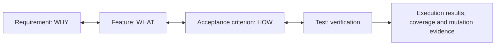

<p align="center">
  
</p>

# @frenchexdev2/requirements

TypeScript Requirements-as-Code DSL and the `requirements` command-line interface.

Keep the reason for a change, its expected behavior, its acceptance criteria and its tests connected in the same repository:



A declaration records an intended relationship. Running the tests, inspecting coverage and measuring mutation results provide different kinds of evidence for that relationship. People still decide whether the requirement describes the right business need.

## Role in the workspace

This package provides the user-facing CLI and a convenient DSL import surface. Its root export re-exports the shared DSL through `requirements-core`, along with five style presets and their registry. Analysis, specification I/O, scaffolding and workflow services are implemented in the specialized sibling packages.

Use [requirements-shared-kernel](../requirements-shared-kernel/README.md) for the foundational DSL, [requirements-styles](../requirements-styles/README.md) for presets, or [requirements-lib](../requirements-lib/README.md) for the broad programmatic analysis facade.

## A Feature and its test

```ts
import {
  Feature, FeatureTest, Verifies, Priority, type ACResult,
} from '@frenchexdev2/requirements';

export abstract class PositiveAmount extends Feature {
  readonly id = 'POSITIVE-AMOUNT';
  readonly title = 'Accept strictly positive amounts';
  readonly priority = Priority.High;

  abstract rejectsZero(): ACResult;
}

function isPositive(amount: number): boolean {
  return amount > 0;
}

@FeatureTest(PositiveAmount)
export class PositiveAmountTest extends PositiveAmount {
  @Verifies<PositiveAmount>('rejectsZero')
  rejectsZero(): ACResult {
    if (isPositive(0)) throw new Error('Zero must be rejected');
    return { satisfied: true };
  }
}
```

Use legacy TypeScript decorators (`experimentalDecorators: true`). With Vitest `globals: true`, `@FeatureTest` registers the decorated test methods automatically. Other runners need their own execution integration. The example introduces the binding; a consumer should test its own implementation and assertions.

To add the WHY tier, declare an abstract `Requirement<typeof DefaultStyle>` with its identity, statement, rationale, fit criteria, provenance, risk and lifecycle fields. Link a Feature with `@Satisfies(MyRequirement)` and decompose Requirements with `@Refines(ParentRequirement)`. Acceptance criteria are abstract Feature methods returning `ACResult`, whose required field is `satisfied`.

## CLI

Build the workspace first. From this package directory, use the local binary:

```sh
pnpm exec requirements --help
pnpm exec requirements compliance --strict
pnpm exec requirements compliance --json --by-test
pnpm exec requirements trace gaps
pnpm exec requirements trace matrix POSITIVE-AMOUNT
pnpm exec requirements trace chain POSITIVE-AMOUNT rejectsZero
pnpm exec requirements trace graph --format mermaid
pnpm exec requirements scaffold test POSITIVE-AMOUNT --dry-run
pnpm exec requirements feature new --dry-run
pnpm exec requirements requirement new --dry-run
pnpm exec requirements schema register --print
```

Run project commands from the consumer project directory with a local installation of this CLI. Configure its directories through `requirements.config.json`; see the defaults in [src/bin/requirements.ts](src/bin/requirements.ts).

The command groups include:

- `feature new`, `feature sync <spec>`, `feature rename <oldId> <newId>`: create, synchronize or rename Features.
- `requirement new`, `sync`, `list`, `show <reqId>`, `orphan`, `rename`: manage and inspect the WHY tier.
- `trace gaps`, `matrix`, `chain`, `graph`: inspect links and export Mermaid or DOT graphs.
- `scaffold test` and `scaffold e2e`: generate test starters for uncovered ACs.
- `ast-smells`: detect empty test bodies, missing assertions and missing implementation targets.
- `behavioral-check` and `behavioral-audit`: explicitly run mutation-based checks; `--plan-only` previews a scoped check.
- `explore` and `watch`: interactive trace navigation and live compliance feedback.

Rename commands default to a preview; `--apply` writes changes. Sync commands support `--dry-run` and `--yes`. Use each command's `--help` for its exact arguments.

`compliance --strict` checks critical uncovered ACs and Requirement/Feature traceability gates. Workspace qualification through `pnpm compliance` additionally reconciles bindings with successful test entries and source fingerprints. These checks have different scopes; mutation testing is a separate opt-in operation.

## Styles and generated tests

Five presets supply domain vocabulary, lifecycle states, validators, templates and reporters: Default, Industrial, Lean, Agile and Kanban. The scaffolder registry provides starters for unit, functional, end-to-end, accessibility, internationalization, visual and performance tests. Generated starters need implementation and any runner-specific dependencies in the consumer project.

## Documentation

- [Glossary](GLOSSARY.md) and [changelog](CHANGELOG.md): terminology and historical changes.
- [Create a custom Style](docs/HOW-TO-CREATE-YOUR-STYLE.md) and [test a Style](docs/HOW-TO-TEST-YOUR-STYLE.md): extension guides.
- [Default](docs/pitches/default.md), [Industrial](docs/pitches/industrial.md), [Lean](docs/pitches/lean.md), [Agile](docs/pitches/agile.md) and [Kanban](docs/pitches/kanban.md): domain pitches and worked examples.
- [Scenario player](../requirements-styles-demo/README.md): the separate `rsd` CLI.

The guides, pitches and changelog include historical paths, measurements and proposals from before the package split. Use current manifests and source for executable behavior, and the [dated qualification report](../../CORRECTIONS-2026-11-03.md) for measured results. Style vocabulary and audit metadata do not constitute regulatory certification or cryptographic signature validation.
## Development and status

This is an unreleased ESM package in the standalone RaC pnpm workspace. Work from the `rac.ts` root with Node.js `^22.22.0 || ^24.0.0 || >=26.0.0` and the pnpm version pinned in the root manifest. Install with `pnpm install --frozen-lockfile`, then build dependencies with `pnpm build`.

Run this package's checks from the workspace root:

```sh
pnpm --filter @frenchexdev2/requirements test
pnpm compliance
```

Coverage gates apply to each configured instrumentation scope. See the [workspace README](../../README.md) for all checks and the [dated qualification report](../../CORRECTIONS-2026-11-03.md) for recorded results and limitations.

After building, run `node test/docs/package-readmes.mjs` from the workspace root to check all package README identities, local links and TypeScript examples. The [documentation check](../../test/docs/package-readmes.mjs) type-checks examples without executing them or requesting external URLs.

## License

See the [FrenchExDev Educational License](../../LICENSE). It permits the educational and evaluation uses stated there; production use requires a separate commercial license.
