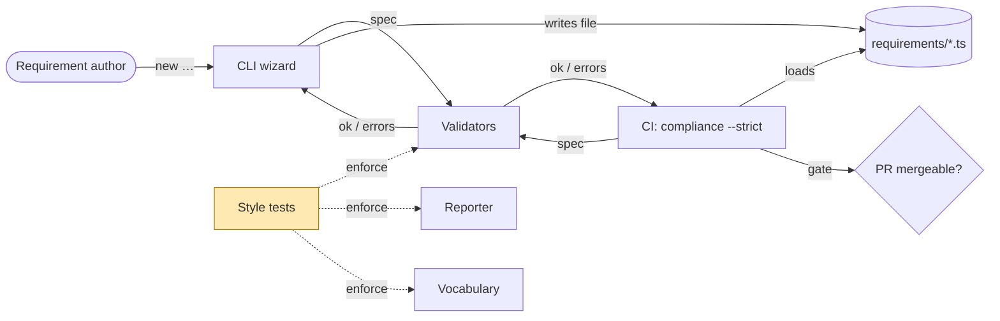
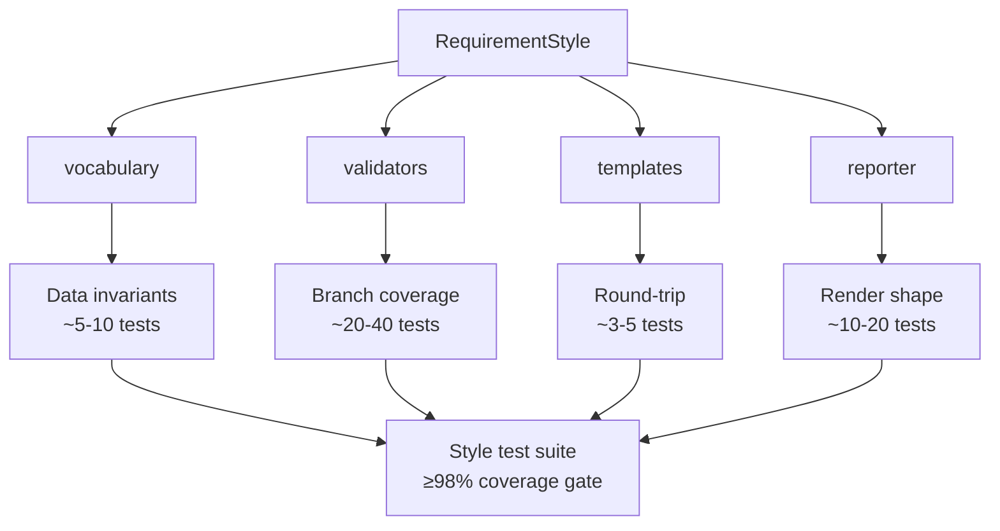
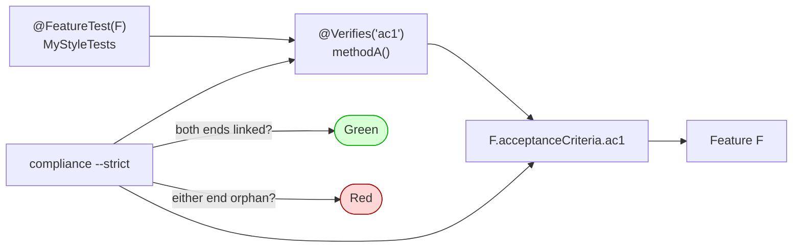
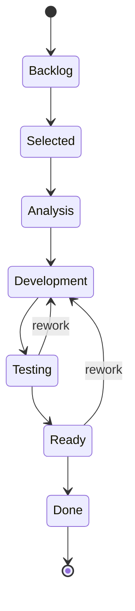
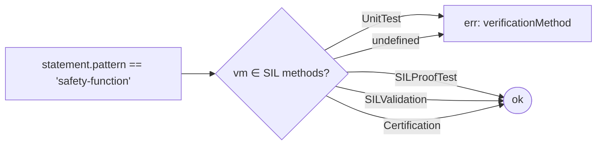

# How to test your own Style

Writing a `RequirementStyle` is half the job. The other half — and the part that decides whether anyone trusts your DSL — is **testing it**. A Style is a small compiler-flavoured artefact: vocabulary (data), validators (pure rules), templates (skeletons), reporter (rendering). Each of those four surfaces is independently testable, and each carries a different kind of failure when you skip it.

This guide walks the discipline end-to-end, using the two production Styles that ship with `@frenchexdev2/requirements` — **KanbanStyle** ([`src/styles/kanban.ts`](../src/styles/kanban.ts)) and **IndustrialStyle** ([`src/styles/industrial.ts`](../src/styles/industrial.ts)) — as fully-worked references. Their tests live in [`test/unit/kanban-style.test.ts`](../test/unit/kanban-style.test.ts) and [`test/unit/industrial-style.test.ts`](../test/unit/industrial-style.test.ts) and both hold ≥98 % coverage gate, no exceptions.

> **Companion document**: see [HOW-TO-CREATE-YOUR-STYLE.md](HOW-TO-CREATE-YOUR-STYLE.md) for the *write* side. This document is the *prove-it-works* side.

---

## Table of contents

**Part I — Why testing a Style is its own discipline**
1. [What you are actually testing](#1-what-you-are-actually-testing)
2. [The four surfaces and their failure modes](#2-the-four-surfaces-and-their-failure-modes)
3. [Dog-fooding: `@FeatureTest` and `@Verifies`, never `describe`/`it`](#3-dog-fooding-featuretest-and-verifies-never-describeit)

**Part II — Test setup**
4. [File layout, naming, imports](#4-file-layout-naming-imports)
5. [Helpers: `fullyFilled`, `baseSafetySpec` and why fixtures matter](#5-helpers-fullyfilled-basesafetyspec-and-why-fixtures-matter)
6. [Anchoring tests to Feature ACs](#6-anchoring-tests-to-feature-acs)

**Part III — Vocabulary tests (data-invariant)**
7. [Status workflow: FSM well-formedness and rework loops](#7-status-workflow-fsm-well-formedness-and-rework-loops)
8. [Risk taxonomy: matrix cells reference declared levels](#8-risk-taxonomy-matrix-cells-reference-declared-levels)
9. [Source kinds and statement patterns: at-least-one-required slot](#9-source-kinds-and-statement-patterns-at-least-one-required-slot)

**Part IV — Validator tests**
10. [Industrial: `Safety` → SIL 1-4 (load-bearing safety-rating rule)](#10-industrial-safety--sil-1-4-load-bearing-safety-rating-rule)
11. [Industrial: `safety-function` requires `SIL*` verification method](#11-industrial-safety-function-requires-sil-verification-method)
12. [Industrial: `Regulatory` requires a typed standard source](#12-industrial-regulatory-requires-a-typed-standard-source)
13. [Kanban: per-class-of-service discipline (`Expedite` / `FixedDate` / `Intangible`)](#13-kanban-per-class-of-service-discipline-expedite--fixeddate--intangible)
14. [Kanban: the Anderson rule on `Intangible.threshold`](#14-kanban-the-anderson-rule-on-intangiblethreshold)
15. [Kanban: `Standard` requires a flow-driven source](#15-kanban-standard-requires-a-flow-driven-source)
16. [Validator hygiene: short-circuits, non-objects, unknown enums, error propagation](#16-validator-hygiene)

**Part V — Reporter tests**
17. [`renderStatement`: every pattern, every slot, every fallback](#17-renderstatement-every-pattern-every-slot-every-fallback)
18. [Industrial `renderMarkdown`: the H1 + table + Statement contract](#18-industrial-rendermarkdown-the-h1--table--statement-contract)
19. [Kanban `renderMarkdown`: the ticket-card contract](#19-kanban-rendermarkdown-the-ticket-card-contract)
20. [Defensive branches: empty arrays, missing fields, fallback strings](#20-defensive-branches-empty-arrays-missing-fields-fallback-strings)

**Part VI — Templates and bundle**
21. [Templates: `findTemplate` round-trip and unknown-id rejection](#21-templates-findtemplate-round-trip-and-unknown-id-rejection)
22. [Bundle: `MyStyle` wires every part through identity](#22-bundle-mystyle-wires-every-part-through-identity)

**Part VII — CI gates and pitfalls**
23. [Coverage configuration: `vitest --coverage` + per-file thresholds](#23-coverage-configuration)
24. [Property-based tests for Styles (optional but recommended)](#24-property-based-tests-for-styles)
25. [Common testing pitfalls](#25-common-testing-pitfalls)
26. [Reference checklist](#26-reference-checklist)

---

## Part I — Why testing a Style is its own discipline

### 1. What you are actually testing

A `RequirementStyle` is, structurally, a tiny compiler front-end. You are not testing a feature, you are testing **the rules a future Requirement author will be held against**. If your validator silently lets a `Safety` Requirement ship with `risk.level: NonSIL`, the consequence is not a failed unit test six months later — it is a Requirement that passed *every* gate without ever being SIL-rated, then got cited in an audit as evidence of compliance. The cost of a missed Style test is structural: **lies in the Requirements file**.

That framing matters because it changes the bar:

- **A failing Style test means a Requirement could be silently malformed.** That is qualitatively worse than "a feature is broken" — it is "the system that detects broken things is itself broken".
- **Coverage matters because branch logic is the surface.** Validators are mostly nested `if`s; an uncovered branch is a class of malformation no one is checking.
- **Tests are the executable spec of your domain.** When someone reads `Safety requirement with NonSIL risk is rejected, SIL2 is accepted`, they are reading IEC 61511 in code form. The test name *is* the rule statement.



The Style tests are the only thing standing between *"someone wrote a free-text safety requirement at 2 AM"* and *"that requirement passed CI with no SIL rating"*. They are not a nice-to-have, they are the integrity layer.

### 2. The four surfaces and their failure modes

Every Style has four sub-interfaces ([`src/style.ts`](../src/style.ts)), and each fails differently when untested:

| Surface | Untested failure mode | Test class to write |
|---|---|---|
| `vocabulary` (data) | Workflow refers to undeclared state; risk matrix uses unknown level; pattern slot conflicts with template id | **Data-invariant tests** — small assertions over the in-memory constants |
| `validators` (rules) | Domain rule silently accepts malformed spec; rule rejects valid spec; unknown kind/status not flagged | **Branch coverage tests** — one test per `if` arm, one per error path |
| `templates` (skeletons) | Wizard offers a template that points at a non-existent pattern; `findTemplate` returns `undefined` for a declared id | **Round-trip tests** — `findTemplate(t.id) === t` for every declared template |
| `reporter` (rendering) | Markdown emits empty string silently; renders `[object Object]`; loses a slot; explodes on missing optional field | **Render-shape tests** — exhaust every pattern + every defensive branch |



KanbanStyle's test file holds **44 test methods** for ~500 lines of style code; IndustrialStyle's holds **9 dense test methods** for ~530 lines. Both clear the 98 % bar. The ratio of test-to-code matters less than the ratio of *branches covered* to *branches that exist*.

### 3. Dog-fooding: `@FeatureTest` and `@Verifies`, never `describe`/`it`

The package rule is absolute and hangs together with the project's overall tracability discipline:

> **Never use `describe` / `it`. Always `@FeatureTest` + `@Verifies`.**

This is not stylistic. The decorators ([`src/decorators.ts`](../src/decorators.ts)) wire each test into the Feature → Acceptance Criterion → Test traceability graph that `compliance --strict` walks. A `describe`/`it` test exists in the void: it has no Feature anchor, no AC binding, and shows up in the compliance report as **orphan coverage**. CI won't even count it.

The skeleton you start from for any Style:

```ts
import { expect } from 'vitest';
import { FeatureTest, Verifies } from '../../src/decorators';
import { RequirementCommandsFeature } from '../../requirements/features/requirement-commands';
import { MY_VOCABULARY, MY_VALIDATORS, MY_TEMPLATES, MY_REPORTER, MyStyle } from '../../src/styles/my-style';

@FeatureTest(RequirementCommandsFeature)
class MyStyleTests {
  @Verifies<RequirementCommandsFeature>('projectCanDefineCustomRiskTaxonomy')
  'risk levels declared by my style'() {
    expect(MY_VOCABULARY.riskTaxonomy.levels.length).toBeGreaterThan(0);
  }
}
void MyStyleTests;
```

Three load-bearing details:

- **`@FeatureTest(F)`**: declares which Feature this whole test class verifies. Pick the Feature whose ACs your Style *exemplifies* — for built-in Styles, that's `RequirementCommandsFeature` (it owns ACs like `projectCanDefineCustomRiskTaxonomy`). For a third-party Style, it's the Feature your Style implements (e.g. `LegalDeonticEngineFeature` for a LegalStyle).
- **`@Verifies<F>('ac-name')`**: anchors *this specific test method* to a single Acceptance Criterion of `F`. The generic parameter `<F>` is what makes the AC name autocompleted and type-checked — you literally cannot anchor to an AC the Feature doesn't declare.
- **`void MyStyleTests;`**: keeps the class from being tree-shaken. Without it, the bundler may drop the file's side-effects and your tests vanish silently.

If you slip in a `describe('whatever', () => …)` somewhere, the test runs, but your compliance report shows the AC as un-verified. CI fails. The runner doesn't look at tests by name; it looks at the Verifies graph.



---

## Part II — Test setup

### 4. File layout, naming, imports

The convention in this package:

```
packages/requirements/
  src/styles/
    industrial.ts       # the Style implementation
    kanban.ts
  test/unit/
    industrial-style.test.ts
    kanban-style.test.ts
    styles-smoke.test.ts # cross-Style smoke checks (optional)
```

One test file per Style. Name it `<style>-style.test.ts`. Don't combine Styles into a multiplexed test file — coverage reports get muddied and a regression in one Style will look like a failure in another.

The four canonical imports (and only these from the Style):

```ts
import {
  KANBAN_VOCABULARY,
  KANBAN_VALIDATORS,
  KANBAN_TEMPLATES,
  KANBAN_REPORTER,
  KanbanStyle,
} from '../../src/styles/kanban';
```

The bundle (`KanbanStyle`) is imported only to verify wiring (§22). Tests run against the four sub-objects directly, so a regression localises to "validators broken" vs "reporter broken" vs "wiring broken".

### 5. Helpers: `fullyFilled`, `baseSafetySpec` and why fixtures matter

Both reference test files open with a single helper. They look small but they are the load-bearing piece of every test in the file.

**Kanban — pattern-driven helper** ([`kanban-style.test.ts:25`](../test/unit/kanban-style.test.ts#L25-L30)):

```ts
function fullyFilled(pattern: string): Record<string, string> {
  const schema = KANBAN_VOCABULARY.statementPatterns.find(p => p.pattern === pattern)!;
  const stmt: Record<string, string> = { pattern };
  for (const slot of schema.slots) stmt[slot.name] = `val-${slot.name}`;
  return stmt;
}
```

This builds a *valid statement for any declared pattern* by reading the pattern's own slots. Why this matters:

- **It uses the vocabulary as the source of truth.** If you add a slot to `service-request`, every test that calls `fullyFilled('service-request')` automatically picks it up. You don't have to update 30 fixtures.
- **It guarantees you test the pattern as declared, not as you remembered it.** A common bug: a slot is added to the vocabulary, but old tests build statements with the old slot list, hide the missing-slot error behind the test scaffolding, and report green. With `fullyFilled` reading the vocabulary, any new required slot fails the test instantly (because `validateStatement` will find it; tests that build by hand wouldn't).
- **Slot values are predictable**: `val-<slotname>`. Reporter assertions can then check `expect(rendered).toContain(stmt.outcome)` without hand-typing literals.

**Industrial — domain-specific helper** ([`industrial-style.test.ts:20`](../test/unit/industrial-style.test.ts#L20-L40)):

```ts
function baseSafetySpec(overrides: Record<string, unknown> = {}): Record<string, unknown> {
  return {
    kind: 'requirement',
    id: 'REQ-S1',
    title: 'Close valve on overpressure',
    priority: 'Critical',
    requirementKind: 'Safety',
    status: 'Draft',
    verificationMethod: 'SILProofTest',
    risk: { level: 'SIL2', ifNotMet: 'Rupture of vessel' },
    statement: {
      pattern: 'safety-function',
      action: 'close XV-101',
      demand: 'PAHH-101 trip',
      responseTime: '2 s',
      silLevel: 'SIL 2',
      proofInterval: '1 year',
    },
    ...overrides,
  };
}
```

Different shape, same idea: **a known-good baseline that every test perturbs by overriding a single field**. The test then asserts that the *single perturbation* causes (or fails to cause) the validator error. This isolates the rule under test from background noise.

A test using it is then trivially readable:

```ts
const bad = INDUSTRIAL_VALIDATORS.validateSpec(
  baseSafetySpec({ risk: { level: 'NonSIL', ifNotMet: 'x' } }),
);
expect(bad.ok).toBe(false);
expect(bad.errors.some(e => e.path === 'risk.level')).toBe(true);
```

You can read this as English: *"start from a valid Safety spec, change the risk to NonSIL, expect the validator to flag risk.level"*. That is also literally the IEC 61511 rule. The fixture pattern is what makes the test double as a spec.

### 6. Anchoring tests to Feature ACs

Every `@Verifies` call must point at a real Acceptance Criterion of the `@FeatureTest` Feature. The TypeScript generic enforces this at compile time, but you still need to *choose well*. Bad anchor choices show up later as compliance noise: ACs over-anchored to 12 unrelated tests, or undertested ACs that look healthy because one tangentially-related test hits them.

Heuristic: **one rule per AC, one AC per rule family, multiple tests per AC for branches**.

In Kanban's test file:

- `requirementNewPromptsEarsPattern` is the AC anchor for *every per-pattern statement-validation test* (8 patterns × accept + reject).
- `requirementNewRequiresNonEmptyFitCriterion` covers the *spec-level discipline rules* (per-CoS branches, source rules).
- `projectCanDefineCustomStatusWorkflow` and `projectCanDefineCustomRiskTaxonomy` cover *vocabulary-shape invariants*.
- `requirementShowReportUsesInverseTerms` covers *every reporter rendering*.

In Industrial's test file the mapping is the same. You can read the test file top-to-bottom and reconstruct which AC is being exercised by which test, and the compliance report does the inverse mapping automatically.

If your Style is the implementation of one of *your own* Features (e.g. a LegalStyle implementing a `LegalDeonticEngine` Feature), use that Feature here, and pick ACs that semantically match the rule under test (`obligationRequiresTypedSource`, `enactedRequiresLegalReview`, etc.).

---

## Part III — Vocabulary tests (data-invariant)

The vocabulary is pure data — no functions to call, just constants to assert over. These tests are cheap and catch a class of bugs that no other layer catches: **internal inconsistency in the data itself**.

### 7. Status workflow: FSM well-formedness and rework loops

The `statusWorkflow` is a small FSM. Two invariants matter:

1. **Every `from` and `to` in `transitions` must be a declared `state`.** A typo here means the wizard offers an invalid status and the spec is unverifiable.
2. **The workflow must include every transition the spec promises** — including rework loops, terminal states, etc.

Kanban's status workflow is non-trivial: it includes rework loops from `Testing` and `Ready` back to `Development` (a flow-based discipline; the standard Toyota / classes-of-service literature requires these). Skipping the test would let someone "simplify" the workflow into a strict forward-only DAG — and silently break Kanban discipline.



The corresponding test ([`kanban-style.test.ts:264`](../test/unit/kanban-style.test.ts#L264-L269)):

```ts
@Verifies<RequirementCommandsFeature>('projectCanDefineCustomStatusWorkflow')
'status workflow declares Testing→Development and Ready→Development rework loops'() {
  const ts = KANBAN_VOCABULARY.statusWorkflow.transitions;
  expect(ts.some(t => t.from === 'Testing' && t.to === 'Development')).toBe(true);
  expect(ts.some(t => t.from === 'Ready' && t.to === 'Development')).toBe(true);
}
```

Two assertions — that's all it takes. The cost of writing this is two minutes; the cost of *not* writing it is someone removing those transitions thinking they're vestigial.

A more general FSM well-formedness test you can copy verbatim:

```ts
@Verifies<RequirementCommandsFeature>('projectCanDefineCustomStatusWorkflow')
'every transition references a declared state'() {
  const states = new Set(KANBAN_VOCABULARY.statusWorkflow.states);
  for (const t of KANBAN_VOCABULARY.statusWorkflow.transitions) {
    expect(states.has(t.from), `from=${t.from}`).toBe(true);
    expect(states.has(t.to),   `to=${t.to}`).toBe(true);
  }
  expect(states.has(KANBAN_VOCABULARY.statusWorkflow.initial)).toBe(true);
  for (const term of KANBAN_VOCABULARY.statusWorkflow.terminal ?? []) {
    expect(states.has(term)).toBe(true);
  }
}
```

This is pitfall **PF6** from [HOW-TO-CREATE-YOUR-STYLE.md §8](HOW-TO-CREATE-YOUR-STYLE.md#8-common-pitfalls) made executable. Every Style should have it.

### 8. Risk taxonomy: matrix cells reference declared levels

If your Style declares a 2-D risk matrix (probability × impact → level), the cells must only refer to the declared levels. This is the same shape of bug as the workflow one: you renamed a level and forgot to update the matrix cells.

From [`kanban-style.test.ts:271`](../test/unit/kanban-style.test.ts#L271-L277):

```ts
@Verifies<RequirementCommandsFeature>('projectCanDefineCustomRiskTaxonomy')
'riskTaxonomy cells reference declared levels'() {
  const levels = new Set(KANBAN_VOCABULARY.riskTaxonomy.levels);
  for (const cell of KANBAN_VOCABULARY.riskTaxonomy.matrix!.cells) {
    expect(levels.has(cell.level)).toBe(true);
  }
}
```

If you don't have a matrix (just a flat list of levels), skip this test — but then add an assertion that `levels.length` is non-zero, because the wizard's `select` will be empty otherwise.

### 9. Source kinds and statement patterns: at-least-one-required slot

A `sourceKind` or `statementPattern` with no required slots is suspicious: the wizard will let the user submit an empty record. This is usually a vocabulary mistake.

From [`kanban-style.test.ts:500`](../test/unit/kanban-style.test.ts#L500-L505):

```ts
@Verifies<RequirementCommandsFeature>('fromFeatureFlagPreFillsFromExistingFeature')
'sourceKinds expose required slots usable for pre-fill wizard'() {
  for (const sk of KANBAN_VOCABULARY.sourceKinds) {
    expect(sk.slots.some(s => s.required)).toBe(true);
  }
}
```

Two-line invariant, never breaks once shipped, but immediately catches the day a maintainer adds a new sourceKind and forgets to mark anything required.

The same shape applies to statement patterns:

```ts
@Verifies<RequirementCommandsFeature>('requirementNewPromptsEarsPattern')
'statement patterns declare at least one slot'() {
  for (const p of KANBAN_VOCABULARY.statementPatterns) {
    expect(p.slots.length, p.pattern).toBeGreaterThan(0);
    expect(p.template, p.pattern).toContain('{');
  }
}
```

The `template` check (`{` is present) is a stand-in for "the template will produce something interpolated". If a pattern has slots but the template is a literal string with no `{slotname}` markers, the reporter will produce identical output for every Requirement of that pattern — silent data loss in the rendered output.

Finally, the **enum-membership test** for the requirement kinds list — it ensures none of the discipline rules in the validator can refer to a removed kind:

From [`kanban-style.test.ts:509`](../test/unit/kanban-style.test.ts#L509-L517):

```ts
@Verifies<RequirementCommandsFeature>('requirementNewLoopsChildFeaturesUntilEnd')
'requirementKinds include every Class of Service needed by the wizard loop'() {
  expect(KANBAN_VOCABULARY.requirementKinds).toContain('Standard');
  expect(KANBAN_VOCABULARY.requirementKinds).toContain('Expedite');
  expect(KANBAN_VOCABULARY.requirementKinds).toContain('FixedDate');
  expect(KANBAN_VOCABULARY.requirementKinds).toContain('Intangible');
  expect(KANBAN_VOCABULARY.requirementKinds).toContain('Defect');
  expect(KANBAN_VOCABULARY.requirementKinds).toContain('LifeCycleReset');
}
```

This is the *contract* the validator's discipline branches assume. If anyone removes `Intangible` from the vocabulary thinking it's unused, this test fails before the validator silently bypasses the Anderson rule on a removed kind.

---

## Part IV — Validator tests

This is the heart of the suite. Validators are pure functions (`(spec: unknown) => ValidationResult`); each `if` branch is a distinct testable rule, and untested branches are uncovered classes of malformation.

The discipline: **one test per branch, both arms (accept + reject), with the discriminating field as the only perturbation from a known-good baseline.**

```mermaid
flowchart TB
  Spec[(spec)] --> Type{typeof object?}
  Type -->|no| ErrType[err: must be object]
  Type -->|yes| Kind{spec.kind == 'requirement'?}
  Kind -->|no| OK1([ok])
  Kind -->|yes| KindEnum{requirementKind in vocab?}
  KindEnum -->|no| ErrKind[err: requirementKind]
  KindEnum -->|yes| StatusEnum{status in vocab?}
  StatusEnum -->|no| ErrStatus[err: status]
  StatusEnum -->|yes| DomainRules[Domain rules<br/>Safety→SIL,<br/>safety-function→SIL VM,<br/>Regulatory→standard source,<br/>...]
  DomainRules -->|all pass| OK2([ok])
  DomainRules -->|any fail| ErrList[errors[]]
```

Every node on this graph maps to one test, on both branches. That's the model — apply it to your own Style.

### 10. Industrial: `Safety` → SIL 1-4 (load-bearing safety-rating rule)

The rule: a Requirement with `requirementKind: 'Safety'` must have `risk.level ∈ {SIL1, SIL2, SIL3, SIL4}` — never `NonSIL`. This is IEC 61511 made executable: a safety-instrumented function without a Safety Integrity Level is not auditable.

From [`industrial-style.test.ts:47`](../test/unit/industrial-style.test.ts#L47-L62):

```ts
@Verifies<RequirementCommandsFeature>('projectCanDefineCustomRiskTaxonomy')
'Safety requirement with NonSIL risk is rejected, SIL2 is accepted'() {
  const bad = INDUSTRIAL_VALIDATORS.validateSpec(
    baseSafetySpec({ risk: { level: 'NonSIL', ifNotMet: 'x' } }),
  );
  expect(bad.ok).toBe(false);
  expect(bad.errors.some(e => e.path === 'risk.level')).toBe(true);

  // Also: risk missing entirely
  const missing = INDUSTRIAL_VALIDATORS.validateSpec(baseSafetySpec({ risk: undefined }));
  expect(missing.ok).toBe(false);
  expect(missing.errors.some(e => e.path === 'risk.level')).toBe(true);

  const good = INDUSTRIAL_VALIDATORS.validateSpec(baseSafetySpec());
  expect(good.ok, JSON.stringify(good)).toBe(true);
}
```

Three sub-cases, one method:
1. **NonSIL is rejected** — the literal rule.
2. **Missing `risk` entirely is rejected** — the corner case where someone forgets the field. This catches the `risk?.level` vs `risk.level` typo silently letting `undefined` through.
3. **A valid SIL2 baseline is accepted** — the positive control. Without it, the test could be passing because the baseline itself is malformed for some unrelated reason.

The `JSON.stringify(good)` in the assertion message is a small detail that pays off the day the test fails: you immediately see *which* error caused the failure, not just "expected true got false".

### 11. Industrial: `safety-function` requires `SIL*` verification method

The rule: if `statement.pattern === 'safety-function'`, then `verificationMethod` must be one of `SILProofTest`, `SILValidation`, `Certification`. A unit test cannot verify a SIF.

From [`industrial-style.test.ts:65`](../test/unit/industrial-style.test.ts#L64-L82):

```ts
@Verifies<RequirementCommandsFeature>('requirementNewPromptsEarsPattern')
'safety-function statement requires SIL verification method'() {
  const bad = INDUSTRIAL_VALIDATORS.validateSpec(
    baseSafetySpec({ verificationMethod: 'UnitTest' }),
  );
  expect(bad.ok).toBe(false);
  expect(bad.errors.some(e => e.path === 'verificationMethod')).toBe(true);

  const missing = INDUSTRIAL_VALIDATORS.validateSpec(
    baseSafetySpec({ verificationMethod: undefined }),
  );
  expect(missing.ok).toBe(false);
  expect(missing.errors.some(e => e.path === 'verificationMethod')).toBe(true);

  for (const vm of ['SILProofTest', 'SILValidation', 'Certification']) {
    const good = INDUSTRIAL_VALIDATORS.validateSpec(baseSafetySpec({ verificationMethod: vm }));
    expect(good.ok, `${vm}: ${JSON.stringify(good)}`).toBe(true);
  }
}
```

The loop over the three accepted methods is the **enumerative-positive** pattern: one negative case (UnitTest), one missing case, and an enumeration of *every* allowed value individually. If a future maintainer removes `Certification` from the allowed list, the loop fails on `Certification` with a clear message.



### 12. Industrial: `Regulatory` requires a typed standard source

The rule: a `Regulatory` Requirement must cite a typed source from `{iec-standard, iso-standard, isa-standard, regulation}`. A free-text "stakeholder" source for a regulatory obligation is exactly the failure mode the Style exists to prevent.

From [`industrial-style.test.ts:84`](../test/unit/industrial-style.test.ts#L84-L116):

```ts
@Verifies<RequirementCommandsFeature>('projectCanDefineCustomStatusWorkflow')
'Regulatory requirement requires iec/iso/isa/regulation source'() {
  const base = {
    kind: 'requirement', id: 'REQ-R1', title: 'CE marking',
    priority: 'Critical', requirementKind: 'Regulatory', status: 'Draft',
    verificationMethod: 'Certification',
    statement: { pattern: 'ubiquitous', response: 'comply with Machinery Directive' },
  };

  const bad = INDUSTRIAL_VALIDATORS.validateSpec({
    ...base,
    source: { type: 'stakeholder' },
  });
  expect(bad.ok).toBe(false);
  expect(bad.errors.some(e => e.path === 'source.type')).toBe(true);

  // Source missing entirely
  const missing = INDUSTRIAL_VALIDATORS.validateSpec(base);
  expect(missing.ok).toBe(false);
  expect(missing.errors.some(e => e.path === 'source.type')).toBe(true);

  for (const type of ['iec-standard', 'iso-standard', 'isa-standard', 'regulation']) {
    const good = INDUSTRIAL_VALIDATORS.validateSpec({
      ...base,
      source: { type, id: 'X', jurisdiction: 'EU', act: 'MD' },
    });
    expect(good.ok, `${type}: ${JSON.stringify(good)}`).toBe(true);
  }
}
```

Same triplet shape: rejected wrong type, rejected missing, enumerated accepts. Note that `base` here is a separate fixture — a `Regulatory` baseline rather than a `Safety` baseline — because the rule under test is keyed on `requirementKind: 'Regulatory'`. When you have multiple discipline rules per Style, you'll often have multiple baselines, each named for the kind under test (`baseRegulatorySpec`, `baseFunctionalSpec`, etc.).

### 13. Kanban: per-class-of-service discipline (`Expedite` / `FixedDate` / `Intangible`)

Kanban's classes of service each carry their own discipline rules:

- `Expedite` → `expedite-pull` pattern + non-empty `cod` (cost of delay).
- `FixedDate` → `fixed-date-commitment` pattern + non-empty `deadline`.
- `Intangible` → `intangible-investment` pattern + non-empty `threshold` (the Anderson rule, see §14).

The same triplet pattern applies — wrong pattern rejected, empty discipline field rejected, populated discipline field accepted. From [`kanban-style.test.ts:121`](../test/unit/kanban-style.test.ts#L121-L152):

```ts
@Verifies<RequirementCommandsFeature>('requirementNewRequiresNonEmptyFitCriterion')
'validateSpec: Expedite without expedite-pull pattern is rejected'() {
  const r = KANBAN_VALIDATORS.validateSpec({
    kind: 'requirement', requirementKind: 'Expedite', status: 'Backlog',
    statement: fullyFilled('service-request'),  // wrong pattern
  });
  expect(r.errors.some(e => e.path === 'statement.pattern' && /expedite-pull/.test(e.message))).toBe(true);
}

@Verifies<RequirementCommandsFeature>('requirementNewRequiresNonEmptyFitCriterion')
'validateSpec: Expedite with empty cod is rejected'() {
  const r = KANBAN_VALIDATORS.validateSpec({
    kind: 'requirement', requirementKind: 'Expedite', status: 'Backlog',
    statement: { pattern: 'expedite-pull', work: 'w', blocking: 'b', cod: '' },
  });
  expect(r.errors.some(e => e.path === 'statement.cod')).toBe(true);
}

@Verifies<RequirementCommandsFeature>('requirementNewRequiresNonEmptyFitCriterion')
'validateSpec: Expedite with quantified cod accepts discipline branch'() {
  const r = KANBAN_VALIDATORS.validateSpec({
    kind: 'requirement', requirementKind: 'Expedite', status: 'Backlog',
    statement: { pattern: 'expedite-pull', work: 'w', blocking: 'b', cod: '500€/day' },
  });
  expect(r.errors.some(e => e.path.startsWith('statement.cod'))).toBe(false);
  expect(r.errors.some(e => e.path === 'statement.pattern' && /expedite-pull/.test(e.message))).toBe(false);
}
```

Three tests, one CoS. Multiply by `FixedDate` and `Intangible` and you have nine. The shape is mechanical and the diff between Expedite/FixedDate/Intangible tests is two strings — copy/paste with substitution is the right move here, not a parameterised loop. Why? Because the failure messages stay specific (`'Expedite with empty cod'` rather than `'CoS with empty discipline field [iteration 1 of 3]'`), and a future maintainer reading the test file sees the rule named in English.

The pattern-rejection branch checks both `path` and `message` content. The message check (`/expedite-pull/.test(e.message)`) ensures the error tells the user *which* pattern they should be using. A validator that says only "wrong pattern" without naming the right one is a bad UX; testing the message contents bakes the UX requirement into the test.

### 14. Kanban: the Anderson rule on `Intangible.threshold`

David J. Anderson's flow rule for Intangible class-of-service: an intangible investment must declare a quantitative threshold at which it will be re-evaluated, otherwise it accumulates indefinitely as "important but not urgent" and starves the system. The Style encodes this as a validator rule.

From [`kanban-style.test.ts:198`](../test/unit/kanban-style.test.ts#L198-L218):

```ts
@Verifies<RequirementCommandsFeature>('requirementNewRequiresNonEmptyFitCriterion')
'validateSpec: Intangible with empty threshold is rejected (Anderson rule)'() {
  const r = KANBAN_VALIDATORS.validateSpec({
    kind: 'requirement', requirementKind: 'Intangible', status: 'Backlog',
    statement: { pattern: 'intangible-investment', work: 'w', benefit: 'b', threshold: '' },
  });
  expect(r.errors.some(e => e.path === 'statement.threshold' && /Anderson/.test(e.message))).toBe(true);
}
```

Two things to notice:

- The test name **cites the rule's source by name** (`(Anderson rule)`). When the test fails six months later and someone reads it cold, they have a search term. This is testimony as documentation.
- The message check (`/Anderson/.test(e.message)`) requires the validator's error message to also cite Anderson. The user who hits the error in the wizard sees *"threshold required (Anderson rule on intangible class of service)"* — they can google it. This is a tiny piece of UX armoured by a test.

### 15. Kanban: `Standard` requires a flow-driven source

For the default class of service, the source must come from a flow signal (a metric, a board observation, a backlog refinement decision) rather than from an ad-hoc stakeholder request. Otherwise Kanban devolves into Scrum-with-WIP.

From [`kanban-style.test.ts:220`](../test/unit/kanban-style.test.ts#L220-L254):

```ts
@Verifies<RequirementCommandsFeature>('requirementNewRequiresNonEmptyFitCriterion')
'validateSpec: Standard without flow-driven source is rejected'() {
  const r = KANBAN_VALIDATORS.validateSpec({
    kind: 'requirement', requirementKind: 'Standard', status: 'Backlog',
    statement: fullyFilled('service-request'),
    source: { type: 'ops-incident' },  // not a flow source
  });
  expect(r.errors.some(e => e.path === 'source.type')).toBe(true);
}

@Verifies<RequirementCommandsFeature>('requirementNewRequiresNonEmptyFitCriterion')
'validateSpec: Standard with no source at all is rejected'() {
  const r = KANBAN_VALIDATORS.validateSpec({
    kind: 'requirement', requirementKind: 'Standard', status: 'Backlog',
    statement: fullyFilled('service-request'),
  });
  expect(r.errors.some(e => e.path === 'source.type')).toBe(true);
}

@Verifies<RequirementCommandsFeature>('requirementNewRequiresNonEmptyFitCriterion')
'validateSpec: Standard with flow-metric source accepts'() {
  const r = KANBAN_VALIDATORS.validateSpec({
    kind: 'requirement', requirementKind: 'Standard', status: 'Backlog',
    statement: fullyFilled('service-request'),
    source: { type: 'flow-metric' },
  });
  expect(r.errors.some(e => e.path === 'source.type')).toBe(false);
  expect(r.ok).toBe(true);
}
```

Same triplet. Note the third test asserts both `errors.some(...path...)` is false **and** `r.ok === true`. The second assertion is the catch-all: it fails if some *other* unrelated error sneaks in. Without it, you could be silently passing because the validator now rejects on `status.type`-something-else and the test only looks at the source-error narrow.

### 16. Validator hygiene

Beyond the domain rules, every validator has plumbing branches you must cover. From the Industrial and Kanban suites combined:

```ts
// 1. Non-object input
expect(KANBAN_VALIDATORS.validateSpec(null).ok).toBe(false);
expect(KANBAN_VALIDATORS.validateSpec('string').ok).toBe(false);

// 2. Non-requirement kind short-circuits domain rules
const r = KANBAN_VALIDATORS.validateSpec({ kind: 'feature' });
expect(r.ok).toBe(true);

// 3. Unknown requirementKind enum
const r = KANBAN_VALIDATORS.validateSpec({
  kind: 'requirement', requirementKind: 'Bogus', status: 'Nowhere',
  statement: fullyFilled('service-request'),
});
expect(r.errors.some(e => e.path === 'requirementKind')).toBe(true);
expect(r.errors.some(e => e.path === 'status')).toBe(true);

// 4. Statement errors propagate into spec errors
const r = INDUSTRIAL_VALIDATORS.validateSpec({
  kind: 'requirement', requirementKind: 'Functional', status: 'Draft',
  statement: { pattern: 'ubiquitous' },  // missing required slot
});
expect(r.errors.some(e => e.path.startsWith('statement.'))).toBe(true);
```

Four branches that *every* Style validator has, four tests that catch them. Skip them and you'll find one day that a typo in the enum check (`requirementKind === 'Standrd'`) silently passes because the test never tried an unknown kind.

The same shape applies to `validateStatement`. Industrial's [`'validateStatement accepts a filled slot and rejects a missing slot for every pattern'`](../test/unit/industrial-style.test.ts#L160-L180) is a single test that loops over the entire `statementPatterns` array and exercises both the accept and the reject path for each. This is the place where the per-pattern loop is the *right* call — the assertion message includes the pattern name (`expect(good.ok, \`${schema.pattern} filled: ${JSON.stringify(good)}\`).toBe(true)`), so a regression on one specific pattern fails with a clear message naming it.

---

## Part V — Reporter tests

The reporter has three entry points (`renderStatement`, `renderRequirement`, `renderMarkdown`) and a long tail of defensive branches (missing fields, empty arrays, unknown patterns, non-objects). Coverage here is mostly about **branch enumeration**, not domain rules.

### 17. `renderStatement`: every pattern, every slot, every fallback

The contract: given a valid statement, `renderStatement` produces a string containing every slot value. Given a missing slot, it substitutes `…`. Given an unknown pattern, it falls back to `JSON.stringify`. Given a non-object, it returns `''`.

The three test cases corresponding to those four contracts ([`kanban-style.test.ts:281`](../test/unit/kanban-style.test.ts#L281-L310)):

```ts
@Verifies<RequirementCommandsFeature>('requirementListShowsCoveragePerRequirement')
'renderStatement templates each pattern'() {
  for (const p of KANBAN_VOCABULARY.statementPatterns) {
    const stmt = fullyFilled(p.pattern);
    const rendered = KANBAN_REPORTER.renderStatement(stmt);
    expect(rendered.length).toBeGreaterThan(0);
    for (const slot of p.slots) expect(rendered).toContain(stmt[slot.name]);
  }
}

@Verifies<RequirementCommandsFeature>('requirementListShowsCoveragePerRequirement')
'renderStatement substitutes ellipsis for missing slot values'() {
  const rendered = KANBAN_REPORTER.renderStatement({ pattern: 'service-request' });
  expect(rendered).toContain('…');
}

@Verifies<RequirementCommandsFeature>('requirementListShowsCoveragePerRequirement')
'renderStatement falls back to JSON.stringify for unknown pattern'() {
  const stmt = { pattern: 'unknown', foo: 'bar' };
  expect(KANBAN_REPORTER.renderStatement(stmt)).toBe(JSON.stringify(stmt));
}

@Verifies<RequirementCommandsFeature>('requirementListShowsCoveragePerRequirement')
'renderStatement returns empty string for non-object'() {
  expect(KANBAN_REPORTER.renderStatement(null)).toBe('');
  expect(KANBAN_REPORTER.renderStatement(undefined)).toBe('');
  expect(KANBAN_REPORTER.renderStatement(42)).toBe('');
}
```

The first test, looping over `KANBAN_VOCABULARY.statementPatterns` and using `fullyFilled`, **exhaustively covers every pattern's template substitution**. Add a pattern to the vocabulary, and this test runs against it for free. Add a pattern but forget to handle it in the reporter's switch — the assertion `expect(rendered).toContain(stmt[slot.name])` fails because the slot value never appeared in the output.

### 18. Industrial `renderMarkdown`: the H1 + table + Statement contract

Industrial's markdown output is a structured engineering document: H1, key-value table, statement block, and an "If not met" footer. The test asserts each load-bearing line ([`industrial-style.test.ts:244`](../test/unit/industrial-style.test.ts#L244-L280)):

```ts
@Verifies<RequirementCommandsFeature>('requirementSyncReusesDiffCore')
'renderMarkdown produces H1 + table + statement block, handles missing source/risk'() {
  const specFull = {
    ...baseSafetySpec(),
    source: { type: 'iec-standard', id: '61511-1', section: '9.2' },
  };
  const md = INDUSTRIAL_REPORTER.renderMarkdown(specFull);
  expect(md).toMatch(/^# REQ-S1 — Close valve on overpressure/);
  expect(md).toContain('| Field | Value |');
  expect(md).toContain('| Kind | Safety |');
  expect(md).toContain('| SIL / Risk | SIL2 |');
  expect(md).toContain('| Priority | Critical |');
  expect(md).toContain('| Status | Draft |');
  expect(md).toContain('| Verification method | SILProofTest |');
  expect(md).toContain('iec-standard');
  expect(md).toContain('id=61511-1');
  expect(md).toContain('## Statement');
  expect(md).toContain('**If not met**: Rupture of vessel');

  // Missing source + risk → fallback "—" / "NonSIL"
  const bare = INDUSTRIAL_REPORTER.renderMarkdown({
    id: 'REQ-X', title: 'X', requirementKind: 'Functional',
    priority: 'Low', status: 'Draft', verificationMethod: 'UnitTest',
    statement: { pattern: 'ubiquitous', response: 'do the thing' },
  });
  expect(bare).toContain('| SIL / Risk | NonSIL |');
  expect(bare).toContain('| Source | — (');
  expect(bare).toContain('**If not met**: —');

  // Non-object → ''
  expect(INDUSTRIAL_REPORTER.renderMarkdown(null)).toBe('');
  expect(INDUSTRIAL_REPORTER.renderMarkdown(123)).toBe('');
}
```

Three sub-cases packed into one method:
1. **Full spec** — every assertion verifies one column of the rendered table is present and correctly populated.
2. **Bare spec (missing source + risk)** — the fallback strings are asserted (`—`, `NonSIL`). This catches the day someone refactors the reporter and accidentally turns the fallback into `undefined` or empty string.
3. **Non-object** — `''`, not a thrown error.

Note that `expect(md).toMatch(/^# REQ-S1 — Close valve on overpressure/)` uses a regex anchored to the start of the string. The H1 must be the first line. A test using `toContain` would silently pass even if a stray newline or comment line ended up before the H1.

### 19. Kanban `renderMarkdown`: the ticket-card contract

Kanban's markdown output is a card-shaped document oriented around flow signals: title with class-of-service tag, statement, "Done when" checklist (mapping fitCriteria → checkboxes), delay profile, status history. Each shape has its own test ([`kanban-style.test.ts:344`](../test/unit/kanban-style.test.ts#L344-L470)):

```ts
@Verifies<RequirementCommandsFeature>('requirementShowReportUsesInverseTerms')
'renderMarkdown renders ticket card with fixed-date deadline and penalty prominently'() {
  const spec = {
    kind: 'requirement', id: 'REQ-FD', title: 'Regulator deadline',
    requirementKind: 'FixedDate', status: 'Analysis', priority: 'High',
    verificationMethod: 'SlaMet',
    statement: { pattern: 'fixed-date-commitment', deadline: '2026-06-30', deliverable: 'report', penalty: 'fine' },
    fitCriteria: [
      { kind: 'unit-test', description: 'schema validates', status: 'passed' },
      { kind: 'metric',    description: 'filed on time',    status: 'pending' },
      { kind: 'orphan' },                  // exercises description ?? kind fallback
      { },                                  // exercises '(unnamed criterion)' branch
    ],
    risk: { level: 'DelayHarmFixedDate' },
    statusHistory: [
      { to: 'Backlog', at: '2026-01-01' },
      { state: 'Selected' },                // exercises e.state fallback, missing at
      { },                                   // exercises '?' fallback
    ],
  };
  const md = KANBAN_REPORTER.renderMarkdown(spec);
  expect(md).toContain('# [FixedDate] REQ-FD — Regulator deadline');
  expect(md).toContain('**Due**: 2026-06-30');
  expect(md).toContain('**Penalty if missed**: fine');
  expect(md).toContain('## Statement');
  expect(md).toContain('## Done when');
  expect(md).toContain('- [x] schema validates');
  expect(md).toContain('- [ ] filed on time');
  expect(md).toContain('- [ ] orphan');
  expect(md).toContain('- [ ] (unnamed criterion)');
  expect(md).toContain('**Delay profile**: DelayHarmFixedDate');
  expect(md).toContain('_history_:');
  expect(md).toContain('Backlog@2026-01-01');
  expect(md).toContain('Selected');
  expect(md).toContain('?');
}
```

Look at the comments: each fixture entry is **deliberately malformed in a different way** to exercise a specific defensive branch in the reporter:

- `{ kind: 'orphan' }` — no `description`, exercises the `description ?? kind` fallback.
- `{ }` — empty object, exercises the `'(unnamed criterion)'` branch.
- `{ state: 'Selected' }` — uses `state` instead of `to` (an alternate field name from the API), exercises the `e.to ?? e.state` fallback.
- `{ }` in statusHistory — exercises the `'?'` ultimate fallback.

This is the *negative-data-as-positive-test* technique: the test isn't checking that good input renders correctly (other tests do that), it's checking that **degenerate input doesn't crash and produces sensible-looking output**. Reporter code is full of `?? '…'` defaults; without tests like this, those defaults silently rot.

### 20. Defensive branches: empty arrays, missing fields, fallback strings

Beyond the structured-card test, there are five "shape" tests in the Kanban suite that each check a specific defensive branch ([`kanban-style.test.ts:386`](../test/unit/kanban-style.test.ts#L386-L470)):

```ts
'renderMarkdown renders fixed-date without penalty'()
'renderMarkdown renders sla-commitment p85'()
'renderMarkdown renders expedite-pull cod and blocking'()
'renderMarkdown renders expedite-pull with cod but no blocking'()
'renderMarkdown skips optional sections when fitCriteria, history and risk are empty'()
'renderMarkdown handles missing arrays via non-array branch'()
'renderMarkdown handles statement criterion status met variant'()
```

Each of these isolates one defensive branch in the reporter (penalty optional, blocking optional, criteria empty, criteria absent, status `met` vs `passed`). They're cheap, mechanical, and what gets you from 80 % to 98 % coverage.

Heuristic: every `?` and `??` and `if (…)` in the reporter is a branch. Write one test per branch. If your reporter has 30 branches, you have 30 reporter tests. There is no shortcut.

---

## Part VI — Templates and bundle

### 21. Templates: `findTemplate` round-trip and unknown-id rejection

Two tests, mechanical. From [`kanban-style.test.ts:473`](../test/unit/kanban-style.test.ts#L473-L483):

```ts
@Verifies<RequirementCommandsFeature>('requirementNewWizardCollectsAllFields')
'findTemplate returns each declared template by id'() {
  for (const t of KANBAN_TEMPLATES.templates) {
    expect(KANBAN_TEMPLATES.findTemplate(t.id)?.id).toBe(t.id);
  }
}

@Verifies<RequirementCommandsFeature>('requirementNewWizardCollectsAllFields')
'findTemplate returns undefined for unknown id'() {
  expect(KANBAN_TEMPLATES.findTemplate('nope-xyz')).toBeUndefined();
}
```

The first uses the templates array as the loop driver — add a template, the test runs against it. The second is the "unknown-id" branch.

Stronger version, also recommended:

```ts
@Verifies<RequirementCommandsFeature>('requirementNewWizardCollectsAllFields')
'every template skeleton uses a declared statementPattern'() {
  const patterns = new Set(KANBAN_VOCABULARY.statementPatterns.map(p => p.pattern));
  for (const t of KANBAN_TEMPLATES.templates) {
    if (t.skeleton.statementPattern) {
      expect(patterns.has(t.skeleton.statementPattern), t.id).toBe(true);
    }
  }
}
```

This catches the day someone renames a pattern and forgets to update the template skeleton — the wizard would otherwise offer a template that immediately fails validation.

### 22. Bundle: `MyStyle` wires every part through identity

The bundle is the object that gets exported and consumed by the CLI. The test verifies the wiring is *identity*, not "looks similar":

From [`kanban-style.test.ts:488`](../test/unit/kanban-style.test.ts#L488-L496):

```ts
@Verifies<RequirementCommandsFeature>('requirementSyncReusesDiffCore')
'KanbanStyle bundle exposes id, version, vocabulary, validators, templates, reporter'() {
  expect(KanbanStyle.id).toMatch(/kanban/);
  expect(KanbanStyle.version.length).toBeGreaterThan(0);
  expect(KanbanStyle.vocabulary).toBe(KANBAN_VOCABULARY);
  expect(KanbanStyle.validators).toBe(KANBAN_VALIDATORS);
  expect(KanbanStyle.templates).toBe(KANBAN_TEMPLATES);
  expect(KanbanStyle.reporter).toBe(KANBAN_REPORTER);
  expect(KanbanStyle.fitCriterionAdapters).toEqual([]);
}
```

`toBe` (referential equality) rather than `toEqual` (structural). This catches the silently-bad refactor where someone copies the vocabulary into the bundle instead of referencing it — the tests still pass for vocabulary content, but the CLI's reflection on `KanbanStyle.vocabulary` now points at a stale copy that diverges from the canonical export.

---

## Part VII — CI gates and pitfalls

### 23. Coverage configuration

Per-Style files must clear **≥ 98 % statements + branches + lines + functions**. The package's `vitest.config.ts` enforces this with per-file thresholds. The runner is invoked with:

```bash
vitest run --coverage
```

**Always with `--coverage`.** Running without coverage is forbidden in this package because the coverage gate is the actual test contract; without it, an uncovered branch ships green.

A typical per-file threshold entry (see [`vitest.config.ts`](../vitest.config.ts)):

```ts
thresholds: {
  'src/styles/kanban.ts':     { lines: 98, branches: 98, functions: 98, statements: 98 },
  'src/styles/industrial.ts': { lines: 98, branches: 98, functions: 98, statements: 98 },
  // ... add yours:
  'src/styles/my-style.ts':   { lines: 98, branches: 98, functions: 98, statements: 98 },
}
```

Don't lower the threshold to "make CI green". If you can't hit 98 %, the uncovered branch is a real branch — write the test or delete the dead code.

### 24. Property-based tests for Styles

Optional but recommended for vocabulary-driven Styles. The package uses `fast-check` in [`property.test.ts`](../test/unit/property.test.ts). Two shapes of property worth adding for any custom Style:

```ts
// Property 1: any well-formed pattern statement is accepted by validateStatement
@Verifies<F>('ac-name')
'any well-formed statement is accepted'() {
  fc.assert(fc.property(
    fc.constantFrom(...MY_VOCABULARY.statementPatterns),
    (schema) => {
      const stmt: Record<string, string> = { pattern: schema.pattern };
      for (const slot of schema.slots) if (slot.required) stmt[slot.name] = 'x';
      return MY_VALIDATORS.validateStatement(stmt).ok === true;
    },
  ));
}

// Property 2: renderStatement is deterministic and pure
@Verifies<F>('ac-name')
'renderStatement is deterministic'() {
  fc.assert(fc.property(
    fc.constantFrom(...MY_VOCABULARY.statementPatterns),
    (schema) => {
      const stmt: Record<string, string> = { pattern: schema.pattern };
      for (const slot of schema.slots) stmt[slot.name] = 'v';
      return MY_REPORTER.renderStatement(stmt) === MY_REPORTER.renderStatement(stmt);
    },
  ));
}
```

These catch shapes of bug that example-based tests can miss — particularly *new patterns added after the test file was written*. Since `fc.constantFrom(...patterns)` reads the live array, future patterns get exercised for free.

### 25. Common testing pitfalls

**TP1 — `describe`/`it` slipping in.**
The compliance report shows the AC as un-verified; CI fails on `--strict`. Fix: replace with `@FeatureTest` + `@Verifies`. There is no exception — not for a "quick test", not for a "throwaway debug check".

**TP2 — Hardcoded fixtures instead of vocabulary-driven helpers.**
The day a slot is added to a pattern, the validator starts requiring it but your tests don't supply it, so the tests fail on the *baseline* rather than on the *perturbation*. Fix: build fixtures off `MY_VOCABULARY.statementPatterns[…].slots`, like `fullyFilled` does.

**TP3 — `toEqual` on the bundle wiring.**
`toEqual` passes against a structural copy, hiding the bug that the bundle holds a stale snapshot of the vocabulary. Fix: always `toBe` for the four sub-interface references in `MyStyle`.

**TP4 — Coverage gate at 80 %.**
80 % means 1 in 5 branches is uncovered. For a Style, that's typically the discipline rules (because the happy path is overrepresented by templates). Fix: 98 % per file, no exceptions.

**TP5 — One mega-test per surface.**
A single 200-line test that exercises every reporter branch is a debugging nightmare when one assertion fails. Fix: one rule = one test method. The Kanban suite has 44 methods; that's the right ballpark, not the wrong one.

**TP6 — Skipping the negative-data reporter test.**
"My reporter handles correct input" is not the contract; the contract is "my reporter doesn't crash on degenerate input". Fix: see §19 — deliberately malformed fixtures with comments naming the branch each one exercises.

**TP7 — Forgetting `void MyStyleTests;` at the bottom of the file.**
The bundler tree-shakes the class; the decorators never register; the tests silently don't run; CI is green and lying. Fix: every test file ends with `void TestClassName;`.

**TP8 — Anchoring every test to the same AC.**
The compliance report shows one AC with 40 verifications and the other 11 ACs as un-verified. Fix: spread the anchors (see §6) — group tests by which AC they semantically verify, not by file proximity.

**TP9 — Asserting on full strings instead of substrings (or vice versa).**
`expect(rendered).toBe('# REQ-1 — title\n\n…')` is brittle; one whitespace change anywhere breaks it. Conversely, `expect(rendered).toContain('REQ-1')` doesn't catch the case where REQ-1 ends up in the wrong place. Fix: use `toMatch(/^# REQ-1 —/)` for *position-sensitive* assertions, `toContain` for *presence* assertions.

**TP10 — Not testing the error message contents.**
`expect(r.errors.some(e => e.path === 'risk.level')).toBe(true)` confirms the error fires but says nothing about the message the user sees. If the message is `'wrong'` instead of `'Safety requirements require SIL 1-4 risk rating'`, the validator is technically correct and practically useless. Fix: assert on `message` content for at least the user-visible branches.

### 26. Reference checklist

Before you publish a Style, this list must be all green:

```
Vocabulary
  [ ] statusWorkflow.transitions: every from/to is a declared state
  [ ] statusWorkflow.initial is a declared state
  [ ] statusWorkflow.terminal (if any) are declared states
  [ ] riskTaxonomy.matrix.cells (if any) reference declared levels
  [ ] every statementPattern has ≥1 slot and a {-templated string
  [ ] every sourceKind has ≥1 required slot
  [ ] requirementKinds includes every kind the validator's discipline rules reference

Validators
  [ ] one test per discipline rule (reject wrong, reject missing, accept N positive cases)
  [ ] non-object input rejected
  [ ] non-requirement kind short-circuits
  [ ] unknown requirementKind rejected
  [ ] unknown status rejected
  [ ] validateStatement errors propagate into validateSpec errors
  [ ] every statementPattern: filled accepted, missing-slot rejected
  [ ] error messages cite the rule they enforce (testable via regex on .message)

Templates
  [ ] findTemplate(t.id) round-trips for every declared template
  [ ] findTemplate('nope-xyz') is undefined
  [ ] every template skeleton's statementPattern is declared in vocabulary

Reporter
  [ ] renderStatement: every pattern's slots appear in output (loop)
  [ ] renderStatement: missing slot → '…'
  [ ] renderStatement: unknown pattern → JSON.stringify
  [ ] renderStatement: non-object → ''
  [ ] renderRequirement: id, title, kind, status, priority all appear
  [ ] renderRequirement: non-object → ''
  [ ] renderMarkdown: H1 + structured body + Statement block (positive)
  [ ] renderMarkdown: degenerate fitCriteria entries don't crash
  [ ] renderMarkdown: missing optional sections don't render
  [ ] renderMarkdown: non-object → ''

Bundle
  [ ] MyStyle.id is set
  [ ] MyStyle.version is set
  [ ] MyStyle.vocabulary === MY_VOCABULARY (referential)
  [ ] MyStyle.validators === MY_VALIDATORS
  [ ] MyStyle.templates === MY_TEMPLATES
  [ ] MyStyle.reporter === MY_REPORTER
  [ ] MyStyle.fitCriterionAdapters is an array

Discipline
  [ ] @FeatureTest on the test class
  [ ] @Verifies<F>('ac-name') on every method, generic type-checked
  [ ] no describe / it anywhere in the file
  [ ] file ends with `void TestClassName;`
  [ ] coverage gate ≥98% lines / branches / functions / statements
  [ ] vitest run --coverage passes
```

If all 30 boxes are checked, your Style is ready to publish. Adopters will trust it. CI will defend it. The next maintainer will be able to read your tests as the spec of your domain rather than as scaffolding around it.

---

## Worked-example index

Every test cited above lives in the repo:

| Concept | File | Lines |
|---|---|---|
| Pattern-driven `fullyFilled` helper | [kanban-style.test.ts](../test/unit/kanban-style.test.ts) | 25-30 |
| Domain-specific `baseSafetySpec` helper | [industrial-style.test.ts](../test/unit/industrial-style.test.ts) | 20-40 |
| Status workflow rework loops | [kanban-style.test.ts](../test/unit/kanban-style.test.ts) | 264-269 |
| Risk matrix referencing declared levels | [kanban-style.test.ts](../test/unit/kanban-style.test.ts) | 271-277 |
| Safety → SIL load-bearing rule | [industrial-style.test.ts](../test/unit/industrial-style.test.ts) | 47-62 |
| safety-function → SIL VM | [industrial-style.test.ts](../test/unit/industrial-style.test.ts) | 64-82 |
| Regulatory → standard source | [industrial-style.test.ts](../test/unit/industrial-style.test.ts) | 84-116 |
| Expedite CoS discipline triplet | [kanban-style.test.ts](../test/unit/kanban-style.test.ts) | 121-152 |
| Anderson rule on Intangible.threshold | [kanban-style.test.ts](../test/unit/kanban-style.test.ts) | 198-218 |
| Standard → flow-driven source | [kanban-style.test.ts](../test/unit/kanban-style.test.ts) | 220-254 |
| Validator hygiene branches | [kanban-style.test.ts](../test/unit/kanban-style.test.ts) | 100-118 |
| renderStatement four-way contract | [kanban-style.test.ts](../test/unit/kanban-style.test.ts) | 281-310 |
| Industrial markdown table contract | [industrial-style.test.ts](../test/unit/industrial-style.test.ts) | 244-280 |
| Kanban ticket-card with degenerate data | [kanban-style.test.ts](../test/unit/kanban-style.test.ts) | 344-383 |
| Templates round-trip | [kanban-style.test.ts](../test/unit/kanban-style.test.ts) | 473-483 |
| Bundle identity wiring | [kanban-style.test.ts](../test/unit/kanban-style.test.ts) | 488-496 |

---

*Last updated: 2026-04-14. See companion: [HOW-TO-CREATE-YOUR-STYLE.md](HOW-TO-CREATE-YOUR-STYLE.md).*
